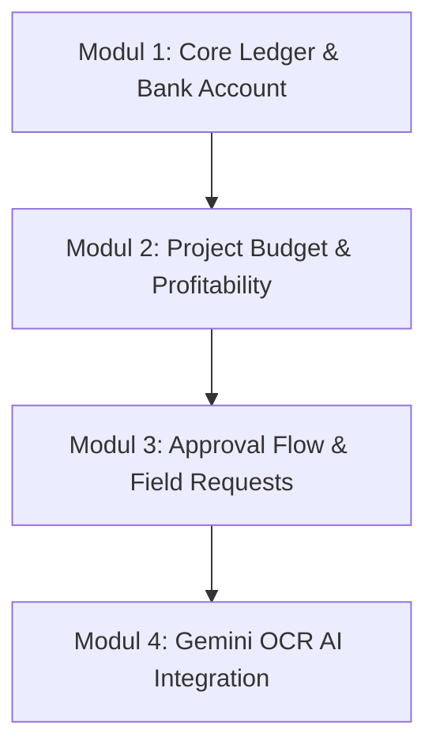

# MVP Blueprint - Atria ERP

## 1. Janji Inti MVP (Core Promise)
MVP Atria ERP menjanjikan: **"Transparansi Keuangan Proyek Secara Real-Time dari Genggaman Tangan."**

Sistem ini dirancang untuk menghentikan kebocoran uang kas perusahaan di lapangan dengan menerapkan satu alur transaksi terintegrasi: pengajuan instan dari Project Manager, verifikasi cepat oleh Admin, persetujuan aman dari Owner, dan pencatatan otomatis pada buku besar keuangan (`cash_transaction` ledger) yang terhubung ke `project_budget_item`.

---

## 2. Modul MVP & Skala Prioritas (MVP Modules & Priorities)

Untuk memastikan rilis yang cepat namun stabil, pengembangan dibagi menjadi 4 modul prioritas utama:

### Modul 1: Core Ledger & Bank Account (Prioritas 1)
*   **Tujuan:** Membangun fondasi pencatatan kas keluar-masuk perusahaan.
*   **Tabel Database Terkait:** `bank_account`, `cash_transaction`, `audit_log`.
*   **Fitur Utama:**
    *   Dashboard saldo akumulatif seluruh rekening bank perusahaan.
    *   Pencatatan kas masuk (debit) dari pembayaran klien.
    *   Pencatatan kas keluar (credit) untuk biaya operasional kantor.
    *   Halaman rekonsiliasi manual mutasi rekening koran bank dengan entri sistem.

### Modul 2: Project Budget & Profitability (Prioritas 2)
*   **Tujuan:** Mengaitkan setiap rupiah transaksi kas dengan proyek tertentu untuk memantau untung-rugi.
*   **Tabel Database Terkait:** `project`, `project_budget_item`.
*   **Fitur Utama:**
    *   Pembuatan profil proyek baru dan penunjukan Project Manager (PM) penanggung jawab.
    *   Input rencana anggaran belanja (RAB) proyek per kategori (`project_budget_item`).
    *   Grafik pembanding antara rencana anggaran vs realisasi pengeluaran riil di lapangan.
    *   Dashboard laba/rugi kotor (*Gross Profit*) proyek yang terupdate otomatis.

### Modul 3: Approval Flow & Field Requests (Prioritas 3)
*   **Tujuan:** Mengatur alur birokrasi pengeluaran dana proyek dari lapangan secara digital.
*   **Tabel Database Terkait:** `field_request` (menyimpan data pengajuan *cash advance* / *reimbursement*).
*   **Fitur Utama:**
    *   Halaman mobile khusus PM untuk mengajukan dana lapangan dengan mengunggah struk/nota.
    *   State-machine status pengajuan: `SUBMITTED` -> `VERIFIED` -> `APPROVED` -> `PAID`.
    *   Sistem otorisasi Server Actions: PM mengajukan, Admin memverifikasi nominal, Owner menyetujui pembayaran, Admin menandai sebagai lunas (`PAID`).

### Modul 4: Gemini OCR AI Integration (Prioritas 4)
*   **Tujuan:** Mempercepat proses input data pengeluaran PM di lapangan dan mengurangi kesalahan pengetikan manual.
*   **Teknologi Terkait:** Gemini AI API (model Gemini Pro Vision / Gemini 1.5 Flash).
*   **Fitur Utama:**
    *   PM cukup mengambil foto kuitansi/nota toko bangunan dari kamera ponsel.
    *   Gemini AI mengekstrak teks, tanggal, nama vendor, dan total biaya secara asinkron.
    *   Hasil ekstraksi otomatis mengisi formulir `field_request`, PM hanya perlu melakukan review singkat sebelum menekan tombol kirim.

---

## 3. Nilai Berdasarkan Peran (Role-Based Value)

*   **Bagi Owner (Pemilik Perusahaan):**
    *   Menghilangkan ketergantungan pada laporan Excel manual mingguan dari tim keuangan.
    *   Mencegah kerugian proyek sebelum terlambat melalui sistem approval mutasi kas bernilai besar langsung dari HP.
*   **Bagi Admin (Finance/Bookkeeper):**
    *   Mengurangi beban administrasi karena data transaksi awal diinput langsung oleh PM dari lapangan.
    *   Proses rekonsiliasi bank harian yang cepat berkat nomor referensi transaksi yang konsisten di sistem.
*   **Bagi Project Manager (PM):**
    *   Proses pencairan dana operasional lapangan menjadi lebih cepat karena alur approval yang terdigitalisasi.
    *   Melihat sisa anggaran kategori proyek sebelum membeli material untuk menghindari teguran over-budget.

---

## 4. Alur Kerja Harian (Daily Workflows)

### A. Alur Kerja Harian Owner (Owner Daily Workflow)
1.  **Pagi Hari (Monitoring):** Buka aplikasi melalui ponsel, memantau total saldo kas di `bank_account` dan melihat grafik P&L proyek yang sedang berjalan.
2.  **Siang & Sore Hari (Approval):** Membuka menu pending approvals untuk memeriksa pengajuan dana lapangan (`field_request`) dengan status `VERIFIED`. Owner menyetujui transaksi penting dengan menekan tombol *Approve* (memanggil Server Action untuk mengubah status pengajuan menjadi `APPROVED`).

### B. Alur Kerja Harian Admin (Admin Daily Workflow)
1.  **Penerimaan Pengajuan:** Memeriksa daftar `field_request` baru yang masuk dari PM lapangan (status `SUBMITTED`).
2.  **Verifikasi Dokumen:** Memeriksa kesesuaian nominal pada form pengajuan dengan foto nota/struk yang diunggah. Jika sesuai, ubah status menjadi `VERIFIED`.
3.  **Pembayaran (Disbursement):** Setelah pengajuan berstatus `APPROVED` oleh Owner, Admin melakukan transfer bank riil ke rekening vendor/PM, lalu mencatatnya sebagai transaksi kas keluar di `cash_transaction` dan mengubah status request menjadi `PAID`.
4.  **Rekonsiliasi Sore Hari:** Mengunggah mutasi rekening koran harian dan melakukan pencocokan (*matching*) dengan `cash_transaction` di ledger sistem.

### C. Alur Kerja Harian Project Manager (PM Daily Workflow)
1.  **Beli Material / Sewa Jasa:** PM memesan material di lapangan (misal: paku atau sewa tangga lipat) dan membayar menggunakan kas bon atau uang pribadi untuk *reimbursement*.
2.  **Input Pengeluaran Real-Time:** PM memotret struk belanja menggunakan kamera HP di aplikasi, menekan tombol *Scan receipt via Gemini AI*, lalu memilih kategori anggaran proyek (`project_budget_item_id`) yang sesuai.
3.  **Kirim Pengajuan:** PM memverifikasi keakuratan nominal hasil scan Gemini, lalu menekan tombol *Submit*. PM dapat melanjutkan pekerjaan lapangan sementara memantau progres persetujuan dana di saku celana mereka.

---

## 5. Kriteria Peluncuran MVP (Launch Criteria)

Sebelum MVP Atria ERP dirilis untuk penggunaan internal perusahaan secara resmi, kriteria berikut wajib dipenuhi:

### Kesiapan Fungsional (Functional Readiness)
1.  **Satu Alur Transaksi Sempurna (Perfect Happy Path):** Alur `field_request` dari input nota PM -> verifikasi Admin -> approval Owner -> pembayaran Admin -> pemotongan saldo `bank_account` -> pencatatan log `cash_transaction` berjalan 100% tanpa ada kegagalan status database.
2.  **Akurasi Gemini OCR:** Tingkat keberhasilan Gemini AI membaca nominal total belanja pada nota fisik berbahasa Indonesia (baik ketikan komputer maupun tulisan tangan rapi) mencapai minimal **90%** dalam kondisi pencahayaan yang cukup di lapangan.
3.  **Role Validation:** Pengujian penetrasi internal memastikan PM dari Proyek A sama sekali tidak memiliki akses API/Server Actions untuk membaca anggaran atau menginput transaksi ke Proyek B.

### Kesiapan Performa & Keamanan (Performance & Security Readiness)
1.  **Load Time Mobile:** Waktu muat halaman dashboard utama dan form pengajuan dana pada perangkat mobile tidak melebihi **2.5 detik** menggunakan jaringan seluler 4G LTE standar.
2.  **Database Transaction Rollback:** Teruji secara teknis bahwa jika proses pembaruan saldo bank gagal di tengah jalan, seluruh transaksi kas terkait dibatalkan (*rolled back*) tanpa meninggalkan data gantung.
3.  **Zero Raw SQL:** Audit kode codebase memastikan tidak ada kode SQL mentah yang digunakan di luar script migrasi Drizzle.
