# Operational Flows - Project Budget Finance & Material Control

The core workflow remains Dekoria's familiar budget-control flow:

`Project Budget Setup -> Expense Tracker by Category -> Budget Dashboard -> Category Usage -> Remaining Budget -> Margin Visibility`

Material control is attached to the Material category as the structured drill-down layer.

## 1. Owner Opens Dashboard
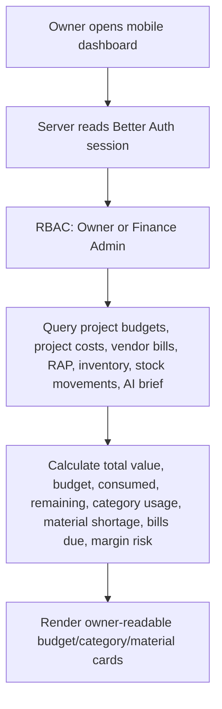

Read-only dashboard queries do not write audit logs. Any action triggered from the dashboard must call a protected Server Action.

## 2. Project Budget Setup from Settings Ratios
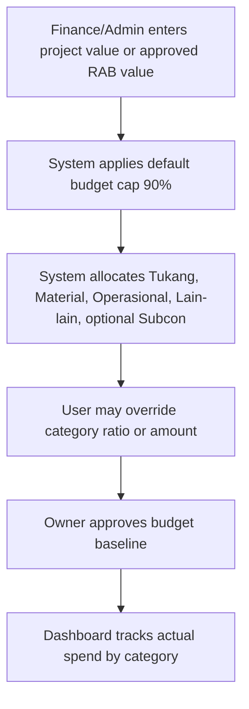

Default ratios come from Budget Allocation Settings, seeded from the current Project Budget workflow. Category cards remain visible even when the user drills into material details.

Category ratios are percentages of Internal Budget and may total less than 100%; the remainder is shown as Unallocated Buffer. Target Gross Margin is calculated separately as Project Value minus Internal Budget. Saving is blocked only when enabled category ratios exceed 100%. Settings changes become defaults for new projects and do not mutate existing project budgets.

Project-level reallocation is a single atomic batch. Approved budgets require Owner/Finance permission and an audit reason.

## 3. Expense Tracker by Category
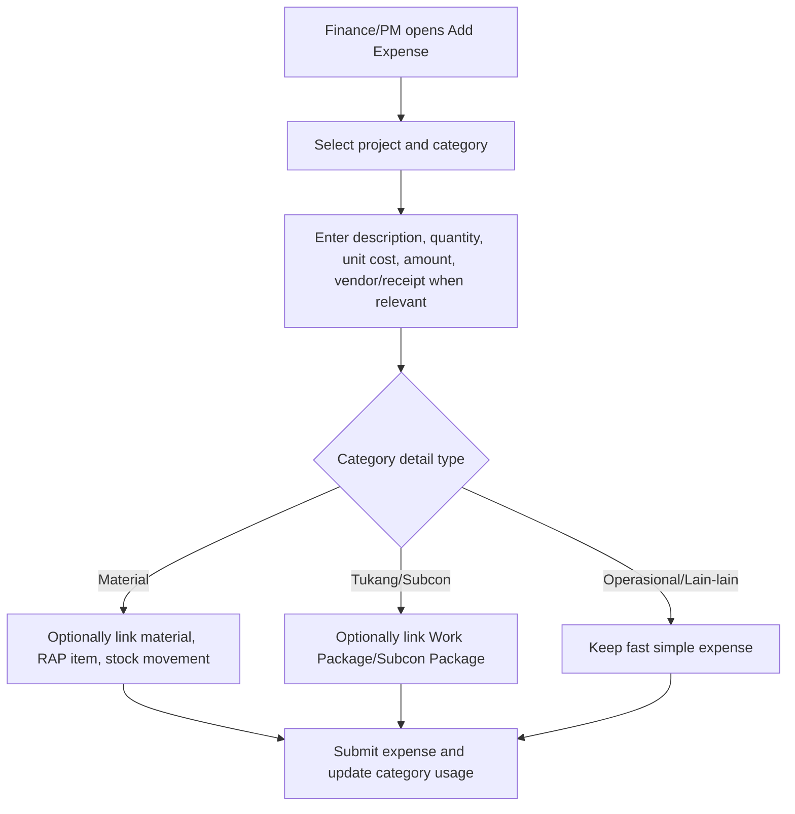

Expense category is mandatory. Material linkage is progressive and only valid for Material category. Package linkage is only valid for matching Tukang/Subcon categories.

## 4. Budget Dashboard Rollup
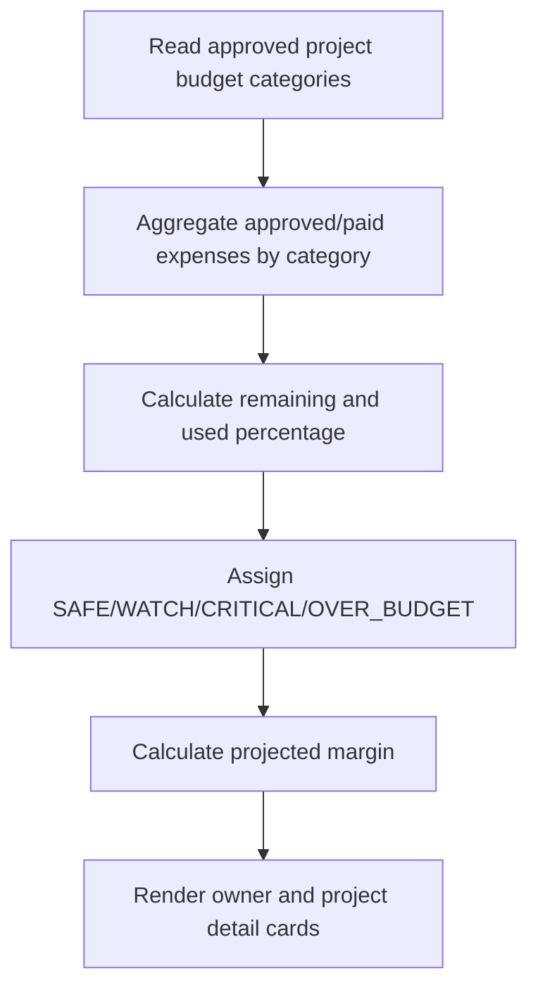

This replaces spreadsheet `SUMIFS` behavior with a structured database read model.

## 5. Project Budget to RAP
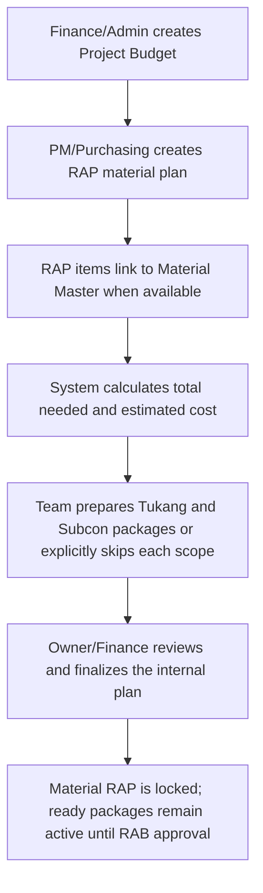

Project Budget is the high-level control layer. RAP is the internal material/cost plan for the Material category. Locked RAP is compared with Material budget, actual material cost, and estimated remaining material cost.

## 6. Inventory Check and Purchase Need
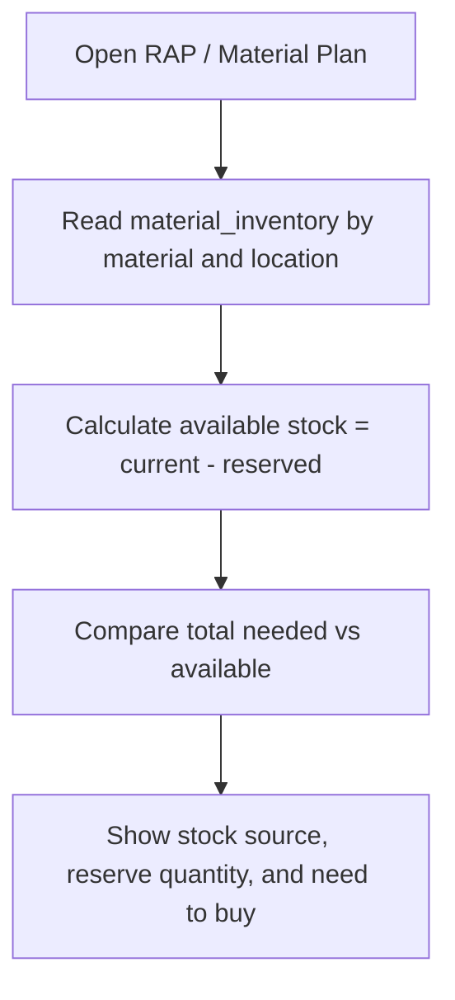

Need to Buy is a calculated operational signal, not an accounting liability. Vendor bills or expenses are created only through explicit user actions.

Goods Receipt is the explicit physical receipt action. It updates stock and weighted average cost but does not pay the vendor.

## 6B. Approved Scope Revision
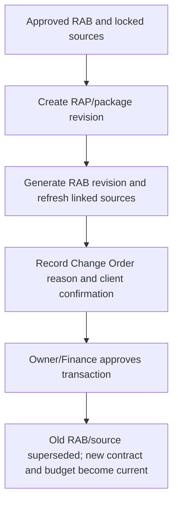

Direct approval is rejected when a current approved RAB already exists.

A draft RAB revision may be cancelled before approval. Cancellation marks the revision `VOID`, cancels any linked open Change Order, preserves the approved baseline and revision number history, and does not update contract, budget, RAP, or package locks.

## 6C. Project Closing
Completion runs only through the closing action. It validates client invoices, vendor liabilities, expenses, open revisions/change orders, stock reservations, and canonical budget synchronization, then writes the final realized-margin/cash-position snapshot.

## 7. Reserve Material for Project
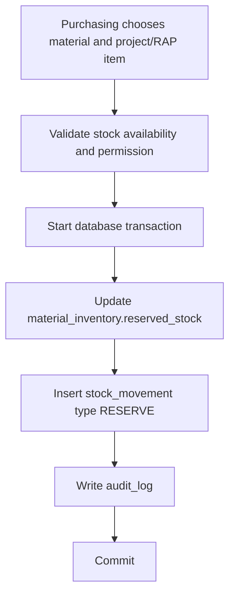

Reservation does not create a cash transaction. It only changes inventory commitment.

## 8. Use Material for Project
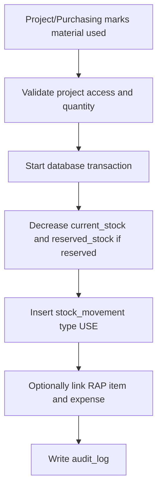

Material usage affects project material status and estimated remaining material need. Cash impact and Material budget actuals are recorded through expense or vendor bill payment.

## 9. Stock In from Purchase
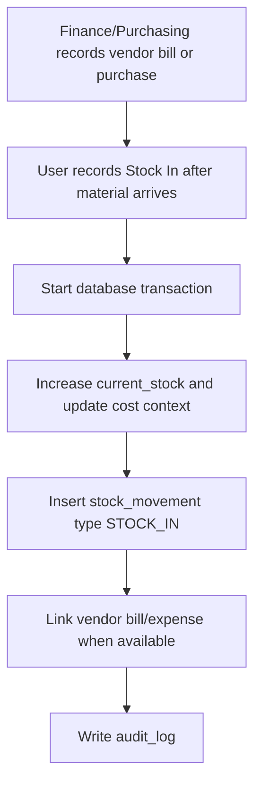

Stock In is explicit. AI OCR can suggest fields but cannot create final stock movement without human action.

## 9B. Transfer, Stock Opname, and Receipt Reversal

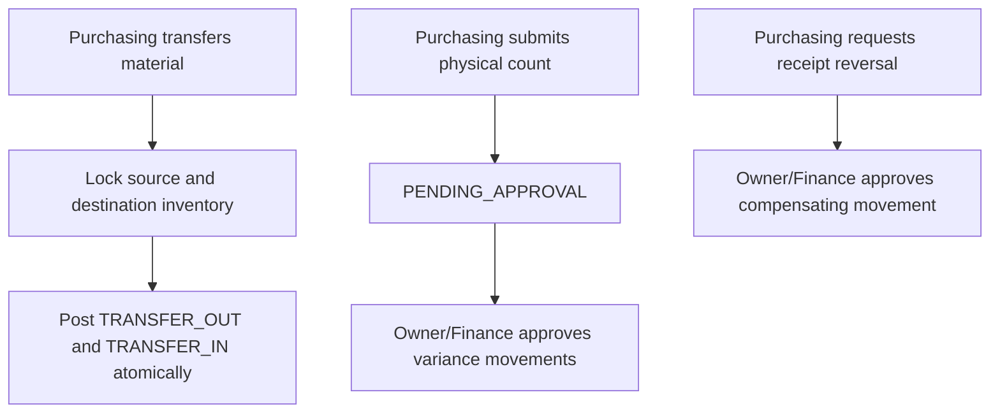

Transfer cannot consume reserved stock. Stock counts reject stale snapshots or counted quantity below reservation. Receipt reversal does not change the linked vendor bill or payment.

## 10. Generate Client Estimate / Quotation from Selected Sources
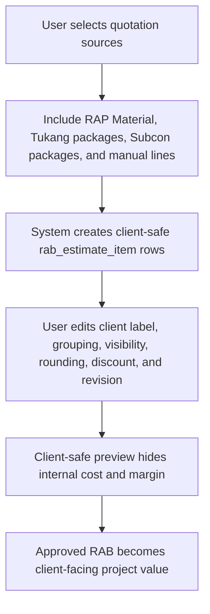

Client-facing RAB output must never include internal unit cost, margin formula, stock availability, vendor notes, or internal notes.

## 11. AI Finance & Material Brief
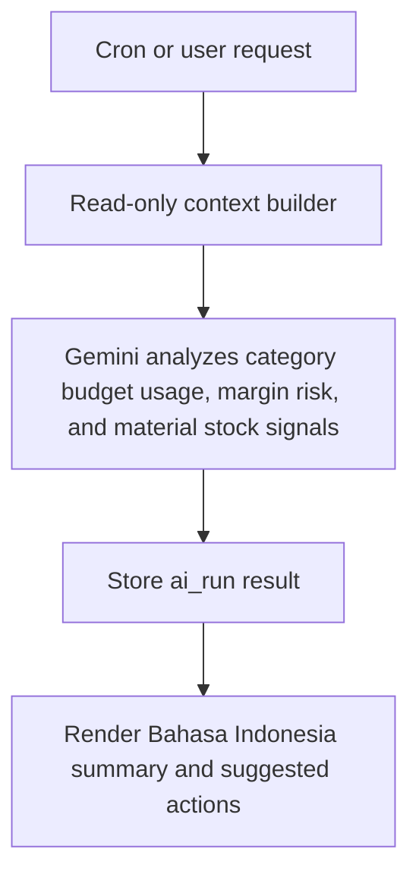

AI can analyze, summarize, and suggest. It cannot mutate finance/material data without explicit approval.
