# Operational Flows & Diagrams (FLOWS.md)

Dokumen ini mendokumentasikan seluruh alur operasional keuangan (**finance-first**) di Atria ERP. Setiap alur menjelaskan bagaimana aksi pengguna di perangkat seluler atau desktop diterjemahkan menjadi perubahan data tingkat rendah pada database PostgreSQL menggunakan **Drizzle ORM** dalam konteks transaksi database yang aman (`db.transaction`).

---

## Ringkasan Schema Database & Entitas Utama

Untuk memahami pergerakan data pada alur-alur di bawah, berikut adalah entitas database utama yang dirujuk:
*   `bank_account`: Akun bank/kas perusahaan yang menyimpan informasi saldo aktual (`balance`).
*   `cash_transaction`: Buku besar (*ledger*) utama pencatatan kas masuk (`DEBIT`) dan kas keluar (`CREDIT`).
*   `project`: Profil proyek desain & konstruksi aktif.
*   `project_budget_item`: Rencana Anggaran Biaya (RAB) per kategori biaya proyek (e.g., Material, Subkontraktor, Operasional).
*   `client_payment_milestone`: Termin piutang dari klien (Accounts Receivable / AR).
*   `vendor_bill`: Tagihan dari vendor atas material atau jasa subkontraktor (Accounts Payable / AP).
*   `field_request`: Pengajuan dana lapangan oleh Project Manager (PM) untuk *cash advance* atau *reimbursement*.
*   `audit_log`: Catatan audit riwayat mutasi saldo dan perubahan state transaksi penting.
*   `notification`: Notifikasi sistem untuk memicu tindakan pengguna.

---

## 1. Owner Opens Finance Dashboard (Owner Membuka Dashboard Keuangan)

### Deskripsi Alur
Owner membuka aplikasi mobile Atria ERP untuk memantau performa keuangan perusahaan secara keseluruhan dan proyek-proyek aktif. Alur ini bersifat *read-only* yang dioptimalkan untuk meminimalkan beban database melalui caching relasional.

### Aktor Utama
*   **Owner** (Pemilik Perusahaan)

### Diagram Alur Data (Mermaid)
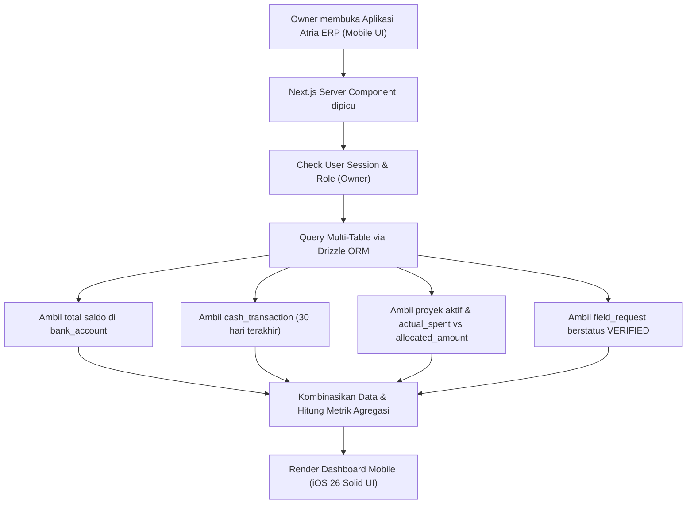

### Detail Operasi Database (Data Flow & DB Operations)
1.  **Aksi UI:** Owner membuka halaman utama `/dashboard` pada perangkat mobile.
2.  **Server Action / Page Component:** Next.js Server Component memanggil fungsi pengambil data.
3.  **Autentikasi & RBAC:** Memvalidasi session menggunakan Better Auth. Sistem memastikan `session.user.role === 'owner'`.
4.  **Operasi Database (Read-Only Queries):**
    *   **Total Saldo Bank:** 
        ```typescript
        const accounts = await db.select({ balance: bank_account.balance }).from(bank_account);
        ```
    *   **Cash Flow Chart (30 hari terakhir):**
        ```typescript
        const transactions = await db.select()
          .from(cash_transaction)
          .where(gt(cash_transaction.created_at, subDays(new Date(), 30)));
        ```
    *   **Progres Budget Proyek Aktif:**
        ```typescript
        const projects = await db.query.project.findMany({
          where: eq(project.status, 'ACTIVE'),
          with: { budgetItems: true }
        });
        ```
    *   **Pengajuan Butuh Persetujuan (Pending Approvals):**
        ```typescript
        const pendingRequests = await db.select()
          .from(field_request)
          .where(eq(field_request.status, 'VERIFIED'));
        ```
5.  **Audit & Log:** Karena merupakan alur *read-only*, tidak ada penulisan ke `audit_log` atau pemutakhiran saldo bank.

---

## 2. Client Payment Tracking (Pelacakan Pembayaran Klien)

### Deskripsi Alur
Merekam dana masuk dari pembayaran termin klien atas tagihan proyek tertentu ke dalam rekening bank perusahaan, lalu memperbarui status tagihan menjadi lunas.

### Aktor Utama
*   **Admin** (Finance / Bookkeeper)

### Diagram Alur Data (Mermaid)
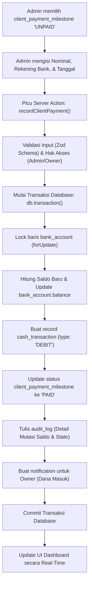

### Detail Operasi Database (Data Flow & DB Operations)
1.  **Aksi UI:** Admin menekan tombol "Record Payment" pada item termin pembayaran klien di menu Ledger/AR.
2.  **Server Action:** Memanggil `recordClientPayment(payload)` dengan Zod schema validation:
    ```typescript
    const schema = z.object({
      milestoneId: z.string().uuid(),
      bankAccountId: z.string().uuid(),
      amount: z.number().positive(),
      paymentDate: z.coerce.date()
    });
    ```
3.  **RBAC Check:** Memastikan user memiliki role `admin` atau `owner`.
4.  **Transaksi Database (`db.transaction`):**
    *   **Langkah 1 (Lock Account):** Ambil baris `bank_account` berdasarkan `bankAccountId` dan kunci baris tersebut agar tidak terjadi *race condition* (`for update`).
        ```typescript
        const [account] = await tx.select().from(bank_account).where(eq(bank_account.id, bankAccountId)).for('update');
        ```
    *   **Langkah 2 (Update Saldo):** Hitung saldo baru.
        $$\text{New Balance} = \text{account.balance} + \text{amount}$$
        Lakukan update pada `bank_account` dan verifikasi bahwa baris yang diperbarui tepat bernilai 1 untuk mencegah kegagalan mutasi.
        ```typescript
        const updateResult = await tx.update(bank_account)
          .set({ balance: newBalance, updated_at: new Date() })
          .where(eq(bank_account.id, bankAccountId));
        if (updateResult.rowsAffected !== 1) throw new Error("Gagal mengupdate saldo bank: baris terupdate tidak sesuai");
        ```
    *   **Langkah 3 (Catat Ledger):** Insert ke tabel `cash_transaction` dengan `type: 'DEBIT'`, `category: 'client_payment'`, `reference_type: 'client_payment_milestone'`, dan `reference_id: milestoneId`.
    *   **Langkah 4 (Update Milestone):** Perbarui status `client_payment_milestone.status` menjadi `'PAID'`.
    *   **Langkah 5 (Audit Log):** Tulis entri log baru ke `audit_log`:
        ```typescript
        await tx.insert(audit_log).values({
          user_id: session.user.id,
          action: 'RECORD_CLIENT_PAYMENT',
          target_table: 'client_payment_milestone',
          target_id: milestoneId,
          original_state: JSON.stringify({ status: 'UNPAID', balance: account.balance }),
          new_state: JSON.stringify({ status: 'PAID', balance: newBalance }),
          timestamp: new Date()
        });
        ```
    *   **Langkah 6 (Notification):** Insert notifikasi baru ke tabel `notification` yang ditargetkan untuk `owner`.

---

## 3. Project Budget Setup (Pembuatan Anggaran Proyek / RAB)

### Deskripsi Alur
Inisialisasi anggaran rencana biaya (BoQ/RAB) proyek per kategori (`MATERIAL`, `SUBCONTRACTOR`, `OPERATIONAL`) yang dilakukan oleh PM atau Admin sebelum proyek dimulai secara fisik.

### Aktor Utama
*   **Project Manager (PM)** atau **Admin**

### Diagram Alur Data (Mermaid)
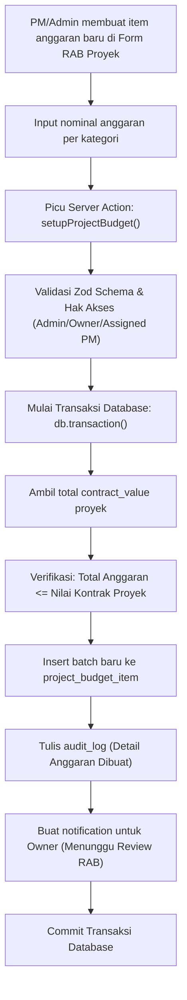

### Detail Operasi Database (Data Flow & DB Operations)
1.  **Aksi UI:** PM mengklik "Simpan Rancangan RAB" setelah menginput estimasi pengeluaran per kategori.
2.  **Server Action:** Memanggil `setupProjectBudget(payload)` dengan validasi Zod untuk memastikan seluruh array anggaran valid.
3.  **RBAC Check:** Memastikan user yang memanggil adalah `admin`, `owner`, atau PM yang ditugaskan ke proyek tersebut (`project.project_manager_id === session.user.id`).
4.  **Transaksi Database (`db.transaction`):**
    *   **Langkah 1 (Verifikasi Nilai Kontrak):** Lakukan query pada tabel `project` untuk mengambil `total_contract_value`.
    *   **Langkah 2 (Validasi Batas Anggaran):** Jumlahkan seluruh nominal `allocated_amount` di pengajuan baru. Pastikan totalnya tidak melebihi `total_contract_value` proyek untuk menjamin keuntungan teoritis awal.
    *   **Langkah 3 (Insert Items):** Masukkan daftar item anggaran ke tabel `project_budget_item`.
        ```typescript
        await tx.insert(project_budget_item).values(budgetItemsArray);
        ```
    *   **Langkah 4 (Audit Log):** Masukkan detail operasi pembuatan anggaran ke tabel `audit_log`.
    *   **Langkah 5 (Notification):** Buat baris pada tabel `notification` untuk `owner` agar melakukan approval visual terhadap rancangan anggaran proyek tersebut.

---

## 4. Project Cost Input (Input Biaya Proyek oleh PM)

### Deskripsi Alur
Project Manager di lapangan mengajukan klaim pengeluaran atau permintaan dana belanja darurat dengan mengambil foto nota fisik dan menentukan item anggaran proyek terkait.

### Aktor Utama
*   **Project Manager (PM)**

### Diagram Alur Data (Mermaid)
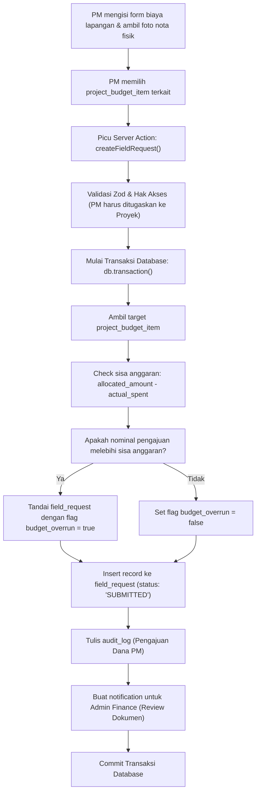

### Detail Operasi Database (Data Flow & DB Operations)
1.  **Aksi UI:** PM menekan tombol "Ajukan Pengeluaran" di aplikasi mobile Atria ERP.
2.  **Server Action:** Memanggil `createFieldRequest(payload)` dengan payload tervalidasi Zod (nominal dana, deskripsi, URL foto nota, ID item anggaran).
3.  **RBAC Check:** Memastikan user yang masuk memiliki role `project_manager` dan ID-nya sesuai dengan penugasan di baris `project.project_manager_id`.
4.  **Transaksi Database (`db.transaction`):**
    *   **Langkah 1 (Check Anggaran Proyek):** Lakukan query ke `project_budget_item` berdasarkan `project_budget_item_id`.
        ```typescript
        const [budgetItem] = await tx.select()
          .from(project_budget_item)
          .where(eq(project_budget_item.id, projectBudgetItemId));
        ```
    *   **Langkah 2 (Perhitungan Sisa Saldo):** Kurangi `allocated_amount` dengan `actual_spent`.
    *   **Langkah 3 (Pemberian Flag Overrun):** Jika `amount > (budgetItem.allocated_amount - budgetItem.actual_spent)`, tandai properti internal `budget_overrun: true`. (Hal ini akan memicu alur otorisasi khusus Owner di langkah approval).
    *   **Langkah 4 (Insert Pengajuan):** Masukkan data ke tabel `field_request` dengan status awal `'SUBMITTED'`.
    *   **Langkah 5 (Audit Log & Notifikasi):** Catat aksi PM ke `audit_log` dan kirim notifikasi ke Admin Finance untuk proses verifikasi data fisik struk.

---

## 5. Vendor/Material Expense Tracking (Pelacakan Pengeluaran Vendor / Material)

### Deskripsi Alur
Pencatatan pengadaan material bervolume besar dari vendor rekanan menggunakan sistem tagihan/invoice termin tempo. Pengeluaran ini terikat langsung ke anggaran proyek tertentu.

### Aktor Utama
*   **Admin** (Finance / Bookkeeper)

### Diagram Alur Data (Mermaid)
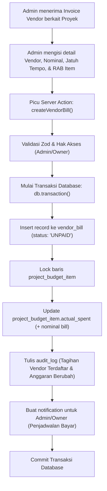

### Detail Operasi Database (Data Flow & DB Operations)
1.  **Aksi UI:** Admin membuka halaman Vendor Bills dan menginput tagihan material semen/kayu dari vendor.
2.  **Server Action:** Memanggil `createVendorBill(payload)`.
3.  **RBAC Check:** Memverifikasi role pengguna adalah `admin` atau `owner`.
4.  **Transaksi Database (`db.transaction`):**
    *   **Langkah 1 (Create Bill):** Masukkan record baru ke tabel `vendor_bill` dengan status `'UNPAID'` dan tanggal jatuh tempo (`due_date`).
    *   **Langkah 2 (Lock & Update Progres Anggaran Proyek):**
        Ambil `project_budget_item` terkait dan kunci baris. Tambahkan nominal tagihan vendor ke kolom `actual_spent`.
        ```typescript
        const [budgetItem] = await tx.select()
          .from(project_budget_item)
          .where(eq(project_budget_item.id, projectBudgetItemId))
          .for('update');
        
        const newActualSpent = budgetItem.actual_spent + amount;
        await tx.update(project_budget_item)
          .set({ actual_spent: newActualSpent })
          .where(eq(project_budget_item.id, projectBudgetItemId));
        ```
    *   **Langkah 3 (Audit Log):** Simpan perubahan status anggaran proyek dan penambahan beban hutang perusahaan ke `audit_log`.
    *   **Langkah 4 (Notification):** Kirim notifikasi kalender pembayaran kepada tim Finance.

---

## 6. Accounts Receivable (AR) Flow (Alur Piutang Klien)

### Deskripsi Alur
Siklus penagihan kepada klien berdasarkan milestone kemajuan fisik proyek kontraktor. Mulai dari penagihan aktif, pencatatan kas masuk, hingga rekonsiliasi manual atau otomatis dengan bank.

### Aktor Utama
*   **Admin** (Finance) & **Owner**

### Diagram Alur Data (Mermaid)
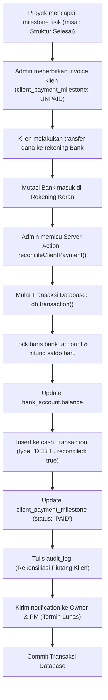

### Detail Operasi Database (Data Flow & DB Operations)
1.  **Aksi UI:** Admin mencocokkan mutasi bank riil dengan tagihan piutang klien pada halaman rekonsiliasi kas.
2.  **Server Action:** Memanggil `reconcileClientPayment({ milestoneId, bankAccountId, amount, transactionRef })`.
3.  **RBAC Check:** Hanya diperbolehkan untuk `admin` atau `owner`.
4.  **Transaksi Database (`db.transaction`):**
    *   **Langkah 1 (Verify & Lock Milestone):** Kunci data `client_payment_milestone` untuk memastikan tagihan belum pernah dilunasi sebelumnya.
    *   **Langkah 2 (Update Saldo Bank):** Kunci akun bank yang menerima transfer (`bank_account`). Set nilai saldo baru:
        $$\text{balance} = \text{balance} + \text{amount}$$
        Lakukan update dan pastikan jumlah baris terupdate tepat bernilai 1:
        ```typescript
        const updateResult = await tx.update(bank_account)
          .set({ balance: newBalance, updated_at: new Date() })
          .where(eq(bank_account.id, bankAccountId));
        if (updateResult.rowsAffected !== 1) throw new Error("Gagal mengupdate saldo bank: baris terupdate tidak sesuai");
        ```
    *   **Langkah 3 (Insert Ledger Ter-rekonsiliasi):** Catat ke `cash_transaction` dengan bendera `reconciled = true` dan isi kolom `reconciliation_date = new Date()`.
    *   **Langkah 4 (Update Milestone):** Set status termin klien ke `'PAID'`.
    *   **Langkah 5 (Audit Log):** Catat pelunasan piutang klien dan mutasi saldo kas internal ke tabel `audit_log`.
    *   **Langkah 6 (Notification):** Kirim notifikasi konfirmasi pembayaran lunas ke Owner dan PM penanggung jawab proyek agar mereka dapat membeli material fase berikutnya.

---

## 7. Accounts Payable (AP) Flow (Alur Utang Vendor)

### Deskripsi Alur
Proses pembayaran tagihan vendor atas pembelian material proyek menggunakan kas keluar dari rekening bank perusahaan, sekaligus menutup utang perusahaan.

### Aktor Utama
*   **Admin** (Finance) & **Owner** (sebagai Approver nominal besar)

### Diagram Alur Data (Mermaid)
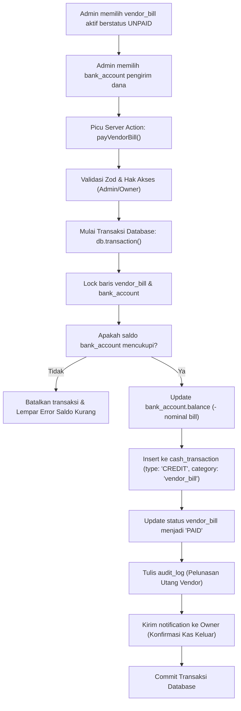

### Detail Operasi Database (Data Flow & DB Operations)
1.  **Aksi UI:** Admin menekan tombol "Proses Pembayaran Vendor" pada tagihan terpilih.
2.  **Server Action:** Memanggil `payVendorBill({ billId, bankAccountId })`.
3.  **RBAC Check:** Hanya diperbolehkan untuk user dengan role `admin` atau `owner`.
4.  **Transaksi Database (`db.transaction`):**
    *   **Langkah 1 (Lock Records):** Ambil data `vendor_bill` dan `bank_account` lalu kunci baris data tersebut di PostgreSQL.
    *   **Langkah 2 (Saldo Check):** Pastikan `bank_account.balance >= vendor_bill.amount`. Jika saldo tidak mencukupi, transaksi langsung dibatalkan (`rollback`) dengan melempar exception:
        ```typescript
        if (account.balance < bill.amount) throw new Error("Saldo kas tidak memadai untuk melunasi tagihan vendor");
        ```
    *   **Langkah 3 (Update Saldo):** Kurangi saldo bank dengan nominal tagihan:
        $$\text{New Balance} = \text{account.balance} - \text{bill.amount}$$
        Simpan ke database dan verifikasi jumlah baris yang terpengaruh tepat 1:
        ```typescript
        const updateResult = await tx.update(bank_account)
          .set({ balance: newBalance, updated_at: new Date() })
          .where(eq(bank_account.id, bankAccountId));
        if (updateResult.rowsAffected !== 1) throw new Error("Gagal mengupdate saldo bank: baris terupdate tidak sesuai");
        ```
    *   **Langkah 4 (Catat Kas Keluar):** Insert record baru ke `cash_transaction` dengan status `type: 'CREDIT'`, `category: 'vendor_bill'`, `reference_type: 'vendor_bill'`, dan `reference_id: billId`.
    *   **Langkah 5 (Close Bill Status):** Perbarui status `vendor_bill.status` menjadi `'PAID'`.
    *   **Langkah 6 (Audit Trail):** Simpan mutasi pengeluaran kas ini ke dalam `audit_log` sebagai bukti rekonsiliasi pembukuan AP.
    *   **Langkah 7 (Notification):** Kirim notifikasi laporan kas keluar ke Owner.

---

## 8. Cash In/Cash Out Flow (Alur Arus Kas Masuk & Keluar)

### Deskripsi Alur
Pencatatan langsung arus uang masuk (Operational Cash In) atau uang keluar (Operational Cash Out) non-proyek, seperti pembayaran sewa kantor bulanan, tagihan listrik, atau penjualan limbah material sisa proyek.

### Aktor Utama
*   **Admin** (Finance) atau **Owner**

### Diagram Alur Data (Mermaid)
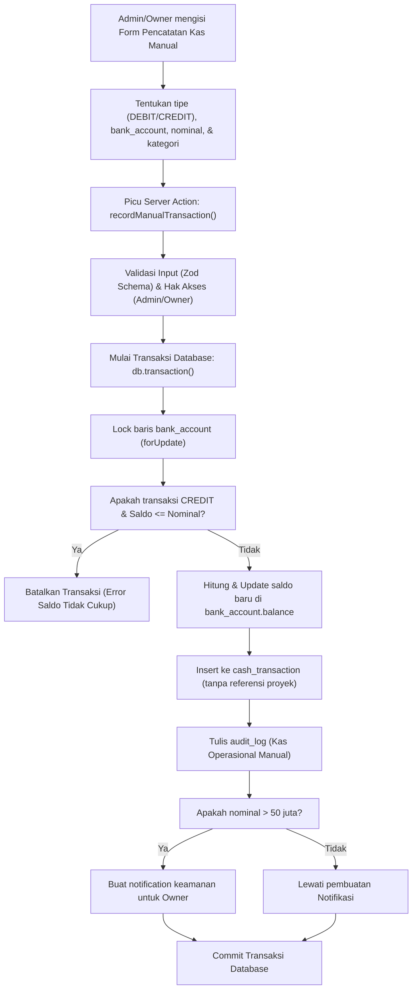

### Detail Operasi Database (Data Flow & DB Operations)
1.  **Aksi UI:** Admin mengklik tombol "Catat Kas Operasional" di halaman pembukuan kantor utama.
2.  **Server Action:** Memanggil `recordManualTransaction(payload)` dengan skema validasi Zod untuk kategori manual seperti `'office_rent'`, `'utilities'`, `'petty_cash_refill'`.
3.  **RBAC Check:** Hanya diperuntukkan bagi user dengan otorisasi `admin` atau `owner`.
4.  **Transaksi Database (`db.transaction`):**
    *   **Langkah 1 (Lock Account):** Panggil query SELECT ... FOR UPDATE pada akun `bank_account` terpilih.
    *   **Langkah 2 (Saldo Verification):** Jika tipe transaksi adalah `'CREDIT'` (kas keluar), pastikan `bank_account.balance >= amount`. Jika kurang, batalkan transaksi.
    *   **Langkah 3 (Update Saldo):** Terapkan perubahan saldo bank:
        $$\text{balance} = \text{balance} \pm \text{amount}$$
        Lakukan update dan pastikan jumlah baris terupdate tepat bernilai 1:
        ```typescript
        const updateResult = await tx.update(bank_account)
          .set({ balance: newBalance, updated_at: new Date() })
          .where(eq(bank_account.id, bankAccountId));
        if (updateResult.rowsAffected !== 1) throw new Error("Gagal mengupdate saldo bank: baris terupdate tidak sesuai");
        ```
    *   **Langkah 4 (Ledger Entry):** Tambahkan record ke `cash_transaction` dengan referensi ID proyek kosong (`null`) karena transaksi ini bersifat umum/operasional kantor.
    *   **Langkah 5 (Audit Log):** Catat mutasi kas ini ke dalam `audit_log`.
    *   **Langkah 6 (Security Notification):** Jika nominal di atas Rp 50.000.000, secara otomatis buat notifikasi keamanan di tabel `notification` yang ditargetkan langsung ke perangkat Owner.

---

## 9. Project Profitability Flow (Alur Profitabilitas Proyek)

### Deskripsi Alur
Alur kalkulasi dan pemantauan margin keuntungan kotor (*Gross Profit*) dan bersih (*Net Profit*) suatu proyek secara real-time berdasarkan total tagihan termin klien dikurangi total pengeluaran terikat. Alur ini merupakan query agregasi teroptimasi tanpa mutasi data.

### Aktor Utama
*   **Owner** & **Admin**

### Diagram Alur Data (Mermaid)
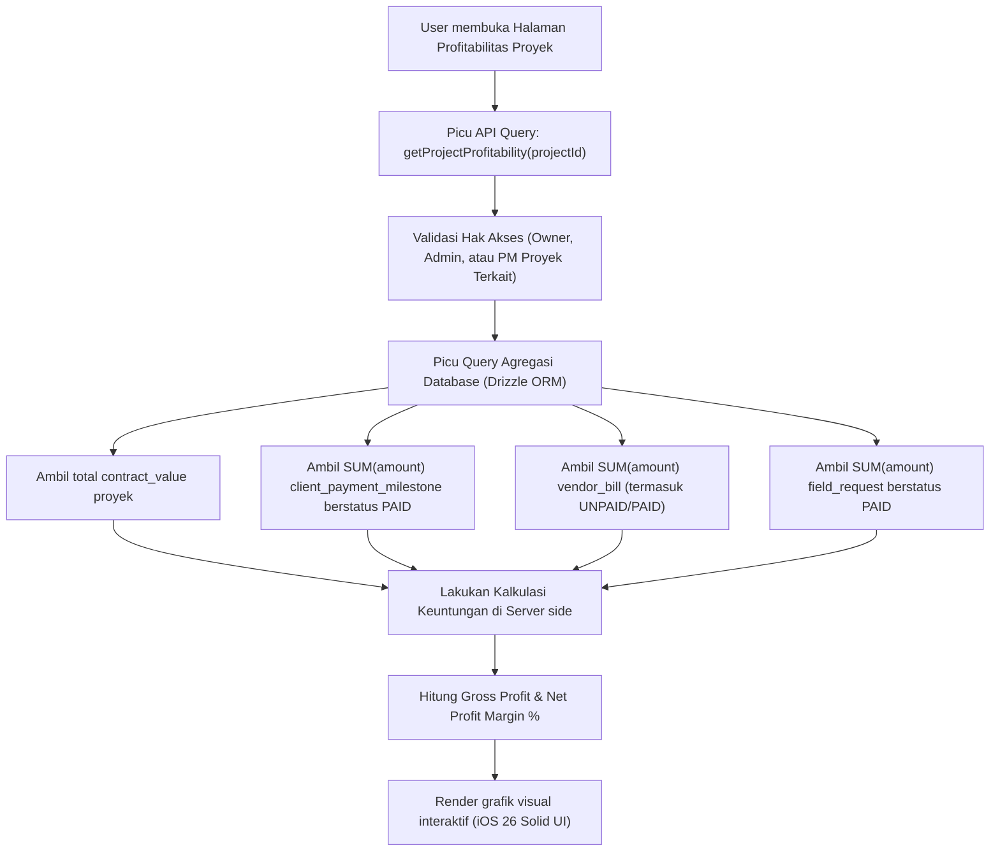

### Detail Operasi Database (Data Flow & DB Operations)
1.  **Aksi UI:** Owner mengklik tab "Profitabilitas" pada profil proyek aktif di aplikasi mobile.
2.  **Server Query Execution:** Pemicuan fungsi `getProjectProfitability(projectId)`.
3.  **RBAC Check:** Memastikan user adalah `owner` atau `admin`. Jika user adalah `project_manager`, sistem memvalidasi bahwa `project.project_manager_id === session.user.id`. PM dilarang melihat profitabilitas proyek yang dipegang PM lain.
4.  **Operasi Database (Read-Only Query Agregasi):**
    *   Mengambil nilai kontrak proyek:
        ```typescript
        const [projectData] = await db.select({ val: project.total_contract_value }).from(project).where(eq(project.id, projectId));
        ```
    *   Mengagregasi total pembayaran klien masuk:
        ```typescript
        const [{ totalRevenue }] = await db.select({ totalRevenue: sum(client_payment_milestone.amount) })
          .from(client_payment_milestone)
          .where(and(eq(client_payment_milestone.project_id, projectId), eq(client_payment_milestone.status, 'PAID')));
        ```
    *   Mengagregasi tagihan vendor terikat (AP):
        ```typescript
        const [{ totalVendorCost }] = await db.select({ totalVendorCost: sum(vendor_bill.amount) })
          .from(vendor_bill)
          .where(eq(vendor_bill.project_id, projectId));
        ```
    *   Mengagregasi pengeluaran kas kecil lapangan yang dibayar (Field Expenses):
        ```typescript
        const [{ totalFieldCost }] = await db.select({ totalFieldCost: sum(field_request.amount) })
          .from(field_request)
          .where(and(eq(field_request.project_id, projectId), eq(field_request.status, 'PAID')));
        ```
5.  **Formulasi Logika Bisnis:**
    $$\text{Gross Profit} = \text{totalRevenue} - (\text{totalVendorCost} + \text{totalFieldCost})$$
    $$\text{Profit Margin \%} = \left( \frac{\text{Gross Profit}}{\text{totalRevenue}} \right) \times 100$$
6.  **UI Rendering:** Data hasil komputasi dikirim ke UI untuk dirender menjadi grafik persentase profitabilitas menggunakan skema warna iOS 26 Solid (Emerald Green untuk untung besar, Amber/Red untuk margin kritis).

---

## 10. Reimbursement/Petty Cash Flow (Alur Kas Kecil / Reimbursement)

### Deskripsi Alur
Alur lengkap pengajuan klaim biaya lapangan (*reimbursement*) oleh PM menggunakan uang pribadi. Admin memverifikasi nota, Owner menyetujui, dan Admin mencairkannya dari dana kas kecil perusahaan.

### Aktor Utama
*   **Project Manager** (Pemohon), **Admin** (Verifier & Disburser), **Owner** (Approver)

### Diagram Alur Data (Mermaid)
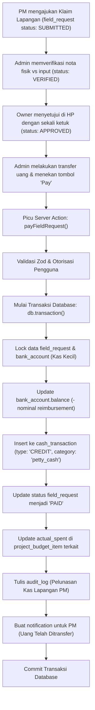

### Detail Operasi Database (Data Flow & DB Operations)
1.  **Aksi UI:** Admin menekan tombol "Confirm Payment & Disburse" setelah memproses transfer bank riil ke PM.
2.  **Server Action:** Memanggil `payFieldRequest({ requestId, bankAccountId })`.
3.  **RBAC Check:** Hanya diperuntukkan bagi user dengan role `admin` atau `owner`.
4.  **Transaksi Database (`db.transaction`):**
    *   **Langkah 1 (Lock & Check):** Kunci data `field_request` dan `bank_account` pengirim kas kecil di PostgreSQL. Pastikan saldo bank memadai.
    *   **Langkah 2 (Update Saldo Kas Kecil):** Update saldo kas kecil dan pastikan jumlah baris terupdate tepat bernilai 1:
        ```typescript
        const updateResult = await tx.update(bank_account)
          .set({ balance: newBalance, updated_at: new Date() })
          .where(eq(bank_account.id, bankAccountId));
        if (updateResult.rowsAffected !== 1) throw new Error("Gagal mengupdate saldo bank: baris terupdate tidak sesuai");
        ```
    *   **Langkah 3 (Catat Kas Keluar):** Insert record baru ke `cash_transaction` dengan `type: 'CREDIT'`, `category: 'petty_cash'`, `reference_type: 'field_request'`, dan `reference_id: requestId`.
    *   **Langkah 4 (Close Request Status):** Perbarui status `field_request.status` menjadi `'PAID'`.
    *   **Langkah 5 (Akumulasi Pengeluaran Anggaran Proyek):**
        Update kolom `actual_spent` pada tabel `project_budget_item` terkait:
        ```typescript
        await tx.update(project_budget_item)
          .set({ actual_spent: sql`${project_budget_item.actual_spent} + ${request.amount}` })
          .where(eq(project_budget_item.id, request.project_budget_item_id));
        ```
    *   **Langkah 6 (Audit Trail):** Simpan perubahan status, saldo bank, dan anggaran proyek ke dalam `audit_log`.
    *   **Langkah 7 (Notification):** Kirim notifikasi pemberitahuan otomatis kepada PM pemohon bahwa klaim dana telah dibayar.

---

## 11. Finance Alert Flow (Alur Peringatan Keuangan / Budget Overrun)

### Deskripsi Alur
Sistem secara otomatis memicu notifikasi peringatan (*warning alert*) kepada Owner dan Admin ketika akumulasi biaya riil proyek mendekati atau melebihi alokasi anggaran rencana.

### Aktor Utama
*   **Sistem** (Dicuci oleh pemicu mutasi database)

### Diagram Alur Data (Mermaid)
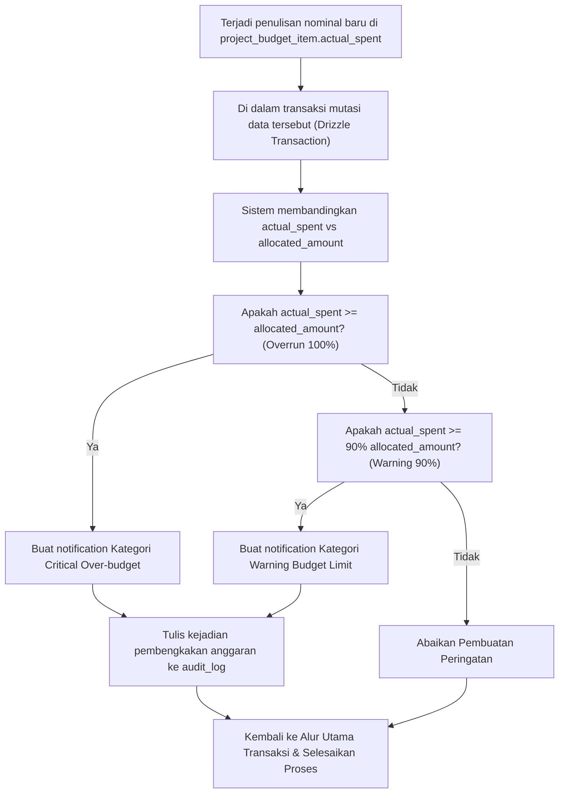

### Detail Operasi Database (Data Flow & DB Operations)
1.  **DB Mutator Trigger:** Ketika Server Action seperti `payFieldRequest` atau `createVendorBill` memperbarui `project_budget_item.actual_spent`, logika pengecekan anggaran dijalankan **di dalam transaksi database yang sama**.
2.  **Budget Check Logic:**
    ```typescript
    const [budgetItem] = await tx.select().from(project_budget_item).where(eq(project_budget_item.id, budgetItemId));
    const usageRatio = budgetItem.actual_spent / budgetItem.allocated_amount;
    ```
3.  **Database Operations:**
    *   **Kasus 1 (Overrun >= 100%):**
        Insert ke tabel `notification` ditujukan kepada `owner`, `admin`, dan `project_manager` terkait:
        ```typescript
        await tx.insert(notification).values({
          user_id: ownerId,
          title: "CRITICAL: Anggaran Proyek Jebol!",
          message: `Pengeluaran untuk kategori ${budgetItem.name} telah melampaui alokasi anggaran rencana sebesar ${formatRupiah(budgetItem.actual_spent - budgetItem.allocated_amount)}`,
          read: false,
          created_at: new Date()
        });
        ```
    *   **Kasus 2 (Warning >= 90%):**
        Insert notifikasi bertipe peringatan awal (Amber Alert) ke tabel `notification`.
    *   **Audit Logging:** Catat kejadian overrun budget ini ke tabel `audit_log` sebagai bukti historis pembengkakan biaya di masa audit proyek mendatang.

---

## 12. Sales-to-Project-to-Budget Flow (Alur Penjualan ke Proyek ke Anggaran)

### Deskripsi Alur
Alur transisi saat penandatanganan kesepakatan kontrak penjualan interior dengan klien baru, pembuatan profil proyek di sistem, hingga penyusunan target pengajuan termin tagihan (milestone).

### Aktor Utama
*   **Admin** (Finance) atau **Owner**

### Diagram Alur Data (Mermaid)
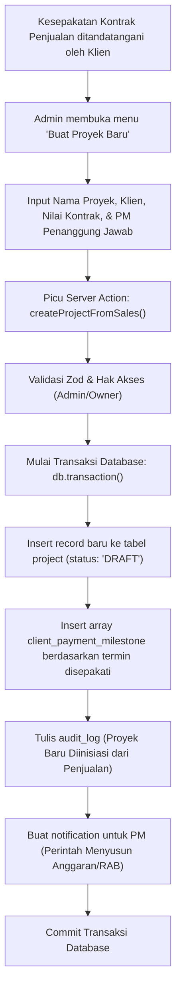

### Detail Operasi Database (Data Flow & DB Operations)
1.  **Aksi UI:** Admin mengisi data kesepakatan penjualan interior/kontraktor bernilai Rp 500.000.000, menentukan PM Budi sebagai penanggung jawab lapangan, dan menjadwalkan 3 termin pembayaran.
2.  **Server Action:** Memanggil `createProjectFromSales(payload)`.
3.  **RBAC Check:** Hanya diperbolehkan untuk `admin` atau `owner`.
4.  **Transaksi Database (`db.transaction`):**
    *   **Langkah 1 (Create Project Profile):** Masukkan baris baru ke tabel `project` dengan status `'DRAFT'` dan menugaskan `project_manager_id` ke user PM terpilih.
    *   **Langkah 2 (Generate Milestones):** Masukkan data array termin penagihan klien ke tabel `client_payment_milestone` dengan status `'UNPAID'`.
        *   Termin 1 (DP 30%): Rp 150.000.000
        *   Termin 2 (Progress 50%): Rp 250.000.000
        *   Termin 3 (Pelunasan 20%): Rp 100.000.000
    *   **Langkah 3 (Audit Log):** Catat pembuatan profil proyek baru dan rancangan milestone ke tabel `audit_log`.
    *   **Langkah 4 (Notification):** Buat baris pada tabel `notification` ditujukan kepada user PM terpilih dengan pesan perintah instruksi agar segera menyusun rancangan Rencana Anggaran Biaya (RAB) proyek di sistem.

---

## 13. Purchasing-to-Expense Flow (Alur Pembelian ke Pengeluaran)

### Deskripsi Alur
Alur operasional pembelian material berskala besar dari vendor. Dimulai dari pengajuan dokumen Purchase Order (PO), kedatangan tagihan/invoice vendor, pengikatan beban anggaran proyek, hingga pelunasan kas keluar.

### Aktor Utama
*   **Admin** (Finance / Purchasing)

### Diagram Alur Data (Mermaid)
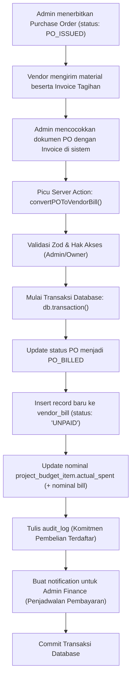

### Detail Operasi Database (Data Flow & DB Operations)
1.  **Aksi UI:** Admin menekan tombol "Proses Tagihan dari PO" setelah mencocokkan jumlah material yang diterima di lapangan dengan struk tagihan vendor.
2.  **Server Action:** Memanggil `convertPOToVendorBill({ poId, billAmount, dueDate, projectBudgetItemId })`.
3.  **RBAC Check:** Memastikan user yang masuk adalah `admin` atau `owner`.
4.  **Transaksi Database (`db.transaction`):**
    *   **Langkah 1 (Update PO Status):** Perbarui status Purchase Order terkait menjadi `'PO_BILLED'`.
    *   **Langkah 2 (Create AP Bill):** Buat record baru pada `vendor_bill` berstatus `'UNPAID'` dengan mengaitkannya ke proyek terkait.
    *   **Langkah 3 (Update Progres Anggaran Proyek):**
        Tambahkan nominal bill tersebut ke target anggaran `project_budget_item.actual_spent` untuk memastikan anggaran terikat secara instan meskipun pembayaran kas belum dilakukan ke vendor.
    *   **Langkah 4 (Audit Log & Notifikasi):** Catat perubahan transaksi dan anggaran proyek ke `audit_log`, serta kirim notifikasi kalender bayar ke Admin Finance.

---

## 14. AI Finance Briefing Flow (Alur Ringkasan Keuangan AI)

### Deskripsi Alur
Sistem asinkron yang dipicu secara otomatis atau manual oleh Owner untuk meminta Gemini AI membaca seluruh ringkasan kondisi arus kas keseluruhan, status pengajuan dana pending PM lapangan, dan profitabilitas proyek aktif guna menyusun ringkasan analisis keuangan dan rekomendasi langkah taktis bagi perusahaan.

### Aktor Utama
*   **Owner** & **Sistem** (Cron Job Scheduler)

### Diagram Alur Data (Mermaid)
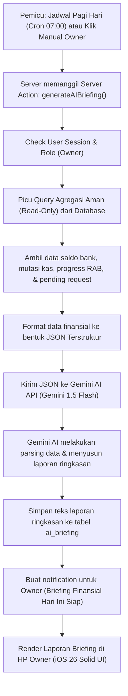

### Detail Operasi Database (Data Flow & DB Operations)
1.  **Pemicu Alur:** Cron job terjadwal memicu endpoint `/api/cron/ai-briefing` setiap pukul 07:00 pagi atau Owner menekan tombol "Generate AI Report" langsung dari aplikasi.
2.  **Server Action Execution:** Memanggil fungsi `generateAIBriefing()`.
3.  **RBAC Check:** Memastikan pengirim adalah `owner` (atau bypass token internal cron job sistem yang sah).
4.  **Operasi Database (Read-Only Queries):**
    *   Mengambil total saldo kas di seluruh `bank_account`.
    *   Mengambil performa cash flow masuk/keluar 7 hari terakhir dari `cash_transaction`.
    *   Mengambil daftar item proyek yang mengalami indikator pembengkakan anggaran (`actual_spent > allocated_amount`).
    *   Mengambil daftar `field_request` berstatus `VERIFIED` yang menunggu keputusan approval Owner hari ini.
5.  **Pemrosesan Integrasi Gemini AI:**
    *   Data finansial mentah diformat menjadi JSON ringkas (tanpa menyertakan PII seperti nama lengkap klien atau data sensitif di luar koridor keuangan proyek).
    *   Mengirim API call ke Gemini AI menggunakan system instructions:
        > *"Anda adalah CFO Virtual di Atria ERP. Analisis data finansial perusahaan kontraktor berikut dan berikan ringkasan analisis dalam Bahasa Indonesia (maksimal 3 paragraf). Fokus pada peringatan cashflow dan persetujuan dana mendesak."*
6.  **Penyimpanan & Notifikasi Laporan:**
    *   Sistem menyimpan teks luaran dari Gemini AI ke dalam tabel `ai_briefing`:
        ```typescript
        await db.insert(ai_briefing).values({
          owner_id: session.user.id,
          content: geminiGeneratedText,
          created_at: new Date()
        });
        ```
    *   Sistem menyisipkan baris notifikasi baru ke dalam tabel `notification` yang ditargetkan untuk Owner: "CFO AI: Laporan Briefing Harian Anda telah siap dibaca."
7.  **Aksi UI:** Owner menerima notifikasi di ponselnya, mengkliknya, dan membaca briefing keuangan harian yang tersaji indah dengan gaya visual iOS 26 Solid UI.
