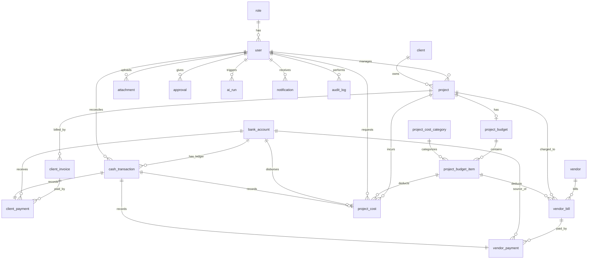

# Database Schema - Atria ERP

Dokumen ini mendokumentasikan skema database relasional PostgreSQL untuk Atria ERP menggunakan syntax **Drizzle ORM**. Skema ini dirancang dengan prinsip **finance-first** untuk menjamin konsistensi mutasi kas, ketahanan data anggaran (BoQ), auditability penuh, serta mendukung performa tinggi pada perangkat seluler.

---

## 1. Relational Database Diagram (Mermaid)

Berikut adalah diagram visual yang menunjukkan hubungan antar tabel dalam database Atria ERP:



---

## 2. Struktur Tabel & Skema Drizzle ORM

Berikut adalah daftar 20 tabel inti Atria ERP beserta properti PostgreSQL dan Drizzle ORM yang digunakan.

### 2.1 Table: `role`
Tabel master untuk menyimpan peran otorisasi pengguna.

```typescript
import { pgTable, uuid, varchar, text, timestamp, boolean, numeric, integer, index, uniqueIndex } from 'drizzle-orm/pg-core';

export const role = pgTable("role", {
  id: uuid("id").primaryKey().defaultRandom(),
  name: varchar("name", { length: 50 }).notNull().unique(), // owner, admin, project_manager
  description: text("description"),
  createdAt: timestamp("created_at").defaultNow().notNull(),
});
```
*   **Indexes:** Unique index otomatis dibuat pada kolom `name`.
*   **Catatan (Bahasa Indonesia):** Menyimpan jenis-jenis peran sistem. Diisi saat instalasi awal (seeding) dengan `'owner'`, `'admin'`, dan `'project_manager'`.

---

### 2.2 Table: `user`
Tabel untuk menyimpan informasi kredensial pengguna yang terintegrasi dengan Better Auth.

```typescript
export const user = pgTable("user", {
  id: uuid("id").primaryKey().defaultRandom(),
  name: varchar("name", { length: 255 }).notNull(),
  email: varchar("email", { length: 255 }).notNull().unique(),
  emailVerified: boolean("email_verified").default(false).notNull(),
  image: text("image"),
  roleId: uuid("role_id").notNull().references(() => role.id, { onDelete: "restrict" }),
  isActive: boolean("is_active").default(true).notNull(),
  createdAt: timestamp("created_at").defaultNow().notNull(),
  updatedAt: timestamp("updated_at").defaultNow().notNull(),
}, (table) => ({
  roleIdIdx: index("user_role_id_idx").on(table.roleId),
}));
```
*   **Indexes:** `user_role_id_idx` pada `roleId` untuk mempercepat query RBAC.
*   **Foreign Keys:** `role_id` mereferensikan `role.id` dengan aturan `onDelete: "restrict"`.
*   **Catatan (Bahasa Indonesia):** Menyimpan profil pengguna sistem. Aturan `restrict` mencegah penghapusan peran jika masih ada pengguna yang menggunakannya.

---

### 2.3 Table: `client`
Tabel master data klien/pemilik proyek interior.

```typescript
export const client = pgTable("client", {
  id: uuid("id").primaryKey().defaultRandom(),
  name: varchar("name", { length: 255 }).notNull(),
  companyName: varchar("company_name", { length: 255 }),
  email: varchar("email", { length: 255 }).notNull().unique(),
  phone: varchar("phone", { length: 50 }).notNull(),
  address: text("address"),
  createdAt: timestamp("created_at").defaultNow().notNull(),
  updatedAt: timestamp("updated_at").defaultNow().notNull(),
});
```
*   **Indexes:** Unique index otomatis pada kolom `email`.
*   **Catatan (Bahasa Indonesia):** Menyimpan informasi kontak klien untuk tujuan penagihan piutang (*client invoices*).

---

### 2.4 Table: `project`
Tabel profil proyek desain & build yang sedang berjalan.

```typescript
export const project = pgTable("project", {
  id: uuid("id").primaryKey().defaultRandom(),
  name: varchar("name", { length: 255 }).notNull(),
  clientId: uuid("client_id").notNull().references(() => client.id, { onDelete: "restrict" }),
  projectManagerId: uuid("project_manager_id").notNull().references(() => user.id, { onDelete: "restrict" }),
  status: varchar("status", { length: 50 }).notNull(), // status enum (DRAFT, ACTIVE, dll)
  financialHealth: varchar("financial_health", { length: 50 }).notNull().default("HEALTHY"), // HEALTHY, WARNING, CRITICAL
  totalContractValue: numeric("total_contract_value", { precision: 15, scale: 2 }).notNull(),
  startDate: timestamp("start_date"),
  endDate: timestamp("end_date"),
  createdAt: timestamp("created_at").defaultNow().notNull(),
  updatedAt: timestamp("updated_at").defaultNow().notNull(),
}, (table) => ({
  clientIdIdx: index("project_client_id_idx").on(table.clientId),
  pmIdIdx: index("project_pm_id_idx").on(table.projectManagerId),
}));
```
*   **Indexes:** `project_client_id_idx` dan `project_pm_id_idx` untuk mempercepat query daftar proyek per klien atau per PM.
*   **Foreign Keys:** 
    *   `clientId` -> `client.id` (`onDelete: "restrict"`)
    *   `projectManagerId` -> `user.id` (`onDelete: "restrict"`)
*   **Catatan (Bahasa Indonesia):** Menyimpan profil proyek aktif. Kolom `financialHealth` diperbarui secara asinkron atau terjadwal berdasarkan pemakaian budget riil.

---

### 2.5 Table: `project_budget`
Header dari Rencana Anggaran Biaya (RAB) proyek.

```typescript
export const projectBudget = pgTable("project_budget", {
  id: uuid("id").primaryKey().defaultRandom(),
  projectId: uuid("project_id").notNull().references(() => project.id, { onDelete: "cascade" }),
  status: varchar("status", { length: 50 }).notNull(), // DRAFT, PENDING_APPROVAL, APPROVED, REJECTED
  approvedById: uuid("approved_by_id").references(() => user.id, { onDelete: "restrict" }),
  approvedAt: timestamp("approved_at"),
  notes: text("notes"),
  createdAt: timestamp("created_at").defaultNow().notNull(),
  updatedAt: timestamp("updated_at").defaultNow().notNull(),
}, (table) => ({
  projectIdIdx: uniqueIndex("pb_project_id_idx").on(table.projectId),
}));
```
*   **Indexes:** Unique index `pb_project_id_idx` pada `projectId` karena 1 proyek hanya boleh memiliki 1 anggaran induk.
*   **Foreign Keys:** 
    *   `projectId` -> `project.id` (`onDelete: "cascade"`)
    *   `approvedById` -> `user.id` (`onDelete: "restrict"`)
*   **Catatan (Bahasa Indonesia):** Jika proyek dihapus, anggaran induk beserta turunannya akan ikut terhapus secara berantai (`cascade`).

---

### 2.6 Table: `project_cost_category`
Tabel master kategori biaya proyek (RAB & realisasi).

```typescript
export const projectCostCategory = pgTable("project_cost_category", {
  id: uuid("id").primaryKey().defaultRandom(),
  name: varchar("name", { length: 100 }).notNull().unique(), // MATERIAL, SUBCONTRACTOR, OPERATIONAL, OTHER
  description: text("description"),
  createdAt: timestamp("created_at").defaultNow().notNull(),
});
```
*   **Catatan (Bahasa Indonesia):** Diisi nilai default: `'MATERIAL'` (pembelian bahan bangunan), `'SUBCONTRACTOR'` (jasa tukang/vendor luar), `'OPERATIONAL'` (biaya makan, bensin, operasional lapangan), dan `'OTHER'`.

---

### 2.7 Table: `project_budget_item`
Detil item anggaran (RAB) per kategori biaya proyek (Bill of Quantities / BoQ).

```typescript
export const projectBudgetItem = pgTable("project_budget_item", {
  id: uuid("id").primaryKey().defaultRandom(),
  projectBudgetId: uuid("project_budget_id").notNull().references(() => projectBudget.id, { onDelete: "cascade" }),
  costCategoryId: uuid("cost_category_id").notNull().references(() => projectCostCategory.id, { onDelete: "restrict" }),
  name: varchar("name", { length: 255 }).notNull(),
  allocatedAmount: numeric("allocated_amount", { precision: 15, scale: 2 }).notNull(),
  actualSpent: numeric("actual_spent", { precision: 15, scale: 2 }).default("0.00").notNull(),
  createdAt: timestamp("created_at").defaultNow().notNull(),
  updatedAt: timestamp("updated_at").defaultNow().notNull(),
}, (table) => ({
  pbIdIdx: index("pbi_project_budget_id_idx").on(table.projectBudgetId),
  catIdIdx: index("pbi_cost_category_id_idx").on(table.costCategoryId),
}));
```
*   **Indexes:** Indeks untuk mempercepat query budget item berdasarkan anggaran induk dan kategori biaya.
*   **Foreign Keys:**
    *   `projectBudgetId` -> `projectBudget.id` (`onDelete: "cascade"`)
    *   `costCategoryId` -> `projectCostCategory.id` (`onDelete: "restrict"`)
*   **Catatan (Bahasa Indonesia):** Kolom `actualSpent` diakumulasikan secara real-time setiap kali transaksi pengeluaran disetujui dan dibayarkan.

---

### 2.8 Table: `bank_account`
Tabel untuk mengelola kas, bank, dan saldo aktual perusahaan.

```typescript
export const bankAccount = pgTable("bank_account", {
  id: uuid("id").primaryKey().defaultRandom(),
  name: varchar("name", { length: 100 }).notNull(),
  accountNumber: varchar("account_number", { length: 50 }).notNull().unique(),
  bankName: varchar("bank_name", { length: 100 }).notNull(),
  holderName: varchar("holder_name", { length: 255 }).notNull(),
  balance: numeric("balance", { precision: 15, scale: 2 }).default("0.00").notNull(),
  createdAt: timestamp("created_at").defaultNow().notNull(),
  updatedAt: timestamp("updated_at").defaultNow().notNull(),
});
```
*   **Catatan (Bahasa Indonesia):** Merupakan representasi rekening kas perusahaan. Saldo (`balance`) tidak boleh diperbarui secara langsung tanpa melewati transaksi database terproteksi yang menyisipkan entri ke `cash_transaction`.

---

### 2.9 Table: `cash_transaction`
Buku besar (*ledger*) utama pencatatan mutasi kas masuk (`DEBIT`) dan kas keluar (`CREDIT`).

```typescript
export const cashTransaction = pgTable("cash_transaction", {
  id: uuid("id").primaryKey().defaultRandom(),
  bankAccountId: uuid("bank_account_id").notNull().references(() => bankAccount.id, { onDelete: "restrict" }),
  type: varchar("type", { length: 10 }).notNull(), // DEBIT, CREDIT
  category: varchar("category", { length: 50 }).notNull(), // client_payment, vendor_payment, dll
  amount: numeric("amount", { precision: 15, scale: 2 }).notNull(),
  description: text("description").notNull(),
  reconciled: boolean("reconciled").default(false).notNull(),
  reconciliationDate: timestamp("reconciliation_date"),
  reconciledById: uuid("reconciled_by_id").references(() => user.id, { onDelete: "restrict" }),
  referenceType: varchar("reference_type", { length: 100 }), // e.g., 'client_payment', 'vendor_payment', 'project_cost'
  referenceId: uuid("reference_id"), // Polimorfik ID yang menunjuk ke tabel detail pembayaran
  createdAt: timestamp("created_at").defaultNow().notNull(),
  updatedAt: timestamp("updated_at").defaultNow().notNull(),
}, (table) => ({
  bankAccIdIdx: index("ct_bank_account_id_idx").on(table.bankAccountId),
  refIdx: index("ct_reference_idx").on(table.referenceType, table.referenceId),
}));
```
*   **Indexes:** Indeks gabungan `ct_reference_idx` untuk melacak rujukan detail transaksi polimorfik secara cepat.
*   **Foreign Keys:**
    *   `bankAccountId` -> `bankAccount.id` (`onDelete: "restrict"`)
    *   `reconciledById` -> `user.id` (`onDelete: "restrict"`)
*   **Catatan (Bahasa Indonesia):** Entri ledger bersifat *write-once* (tidak boleh didelete/diedit jika `reconciled` bernilai `true` untuk mematuhi guardrail finansial).

---

### 2.10 Table: `project_cost`
Pencatatan pengeluaran riil lapangan (klaim biaya PM, reimbursement, cash advance) yang terikat pada item budget proyek.

```typescript
export const projectCost = pgTable("project_cost", {
  id: uuid("id").primaryKey().defaultRandom(),
  projectId: uuid("project_id").notNull().references(() => project.id, { onDelete: "restrict" }),
  projectBudgetItemId: uuid("project_budget_item_id").notNull().references(() => projectBudgetItem.id, { onDelete: "restrict" }),
  requestedById: uuid("requested_by_id").notNull().references(() => user.id, { onDelete: "restrict" }),
  amount: numeric("amount", { precision: 15, scale: 2 }).notNull(),
  description: text("description").notNull(),
  receiptImageUrl: text("receipt_image_url"),
  status: varchar("status", { length: 50 }).notNull(), // SUBMITTED, VERIFIED, APPROVED, PAID, REJECTED
  budgetOverrun: boolean("budget_overrun").default(false).notNull(),
  bankAccountId: uuid("bank_account_id").references(() => bankAccount.id, { onDelete: "restrict" }),
  cashTransactionId: uuid("cash_transaction_id").references(() => cashTransaction.id, { onDelete: "restrict" }),
  verifiedById: uuid("verified_by_id").references(() => user.id, { onDelete: "restrict" }),
  verifiedAt: timestamp("verified_at"),
  approvedById: uuid("approved_by_id").references(() => user.id, { onDelete: "restrict" }),
  approvedAt: timestamp("approved_at"),
  paidById: uuid("paid_by_id").references(() => user.id, { onDelete: "restrict" }),
  paidAt: timestamp("paid_at"),
  createdAt: timestamp("created_at").defaultNow().notNull(),
  updatedAt: timestamp("updated_at").defaultNow().notNull(),
}, (table) => ({
  projectIdIdx: index("pc_project_id_idx").on(table.projectId),
  pbiIdIdx: index("pc_project_budget_item_id_idx").on(table.projectBudgetItemId),
  reqByIdIdx: index("pc_requested_by_id_idx").on(table.requestedById),
  bankAccountIdIdx: index("pc_bank_account_id_idx").on(table.bankAccountId),
  cashTxIdx: index("pc_cash_transaction_id_idx").on(table.cashTransactionId),
  verifiedByIdIdx: index("pc_verified_by_id_idx").on(table.verifiedById),
  approvedByIdIdx: index("pc_approved_by_id_idx").on(table.approvedById),
  paidByIdIdx: index("pc_paid_by_id_idx").on(table.paidById),
}));
```
*   **Indexes:** Mempercepat pelacakan biaya per proyek, per budget item, dan filter permohonan PM.
*   **Foreign Keys:** Semua relasi menggunakan `restrict` untuk menjamin integritas transaksi historical.
*   **Catatan (Bahasa Indonesia):** Mewakili tabel `field_request` yang digunakan PM untuk klaim kas kecil. Jika disetujui, relasi `cashTransactionId` akan terisi.

---

### 2.11 Table: `client_invoice`
Tabel tagihan piutang (AR) kepada klien berdasarkan progres termin proyek.

```typescript
export const clientInvoice = pgTable("client_invoice", {
  id: uuid("id").primaryKey().defaultRandom(),
  projectId: uuid("project_id").notNull().references(() => project.id, { onDelete: "restrict" }),
  invoiceNumber: varchar("invoice_number", { length: 100 }).notNull().unique(),
  amount: numeric("amount", { precision: 15, scale: 2 }).notNull(),
  status: varchar("status", { length: 50 }).notNull(), // UNPAID, PARTIALLY_PAID, PAID, OVERDUE, VOID
  stage: varchar("stage", { length: 50 }).notNull(), // DP, PROGRESS_1, PROGRESS_2, PELUNASAN, RETENTION, AD_HOC
  dueDate: timestamp("due_date").notNull(),
  notes: text("notes"),
  createdAt: timestamp("created_at").defaultNow().notNull(),
  updatedAt: timestamp("updated_at").defaultNow().notNull(),
}, (table) => ({
  projIdIdx: index("ci_project_id_idx").on(table.projectId),
}));
```
*   **Indexes:** `ci_project_id_idx` untuk mengambil seluruh riwayat tagihan klien per proyek.
*   **Catatan (Bahasa Indonesia):** Diterbitkan oleh Admin ketika proyek mencapai milestone tertentu.

---

### 2.12 Table: `client_payment`
Pencatatan realisasi dana masuk dari pembayaran termin invoice klien.

```typescript
export const clientPayment = pgTable("client_payment", {
  id: uuid("id").primaryKey().defaultRandom(),
  clientInvoiceId: uuid("client_invoice_id").notNull().references(() => clientInvoice.id, { onDelete: "restrict" }),
  bankAccountId: uuid("bank_account_id").notNull().references(() => bankAccount.id, { onDelete: "restrict" }),
  cashTransactionId: uuid("cash_transaction_id").notNull().references(() => cashTransaction.id, { onDelete: "restrict" }),
  amountPaid: numeric("amount_paid", { precision: 15, scale: 2 }).notNull(),
  paymentDate: timestamp("payment_date").notNull(),
  receivedById: uuid("received_by_id").notNull().references(() => user.id, { onDelete: "restrict" }),
  referenceNumber: varchar("reference_number", { length: 100 }),
  createdAt: timestamp("created_at").defaultNow().notNull(),
}, (table) => ({
  invoiceIdIdx: index("cp_invoice_id_idx").on(table.clientInvoiceId),
  bankAccIdx: index("cp_bank_account_id_idx").on(table.bankAccountId),
  cashTxIdx: index("cp_cash_transaction_id_idx").on(table.cashTransactionId),
}));
```
*   **Foreign Keys:** `cashTransactionId` mengikat data ini dengan mutasi `DEBIT` di ledger.
*   **Catatan (Bahasa Indonesia):** Mengubah status tagihan klien menjadi `PAID` secara otomatis dalam satu transaksi database.

---

### 2.13 Table: `vendor`
Tabel master data suplier material dan subkontraktor lapangan.

```typescript
export const vendor = pgTable("vendor", {
  id: uuid("id").primaryKey().defaultRandom(),
  name: varchar("name", { length: 255 }).notNull(),
  email: varchar("email", { length: 255 }).unique(),
  phone: varchar("phone", { length: 50 }).notNull(),
  address: text("address"),
  bankName: varchar("bank_name", { length: 100 }),
  bankAccountNumber: varchar("bank_account_number", { length: 50 }),
  bankAccountHolder: varchar("bank_account_holder", { length: 255 }),
  createdAt: timestamp("created_at").defaultNow().notNull(),
  updatedAt: timestamp("updated_at").defaultNow().notNull(),
});
```
*   **Catatan (Bahasa Indonesia):** Menyimpan rincian rekening bank vendor untuk memudahkan Admin melakukan transfer pelunasan tagihan tempo (*Accounts Payable*).

---

### 2.14 Table: `vendor_bill`
Pencatatan tagihan hutang (AP) yang diterbitkan oleh vendor atas pemesanan material bervolume besar.

```typescript
export const vendorBill = pgTable("vendor_bill", {
  id: uuid("id").primaryKey().defaultRandom(),
  vendorId: uuid("vendor_id").notNull().references(() => vendor.id, { onDelete: "restrict" }),
  projectId: uuid("project_id").notNull().references(() => project.id, { onDelete: "restrict" }),
  projectBudgetItemId: uuid("project_budget_item_id").notNull().references(() => projectBudgetItem.id, { onDelete: "restrict" }),
  billNumber: varchar("bill_number", { length: 100 }).notNull().unique(),
  amount: numeric("amount", { precision: 15, scale: 2 }).notNull(),
  status: varchar("status", { length: 50 }).notNull(), // UNPAID, PARTIALLY_PAID, PAID, OVERDUE, VOID
  dueDate: timestamp("due_date").notNull(),
  notes: text("notes"),
  createdAt: timestamp("created_at").defaultNow().notNull(),
  updatedAt: timestamp("updated_at").defaultNow().notNull(),
}, (table) => ({
  vendorIdIdx: index("vb_vendor_id_idx").on(table.vendorId),
  projIdIdx: index("vb_project_id_idx").on(table.projectId),
  pbiIdIdx: index("vb_project_budget_item_id_idx").on(table.projectBudgetItemId),
}));
```
*   **Indexes:** Penelusuran tagihan per vendor, per proyek, atau berdasarkan alokasi item anggaran.
*   **Catatan (Bahasa Indonesia):** Saat tagihan vendor dicatat, dana langsung dipotongkan (ditambahkan) ke nominal `project_budget_item.actual_spent` untuk mencegah belanja berlebih, meskipun kas riil belum ditransfer.

---

### 2.15 Table: `vendor_payment`
Pencatatan pelunasan tagihan hutang kepada vendor dari kas perusahaan.

```typescript
export const vendorPayment = pgTable("vendor_payment", {
  id: uuid("id").primaryKey().defaultRandom(),
  vendorBillId: uuid("vendor_bill_id").notNull().references(() => vendorBill.id, { onDelete: "restrict" }),
  bankAccountId: uuid("bank_account_id").notNull().references(() => bankAccount.id, { onDelete: "restrict" }),
  cashTransactionId: uuid("cash_transaction_id").references(() => cashTransaction.id, { onDelete: "restrict" }),
  amountPaid: numeric("amount_paid", { precision: 15, scale: 2 }).notNull(),
  status: varchar("status", { length: 50 }).notNull().default("PENDING"), // status enum (PENDING, PROCESSING, COMPLETED, FAILED)
  paymentDate: timestamp("payment_date").notNull(),
  paidById: uuid("paid_by_id").notNull().references(() => user.id, { onDelete: "restrict" }),
  referenceNumber: varchar("reference_number", { length: 100 }),
  createdAt: timestamp("created_at").defaultNow().notNull(),
}, (table) => ({
  billIdIdx: index("vp_bill_id_idx").on(table.vendorBillId),
  bankAccIdx: index("vp_bank_account_id_idx").on(table.bankAccountId),
  cashTxIdx: index("vp_cash_transaction_id_idx").on(table.cashTransactionId),
}));
```
*   **Foreign Keys:** Terikat erat dengan `cashTransactionId` sebagai rekonsiliasi kas keluar (`CREDIT`).

---

### 2.16 Table: `attachment`
Penyimpanan file bukti transaksi (foto nota, file dokumen kontrak, serah terima).

```typescript
export const attachment = pgTable("attachment", {
  id: uuid("id").primaryKey().defaultRandom(),
  fileName: varchar("file_name", { length: 255 }).notNull(),
  fileUrl: text("file_url").notNull(),
  fileSize: integer("file_size").notNull(),
  mimeType: varchar("mime_type", { length: 100 }).notNull(),
  uploadedById: uuid("uploaded_by_id").notNull().references(() => user.id, { onDelete: "restrict" }),
  referenceType: varchar("reference_type", { length: 100 }).notNull(), // project_cost, vendor_bill, client_invoice
  referenceId: uuid("reference_id").notNull(), // ID dari entitas terkait secara polimorfik
  createdAt: timestamp("created_at").defaultNow().notNull(),
}, (table) => ({
  refIdx: index("att_reference_idx").on(table.referenceType, table.referenceId),
}));
```
*   **Indexes:** `att_reference_idx` untuk penarikan file secara instan saat melihat rincian biaya atau tagihan.

---

### 2.17 Table: `approval`
Log keputusan otorisasi transaksi finansial oleh Admin/Owner.

```typescript
export const approval = pgTable("approval", {
  id: uuid("id").primaryKey().defaultRandom(),
  approverId: uuid("approver_id").notNull().references(() => user.id, { onDelete: "restrict" }),
  referenceType: varchar("reference_type", { length: 100 }).notNull(), // project_cost, project_budget, vendor_bill
  referenceId: uuid("reference_id").notNull(),
  status: varchar("status", { length: 50 }).notNull(), // APPROVED, REJECTED
  notes: text("notes"),
  createdAt: timestamp("created_at").defaultNow().notNull(),
}, (table) => ({
  refIdx: index("app_reference_idx").on(table.referenceType, table.referenceId),
  approverIdx: index("app_approver_id_idx").on(table.approverId),
}));
```
*   **Catatan (Bahasa Indonesia):** Digunakan untuk melacak siapa yang memberikan izin/override anggaran ketika terjadi pengajuan di atas plafon anggaran (over-budget).

---

### 2.18 Table: `ai_run`
Log eksekusi parser Gemini OCR pada struk belanja PM, atau pembuatan AI financial briefing harian untuk Owner.

```typescript
export const aiRun = pgTable("ai_run", {
  id: uuid("id").primaryKey().defaultRandom(),
  runType: varchar("run_type", { length: 50 }).notNull(), // OCR_RECEIPT, FINANCIAL_BRIEFING
  runById: uuid("run_by_id").notNull().references(() => user.id, { onDelete: "restrict" }),
  status: varchar("status", { length: 50 }).notNull(), // PROCESSING, COMPLETED, FAILED
  payload: text("payload"), // Input parameter / URL gambar dalam bentuk stringified JSON
  result: text("result"), // Hasil ekstraksi JSON / teks ringkasan asinkron
  errorMessage: text("error_message"),
  tokensUsed: integer("tokens_used"),
  createdAt: timestamp("created_at").defaultNow().notNull(),
}, (table) => ({
  runByIdIdx: index("ai_run_by_id_idx").on(table.runById),
}));
```
*   **Catatan (Bahasa Indonesia):** Digunakan untuk audit konsumsi token API Gemini serta melakukan troubleshooting apabila pembacaan nota gagal.

---

### 2.19 Table: `notification`
Pusat pengiriman peringatan dini finansial dan pemberitahuan persetujuan.

```typescript
export const notification = pgTable("notification", {
  id: uuid("id").primaryKey().defaultRandom(),
  userId: uuid("user_id").notNull().references(() => user.id, { onDelete: "cascade" }),
  title: varchar("title", { length: 255 }).notNull(),
  message: text("message").notNull(),
  read: boolean("read").default(false).notNull(),
  severity: varchar("severity", { length: 20 }).default("INFO").notNull(), // INFO, WARNING, CRITICAL
  referenceType: varchar("reference_type", { length: 100 }),
  referenceId: uuid("reference_id"),
  createdAt: timestamp("created_at").defaultNow().notNull(),
}, (table) => ({
  userIdIdx: index("notif_user_id_idx").on(table.userId),
  readIdx: index("notif_read_idx").on(table.read),
}));
```
*   **Indexes:** `notif_user_id_idx` dan `notif_read_idx` digunakan oleh menu lonceng notifikasi di HP agar pemuatan instan.

---

### 2.20 Table: `audit_log`
Tabel log audit yang tidak dapat dihapus (*immutable trail*) untuk semua aksi mutasi saldo atau perubahan status anggaran.

```typescript
export const auditLog = pgTable("audit_log", {
  id: uuid("id").primaryKey().defaultRandom(),
  userId: uuid("user_id").notNull().references(() => user.id, { onDelete: "restrict" }),
  action: varchar("action", { length: 100 }).notNull(), // CREATE_PROJECT, RECORD_CLIENT_PAYMENT, PAY_VENDOR_BILL, dll
  targetTable: varchar("target_table", { length: 100 }).notNull(),
  targetId: uuid("target_id").notNull(),
  originalState: text("original_state"), // Menyimpan state JSON lama sebelum di-update
  newState: text("new_state"), // Menyimpan state JSON baru sesudah di-update
  ipAddress: varchar("ip_address", { length: 50 }),
  userAgent: text("user_agent"),
  createdAt: timestamp("created_at").defaultNow().notNull(),
}, (table) => ({
  userIdIdx: index("al_user_id_idx").on(table.userId),
  targetIdx: index("al_target_idx").on(table.targetTable, table.targetId),
}));
```
*   **Catatan (Bahasa Indonesia):** Paling krusial untuk forensik keuangan. Aturan `restrict` menjamin bahwa log tidak akan pernah bisa dihapus meskipun data proyek diarsipkan.

---

### 2.21 Table: `app_config`
Tabel untuk menyimpan konfigurasi aplikasi secara dinamis (misal: limit nominal approval Owner).

```typescript
export const appConfig = pgTable("app_config", {
  id: uuid("id").primaryKey().defaultRandom(),
  key: varchar("key", { length: 100 }).notNull().unique(),
  value: text("value").notNull(),
  description: text("description"),
  updatedAt: timestamp("updated_at").defaultNow().notNull(),
  updatedById: uuid("updated_by_id").references(() => user.id, { onDelete: "restrict" }),
});
```
*   **Catatan (Bahasa Indonesia):** Digunakan untuk menyimpan variabel konfigurasi seperti `min_owner_approval_amount` (default '5000000.00').

---

### 2.22 Table: `bank_statement_import`
Tabel header pencatatan pengunggahan berkas mutasi rekening koran bank (e-statement).

```typescript
export const bankStatementImport = pgTable("bank_statement_import", {
  id: uuid("id").primaryKey().defaultRandom(),
  bankAccountId: uuid("bank_account_id").notNull().references(() => bankAccount.id, { onDelete: "restrict" }),
  fileName: varchar("file_name", { length: 255 }).notNull(),
  fileUrl: text("file_url").notNull(),
  importedById: uuid("imported_by_id").notNull().references(() => user.id, { onDelete: "restrict" }),
  startDate: timestamp("start_date").notNull(),
  endDate: timestamp("end_date").notNull(),
  createdAt: timestamp("created_at").defaultNow().notNull(),
}, (table) => ({
  bankAccIdx: index("bsi_bank_account_id_idx").on(table.bankAccountId),
}));
```
*   **Foreign Keys:** `bankAccountId` -> `bankAccount.id` (`onDelete: "restrict"`)
*   **Catatan (Bahasa Indonesia):** Digunakan untuk melacak siapa yang melakukan impor file koran bank dan periode transaksinya.

---

### 2.23 Table: `bank_statement_row`
Tabel detil transaksi dari file mutasi bank koran untuk kebutuhan rekonsiliasi kas riil.

```typescript
export const bankStatementRow = pgTable("bank_statement_row", {
  id: uuid("id").primaryKey().defaultRandom(),
  importId: uuid("import_id").notNull().references(() => bankStatementImport.id, { onDelete: "cascade" }),
  transactionDate: timestamp("transaction_date").notNull(),
  description: text("description").notNull(),
  amount: numeric("amount", { precision: 15, scale: 2 }).notNull(),
  type: varchar("type", { length: 10 }).notNull(), // DEBIT, CREDIT
  isReconciled: boolean("is_reconciled").default(false).notNull(),
  matchedCashTransactionId: uuid("matched_cash_transaction_id").references(() => cashTransaction.id, { onDelete: "set null" }),
  createdAt: timestamp("created_at").defaultNow().notNull(),
}, (table) => ({
  importIdx: index("bsr_import_id_idx").on(table.importId),
  matchedCashTxIdx: index("bsr_matched_cash_transaction_idx").on(table.matchedCashTransactionId),
}));
```
*   **Foreign Keys:** `matchedCashTransactionId` -> `cashTransaction.id` (`onDelete: "set null"`).
*   **Catatan (Bahasa Indonesia):** Baris transaksi koran dicocokkan dengan entri ledger. Jika baris ledger dihapus (misal koreksi), status rekonsiliasi akan reset kembali.

---

## 3. Penegakan Saldo Kas Transaksional (Ledger Option A)

Atria ERP menerapkan **Option A** dalam penegakan saldo kas transaksional. Sistem ini menggabungkan pencatatan buku besar (*ledger*) mutasi kas secara riil dengan pembaruan saldo aktual pada tabel `bank_account` yang berjalan secara sinkron di dalam satu transaksi database (`db.transaction`).

### Bagaimana Option A Bekerja:

1.  **Penguncian Baris Data Rekening Bank (`Pessimistic Locking` / `FOR UPDATE`):**
    Setiap transaksi mutasi kas (baik `DEBIT` maupun `CREDIT`) wajib melakukan query penguncian baris pada PostgreSQL untuk record akun bank tujuan agar tidak dapat dimodifikasi oleh proses concurrent lainnya.
    
    ```typescript
    const [account] = await tx.select()
      .from(bankAccount)
      .where(eq(bankAccount.id, bankAccountId))
      .for('update'); // Melakukan locking baris di PostgreSQL
    ```

2.  **Verifikasi Saldo (Untuk Transaksi CREDIT / Kas Keluar):**
    Sebelum memotong kas, sistem memverifikasi saldo akun bank terpilih. Jika saldo tidak memadai, sistem secara eksplisit melemparkan error sehingga transaksi dibatalkan sepenuhnya (rollback).
    
    $$\text{balance} \ge \text{amount}$$

3.  **Kalkulasi Saldo Baru yang Akurat & Aman:**
    Saldo baru dikalkulasikan di memori server, lalu disimpan ke tabel bank dengan memverifikasi bahwa jumlah baris yang terpengaruh tepat bernilai satu.
    
    $$\text{New Balance} = \text{Old Balance} \pm \text{Transaction Amount}$$
    
    ```typescript
    const updatedRows = await tx.update(bankAccount)
      .set({ balance: newBalance.toFixed(2), updatedAt: new Date() })
      .where(eq(bankAccount.id, bankAccountId))
      .returning();
    
    if (updatedRows.length !== 1) {
      throw new Error("Gagal mengupdate saldo bank: data terpengaruh tidak sesuai.");
    }
    ```

4.  **Pencatatan Entri Buku Besar yang Immutable:**
    Entri ledger mutasi dimasukkan ke `cash_transaction` dengan tipe `DEBIT` atau `CREDIT` dan ditandai sebagai rekonsiliasi. Entri kas yang berstatus `reconciled = true` dikunci sepenuhnya oleh sistem dan **tidak dapat diedit maupun didelete**.
    Jika terjadi kesalahan input atau penyesuaian angka di kemudian hari, tim Admin wajib menerbitkan **transaksi pembalik (jurnal koreksi)** disertai catatan audit khusus.

5.  **Log Audit Forensik & Rollback Penuh:**
    Di akhir transaksi database, record perubahan ditulis ke `audit_log` yang menampung keadaan data lama (`originalState`) dan data baru (`newState`). Jika ada satu langkah yang gagal di dalam blok transaksi (misalnya jaringan terputus atau foreign key error), PostgreSQL secara otomatis membatalkan seluruh perubahan saldo bank maupun entri ledger agar tidak terjadi kondisi data gantung atau saldo bank fiktif.
