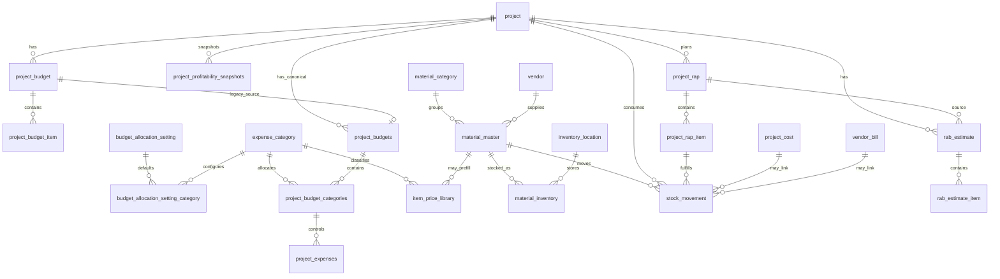

# Database Schema - Project Budget Control & Material Visibility

## Overview

The database keeps the existing finance spine, introduces canonical project budget/category tables informed by the old workbook ratios, and keeps material-control entities as the Material category drill-down. Existing tables for auth, projects, legacy budgets, costs, vendor bills, client invoices, ledger, approvals, AI runs, notifications, and audit logs remain useful and should be preserved during migration.

## Preserved Finance Tables

- `role`, `user`, `session`, `account`, `verification`
- `client`, `project`
- `project_budget`, `project_budget_item`, `project_cost_category`
- `project_cost`
- `vendor`, `vendor_bill`, `vendor_payment`
- `client_invoice`, `client_payment`
- `bank_account`, `cash_transaction`, `bank_statement_import`, `bank_statement_row`
- `attachment`, `approval`, `ai_run`, `notification`, `audit_log`, `app_config`, `onboarding_event`

`project.project_manager_id` nullable hanya saat project masih `DRAFT` dari quick start. Aktivasi
memerlukan akun PM aktif dengan data scope project. `onboarding_event` menyimpan event first-party
tanpa nama, email, isi form, atau nilai finansial.

`project_cost` is the implemented field expense table. Documentation and code should not refer to a separate `field_request` table unless one is intentionally introduced later.

## Per-user Role Guide State

`user_role_guide_state` stores the last role-guide acknowledgment for one authenticated person,
independent of organization onboarding and company finance/material records. It is global auth
metadata, scoped by the session's user ID; it does not use `tenant_id`.

- `user_id`: primary key and foreign key to `user`, deleted with the user.
- `context_key`: SHA-256 of guide version, effective role identity, project data scope, and relevant grants.
- `acknowledged_at`: time of the latest changed-context acknowledgment; repeated acknowledgment does not update it.

Missing rows make existing and new accounts eligible. Developer account simulation never writes
these records. Migration: `0047_user_role_guide_state`.

## Project Budget Control Tables

### `budget_allocation_setting`

Owner/Admin-managed default used when creating a new Project Budget.

- `id`
- `name`
- `status`: `ACTIVE`, `INACTIVE`
- `budget_cap_ratio`
- `notes`
- `is_active`
- `updated_by_id`
- timestamps

### `budget_allocation_setting_category`

Default ratio per expense category for the active budget allocation setting.
`ratio_percentage` is interpreted as a percentage of Internal Budget. Enabled rows may sum to less than `1.0`; the difference is Unallocated Buffer. Gross margin is not stored as a category ratio.

- `id`
- `budget_allocation_setting_id`
- `expense_category_id`
- `ratio_percentage`
- `is_enabled`
- `sort_order`
- timestamps

Project-level overrides are stored in `project_budget_categories`; changing Settings does not rewrite existing approved project budgets.

### `expense_category`

Canonical budget buckets used by Project Budget, Expense Tracker, Dashboard, and AI Brief.

- `id`
- `code`: `MATERIAL`, `TUKANG`, `OPERASIONAL`, `LAIN_LAIN`, `SUBCON`
- `name`
- `description`
- `default_ratio`
- `sort_order`
- `is_active`
- timestamps

### `project_budgets`

Canonical project budget setup, replacing overloaded legacy budget semantics over time.

- `id`
- `project_id`
- `legacy_project_budget_id`
- `status`
- `contract_value`
- `approved_rab_value`
- `internal_budget`
- `budget_cap_ratio`
- `target_gross_amount`
- `target_gross_percentage`
- `project_progress_percentage`
- `approved_by_id`
- `approved_at`
- `notes`
- timestamps

### `project_budget_categories`

Per-project category allocations.

- `id`
- `project_budget_id`
- `expense_category_id`
- `ratio_percentage`
- `allocated_amount`
- `pending_amount`: submitted/verified cost waiting for finance or owner decision
- `actual_amount`
- `paid_amount`
- `remaining_amount`
- `used_percentage`
- `status`: `SAFE`, `WATCH`, `CRITICAL`, `OVER_BUDGET`
- `is_manual_override`
- `sort_order`
- timestamps

Actual/remaining/used fields are stored as a dashboard-friendly snapshot and recalculated by protected actions whenever category expense totals change.

### `item_price_library`

Reusable item/service reference for estimation, RAP, work packages, Subcon packages, and client-safe quotation lines.

- `id`
- `expense_category_id`
- `material_id`
- `default_vendor_id`
- `code`
- `item_type`: `MATERIAL_ITEM`, `WORK_PACKAGE`, `SUBCON_PACKAGE`, `CLIENT_LINE`
- `item_category`
- `name`
- `description`
- `unit`
- `default_client_price`
- `default_internal_cost`
- `pricing_mode`, `target_gross_percentage`
- `price_source_type`, `source_note`, `effective_from`
- `is_active`
- `updated_by_id`
- timestamps

Archived library items stay available for historical references but should not appear as new defaults.

### `item_price_library_cost_component`

Traceable component rows (`LABOR`, `MATERIAL`, `EQUIPMENT`, `LOGISTICS`, `OVERHEAD`, `OTHER`) with quantity, unit, unit cost, total cost, optional vendor, and notes. `default_internal_cost` is synchronized to the component total; margin-based client price uses `cost / (1 - gross_margin)`.

### `project_expenses`

Canonical category expense tracker record. It coexists with `project_cost` during migration.

- `id`
- `project_id`
- `project_budget_category_id`
- `expense_category_id`
- `legacy_project_cost_id`
- `vendor_id`
- `vendor_bill_id`
- `material_id`
- `project_rap_item_id`
- `project_category_plan_item_id`
- `stock_movement_id`
- `requested_by_id`
- `description`
- `quantity`
- `unit_cost`
- `amount`
- `source_type`
- `is_cash_impact`
- `expense_date`
- `payment_status`
- `receipt_image_url`
- `status`
- `audit_note`
- timestamps

Material/RAP/stock links are valid only when the expense category is `MATERIAL`. `project_category_plan_item_id` is valid only for Tukang and Subcon package tracking.

### `project_category_plan_item`

Lightweight internal package plan for non-material categories that need detail without stock behavior.

- `id`
- `project_id`
- `project_budget_id`
- `project_budget_category_id`
- `expense_category_id`: server actions allow only `TUKANG` or `SUBCON`
- `vendor_id`
- `source_library_item_id`
- `supersedes_project_category_plan_item_id`
- `revision`
- `name`
- `scope_description`
- `area`
- `quantity`
- `unit`
- `estimated_unit_cost`
- `estimated_total_cost`
- `status`: `DRAFT`, `ACTIVE`, `LOCKED`, `SUPERSEDED`, `DONE`, `CANCELLED`
- `locked_by_id`, `locked_at`
- `internal_note`
- `display_order`
- timestamps

Material uses `project_rap_item`, not this table. Operasional and Lain-lain remain fast category expense records in v1.

### `project_profitability_snapshots`

Cached read model for owner dashboard and AI brief.

- `id`
- `project_id`
- `project_budget_id`
- `contract_value`
- `approved_rab_value`
- `internal_budget`
- `actual_cost`
- `remaining_budget`
- `budget_used_percentage`
- `target_gross_amount`
- `target_gross_percentage`
- `projected_final_cost`
- `projected_margin_amount`
- `projected_margin_percentage`
- `realized_margin_amount`, `realized_margin_percentage`
- `cash_position`
- `snapshot_type`: `PERIODIC`, `FINAL`
- `material_budget`
- `material_actual`
- `material_remaining`
- `material_used_percentage`
- `material_stock_value_applied`
- `material_shortage_value`
- `leftover_stock_value`
- `risk_status`
- `snapshot_at`
- timestamps

Snapshots are read models, not authoritative accounting records.

## New Material-Control Tables

### `material_category`

Master category for material grouping.

- `id`
- `name`
- `description`
- `created_at`

### `material_master`

Structured material list.

- `id`
- `category_id`
- `default_vendor_id`
- `name`
- `specification`
- `brand`
- `code`
- `color`
- `unit`
- `is_active`
- timestamps

### `inventory_location`

Locations where stock is held.

- `id`
- `name`
- `description`
- `is_active`
- timestamps

### `material_inventory`

Current stock state per material and location.

- `id`
- `material_id`
- `location_id`
- `current_stock`
- `reserved_stock`
- `minimum_stock`
- `average_cost`
- `last_purchase_price`
- timestamps

Available stock is derived in queries:

`available_stock = current_stock - reserved_stock`

### `project_rap`

Internal execution/material plan header.

- `id`
- `project_id`
- `supersedes_project_rap_id`
- `status`
- `revision`
- `locked_by_id`
- `locked_at`
- `notes`
- timestamps

### `project_rap_item`

Internal RAP line item.

- `id`
- `project_rap_id`
- `material_id`
- `source_library_item_id`
- `suggested_client_unit_price`
- `area`
- `name`
- `description`
- `required_quantity`
- `buffer_quantity`
- `total_quantity`
- `unit`
- `estimated_unit_cost`
- `estimated_total_cost`
- `source`
- `status`
- `internal_note`
- timestamps

### `stock_movement`

Auditable inventory movement.

- `id`
- `material_id`
- `inventory_location_id`
- `project_id`
- `project_rap_item_id`
- `project_cost_id`
- `vendor_bill_id`
- `movement_type`
- `movement_direction`
- `reference_type` / `reference_id`
- `quantity`
- `unit_cost`
- `note`
- `created_by_id`
- `created_at`

Stock-changing actions must run in a transaction and write `audit_log`.

Standalone project `USE` creates a non-cash canonical expense at average cost; `RETURN` creates a reversal. A USE already linked to a direct-use `project_cost` is not counted twice.

### `goods_receipt` and `goods_receipt_item`

Physical receipt is separate from payment. Posting updates inventory/weighted average cost, inserts stock movements, and writes audit logs without moving cash.

Receipt headers retain reversal request/approval metadata; receipt items link the compensating movement.

### `stock_transfer` and `stock_transfer_item`

Batch document for atomic multi-item movement between two inventory locations. Item rows preserve quantity, source unit cost, and paired OUT/IN movement references.

### `stock_count` and `stock_count_item`

Physical-count document with location, lifecycle, creator/approver, system quantity snapshot, counted quantity, variance, valuation, and optional posted adjustment movement.

### `rab_estimate`

Client-facing estimate/proposal header.

- `id`
- `project_id`
- `source_project_rap_id`
- `supersedes_rab_estimate_id`
- `void_reason`, `voided_at`, `voided_by_id` for auditable abandoned revisions
- `status`
- `revision`
- `title`
- `client_notes`
- `approved_value`
- `approved_at`
- timestamps

### `rab_estimate_item`

Client-facing estimate item.

- `id`
- `rab_estimate_id`
- `source_type`: `RAP_MATERIAL`, `CATEGORY_PLAN`, or `MANUAL`
- `source_project_rap_item_id`
- `source_project_category_plan_item_id`
- `source_library_item_id`, `source_revision`, `source_updated_at`
- `client_label`
- `description`
- `quantity`
- `unit`
- `unit_price`
- `line_total`
- `display_order`
- `is_hidden`
- `is_bundle`
- timestamps

Client-facing RAB rows must not expose internal RAP cost, margin, markup, vendor notes, or internal notes.

### `project_change_order`

Formal post-approval revision with baseline/revised RAB, reason, scope summary, old/delta/new contract values, client confirmation reference/date, and internal approval metadata. Approval atomically supersedes the old RAB, approves the revision, updates contract/budget, locks source revisions, and writes audit logs.

## Extensions to Existing Tables

- `project_cost` requires canonical `project_budget_category`; legacy `project_budget_item` remains optional detail linkage.
- `vendor_bill` requires canonical `project_budget_category`; legacy `project_budget_item` remains optional detail linkage.

These links are optional because operational expenses and non-material bills must remain fast to record.

## Relationship Summary

- Guided setup fields: `setup_stage`, `tukang_scope_skipped`, `subcon_scope_skipped`, and `setup_updated_by_id`.

# AI User Preference

`ai_user_preference` menyimpan satu preferensi asisten per user: `response_style`,
`primary_focus`, `custom_note` maksimal 300 karakter, dan `updated_at`. `user_id`
adalah primary key sekaligus foreign key cascade ke `user`; tidak ada preference
lintas user atau organisasi.

## Notification lifecycle

`notification` additionally stores `read_at`, `project_id`, `required_permission`, `event_key`, and
`updated_at`. The unique `(tenant_id, user_id, event_key)` index prevents duplicate event delivery
to one recipient. The feed index covers company/user/category/resolution/creation/id; the SSE cursor
index covers company/user/update/id. Every read or resolution mutation advances `updated_at`.
`read` and `is_resolved` are independent: open actions remain actionable after reading.

`notification_condition` stores a company-scoped rule key, current stage, revision and update time. Row locks serialize condition transitions and the scheduler execution. Recovery clears the stage; a subsequent recurrence increments the revision and produces a fresh event. No finance or stock balances are stored or changed by notification jobs.

`user_push_subscription` stores Web Push or Expo credentials and, for new registrations, the Better Auth `session_id`. Deleting that session cascades the subscription so a logged-out device cannot keep receiving messages. `notification_delivery` is the durable outbox: one unique row per notification/subscription with channel, status, attempts, receipt attempts, retry time, processing lease, provider ticket, terminal error, and sent/delivered timestamps. Deleting a notification or subscription cascades its delivery rows.

Migration `0038_notification_hardening` backfills read timestamps and known legacy project references.
Migration `0039_notification_sse_cursor` adds the indexed change cursor used by the web SSE stream.
Migration `0040_notification_delivery_outbox` adds session-bound subscriptions and the durable push outbox.
See `docs/guide/notifications.md` for first-run reconciliation, synchronization, and the 30-day
visibility policy.
