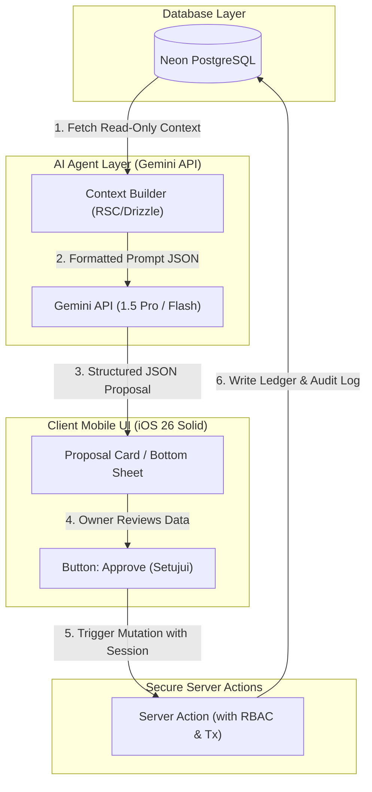
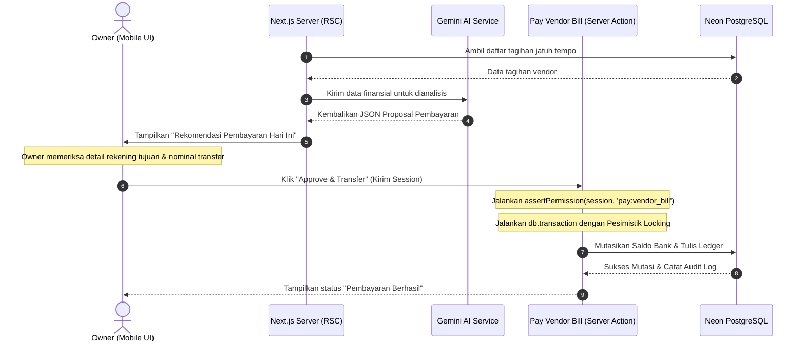

# AI Agent Architecture - Atria ERP

Dokumen ini mendokumentasikan desain arsitektur untuk lapisan kecerdasan buatan (*AI Layer*) di Atria ERP yang ditenagai oleh model **Gemini API**. AI Layer dirancang untuk membantu efisiensi operasional PM di lapangan (via OCR) dan memberikan analisis keuangan tingkat tinggi bagi Owner (via briefing dan pendeteksian risiko) tanpa berkompromi pada keamanan data transaksi.

---

## 1. Arsitektur AI Layer & Aliran Data

Atria ERP menerapkan arsitektur AI berbasis **Proposal-Action Pattern**. Lapisan AI bersifat sepenuhnya **Read-Only** terhadap database. AI dilarang keras melakukan penulisan (*write*), pembaruan (*update*), atau penghapusan (*delete*) data secara langsung ke database.

### 1.1 Diagram Alur AI Proposal-Action (Mermaid)



---

## 2. Definisi & Tanggung Jawab Tiga Agent Utama

Sistem mendefinisikan tiga agen AI dengan spesialisasi tugas yang berbeda:

### 2.1 FinanceOwnerAgent (Daily Executive Briefings)
Agen ini bertugas menyusun laporan eksekutif harian berupa narasi ringkas dalam Bahasa Indonesia yang dikirimkan ke Owner setiap pukul 07:00 pagi.

*   **Jadwal Eksekusi:** Otomatis via Vercel Cron Job harian.
*   **Konteks yang Dikumpulkan (Read-Only):**
    *   Total saldo kas dari seluruh rekening aktif (`bank_account`).
    *   Tagihan piutang klien yang mendekati jatuh tempo (`client_invoice` berstatus `UNPAID` / `PARTIALLY_PAID`).
    *   Tagihan hutang vendor yang jatuh tempo dalam 7 hari ke depan (`vendor_bill`).
    *   Daftar pengajuan pengeluaran kas lapangan PM yang berstatus `VERIFIED` (menunggu approval Owner).
    *   Daftar peringatan proyek yang berstatus `WARNING` atau `CRITICAL` berdasarkan kesehatan finansial.
*   **Strategi System Prompt:**
    ```text
    Role: Senior CFO AI Assistant
    Task: Buat daily briefing finansial ringkas, profesional, dan berorientasi tindakan dalam Bahasa Indonesia untuk Pemilik Perusahaan (Owner).
    Rules:
    - Selalu tampilkan angka moneter dalam format Rupiah (IDR).
    - Kelompokkan laporan menjadi tiga bagian: (1) Status Kas & Likuiditas, (2) Pengingat Pembayaran Penting (Hutang/Piutang), dan (3) Tindakan Penting yang Membutuhkan Otorisasi Hari Ini.
    - Hindari jargon teknis AI. Fokus pada metrik bisnis dan manajemen risiko.
    ```
*   **Skema Luaran JSON (JSON Output Schema):**
    ```json
    {
      "briefingDate": "2026-06-11",
      "summary": "Ringkasan eksekutif naratif...",
      "metrics": {
        "cashBalance": 1250000000.00,
        "receivablesOverdue": 150000000.00,
        "payablesDueSevenDays": 45000000.00
      },
      "alerts": [
        {
          "projectId": "uuid-1",
          "projectName": "Apartemen Sudirman Suite",
          "severity": "WARNING",
          "message": "Penggunaan budget material mencapai 92%."
        }
      ],
      "pendingActions": [
        {
          "actionType": "APPROVE_COST_CLAIM",
          "referenceId": "uuid-cost-1",
          "description": "Klaim reimbursement PM Lapangan Budi Rp 6.200.000 (Over-Budget)."
        }
      ]
    }
    ```

### 2.2 FinanceRiskAgent (Cash Burn Rate & Project Budget Overruns)
Agen ini memantau kecepatan pengeluaran proyek dan memperkirakan ketahanan kas korporat (*runway*) untuk meminimalisasi risiko kemacetan dana.

*   **Jadwal Eksekusi:** Setiap akhir pekan (Sabtu pukul 23:00) atau saat dipicu oleh peringatan transaksi bernilai di atas Rp 50.000.000.
*   **Kalkulasi Metrik & Analisis:**
    *   **Spend Velocity:** Kecepatan realisasi pengeluaran proyek per minggu dibandingkan terhadap sisa durasi pengerjaan.
    *   **Corporate Cash Runway:** Mengambil total pengeluaran operasional umum perusahaan (gaji, sewa kantor, listrik, pengeluaran proyek) dalam 3 bulan terakhir untuk menghitung rata-rata pengeluaran bulanan (*monthly burn rate*).
        $$\text{Runway (Bulan)} = \frac{\text{Total Saldo Rekening Bank}}{\text{Rata-rata Pengeluaran Bulanan}}$$
    *   **Pendeteksian Overrun:** Mengidentifikasi penyimpangan pengeluaran per kategori anggaran proyek (`actual_spent` vs `allocated_amount`).
*   **Strategi System Prompt:**
    ```text
    Role: Financial Risk Analyst AI
    Task: Lakukan audit kecepatan konsumsi anggaran proyek dan kalkulasi masa ketahanan kas perusahaan (runway).
    Rules:
    - Identifikasi proyek yang memiliki pola pengeluaran terlalu cepat dibandingkan persentase penyelesaian fisik.
    - Hitung cash runway korporat dalam satuan bulan.
    - Kembalikan daftar usulan penyesuaian anggaran atau penundaan pembayaran non-kritis.
    ```
*   **Zod Output Schema:**
    ```typescript
    const financeRiskReportSchema = z.object({
      calculatedAt: z.coerce.date(),
      monthlyBurnRate: z.number(),
      cashRunwayMonths: z.number(),
      highRiskProjects: z.array(
        z.object({
          projectId: z.string().uuid(),
          projectName: z.string(),
          allocatedAmount: z.number(),
          actualSpent: z.number(),
          burnRateVelocity: z.enum(["LOW", "MEDIUM", "HIGH"]),
          overrunProbability: z.number().min(0).max(100),
          recommendedAction: z.string(),
        })
      ),
    });
    ```

### 2.3 OCRReceiptAgent (Multimodal Receipt Details Extraction)
Agen ini memproses foto nota belanja material atau kuitansi yang diunggah oleh Project Manager dari ponsel mereka untuk secara otomatis mengekstraksi rincian pembelian.

*   **Input Data:** File gambar bukti belanja (JPEG/PNG) yang diunggah secara aman ke ImageKit CDN. URL gambar dikirimkan ke model multimodal Gemini (seperti `gemini-1.5-flash`).
*   **Strategi Multimodal Prompt:**
    ```text
    [IMAGE INPUT]
    Task: Ekstrak rincian bukti transaksi dari foto nota/struk belanja di atas.
    Rules:
    - Baca nama Vendor/Toko, Tanggal Transaksi, dan Daftar Item Barang.
    - Untuk setiap item, ambil nama barang, kuantitas, harga satuan, dan total harga.
    - Ekstrak nilai Subtotal, Pajak/Tax (jaka ada), dan Total akhir pembayaran.
    - Jika ada diskon, catat sebagai nilai negatif.
    - Format output wajib berupa JSON yang valid sesuai skema yang diminta, tanpa markdown wrapper (seperti ```json).
    ```
*   **Skema Luaran JSON (JSON Output Schema):**
    ```json
    {
      "vendorName": "TB Sinar Maju",
      "transactionDate": "2026-06-10T00:00:00.000Z",
      "items": [
        {
          "itemName": "Semen Tiga Roda 50kg",
          "quantity": 10,
          "unitPrice": 72000.00,
          "totalPrice": 720000.00
        },
        {
          "itemName": "Paku Kayu 3 Inch",
          "quantity": 2,
          "unitPrice": 15000.00,
          "totalPrice": 30000.00
        }
      ],
      "subtotal": 750000.00,
      "tax": 0.00,
      "totalAmount": 750000.00
    }
    ```
*   **Validasi Kategori Anggaran:** Hasil ekstraksi di atas akan dipetakan ke kategori anggaran proyek (`cost_category`) menggunakan pencocokan teks semantik (misal: "Semen" dipetakan ke kategori `'MATERIAL'`).

### 2.4 Pengaturan SDK Gemini API untuk Keandalan Output JSON

Untuk menjamin bahwa luaran dari Gemini API selalu berupa JSON terstruktur yang valid dan sesuai dengan schema yang diharapkan (menghindari kegagalan parsing JSON di sisi server), pengembang wajib menggunakan opsi native Gemini SDK berikut saat melakukan pemanggilan API:

1. **`responseMimeType`**: Harus disetel ke `"application/json"`. Parameter ini memaksa model Gemini untuk menstrukturkan responsnya dalam format JSON yang valid secara sintaksis.
2. **`responseSchema`**: Menyediakan definisi schema JSON target (menggunakan format OpenAPI Schema) secara langsung ke API call SDK. Dengan menyertakan schema ini di tingkat SDK, model Gemini menjamin output mengikuti properti, tipe data, dan daftar properti wajib (*required fields*) yang telah didefinisikan.

#### Contoh Pengaturan SDK (Node.js):
```typescript
import { GoogleGenAI, Type } from "@google/genai";

const ai = new GoogleGenAI({ apiKey: process.env.GEMINI_API_KEY });

const response = await ai.models.generateContent({
  model: "gemini-1.5-flash",
  contents: "Ekstrak rincian bukti transaksi dari foto...",
  config: {
    // Memaksa model mengembalikan format JSON
    responseMimeType: "application/json",
    // Menentukan schema terstruktur yang harus dipatuhi
    responseSchema: {
      type: Type.OBJECT,
      properties: {
        vendorName: { type: Type.STRING },
        transactionDate: { type: Type.STRING },
        subtotal: { type: Type.NUMBER },
        tax: { type: Type.NUMBER },
        totalAmount: { type: Type.NUMBER },
        items: {
          type: Type.ARRAY,
          items: {
            type: Type.OBJECT,
            properties: {
              itemName: { type: Type.STRING },
              quantity: { type: Type.INTEGER },
              unitPrice: { type: Type.NUMBER },
              totalPrice: { type: Type.NUMBER },
            },
            required: ["itemName", "quantity", "unitPrice", "totalPrice"],
          },
        },
      },
      required: ["vendorName", "transactionDate", "subtotal", "tax", "totalAmount", "items"],
    },
  },
});
```

Dengan konfigurasi ini, aplikasi tidak perlu lagi melakukan pembersihan string (seperti menghapus triple backticks ` ```json ` secara manual), karena Gemini API secara langsung mengembalikan string JSON bersih yang siap di-parse oleh Zod.

---

## 3. Pola Otorisasi & Alur Persetujuan (Approval-Gated Mutation Flow)

Seluruh perubahan saldo keuangan atau data komitmen hutang-piutang yang diusulkan oleh AI **wajib melewati persetujuan manual (human-in-the-loop)**.

### 3.1 Langkah Kerja Alur Approval Gate
1.  **AI Menghasilkan Proposal:** AI Agent (misalnya `OCRReceiptAgent` atau `FinanceRiskAgent`) memproses input dan menghasilkan dokumen proposal transaksi berupa struktur data JSON terenkripsi.
2.  **Penyimpanan Proposal:** Proposal disimpan sementara di database (atau dikirimkan ke state klien) sebagai draf transaksi dengan referensi ID AI.
3.  **Tampilan Verifikasi UI:** Aplikasi menampilkan draf tersebut dalam bentuk kartu verifikasi di mobile webview Owner atau Finance Admin. Pengguna dapat mengoreksi nilai ekstraksi jika terjadi kesalahan pembacaan OCR.
4.  **Tindakan Manusia (Explicit Human Action):** Pengguna menekan tombol "Approve" (Setujui) secara sadar pada layar ponsel.
5.  **Eksekusi Server Action:** Sesi aktif pengguna mengirimkan permintaan eksekusi Server Action (misal: `payVendorBill` atau `recordClientPayment`). Server Action akan memvalidasi ulang seluruh hak akses pengguna terhadap objek target menggunakan token Better Auth dan menjalankan verifikasi saldo kas di dalam transaksi database.

### 3.2 Diagram Urutan Pembayaran Vendor yang Diusulkan AI (Mermaid)



---

## 4. Keamanan & Batasan AI Layer (Guardrails)

Untuk mencegah kebocoran anggaran dan manipulasi data melalui *prompt injection*, Atria ERP menerapkan batasan keamanan ketat berikut:

### 4.1 AI Read-Only Rule
*   Kredensial database yang digunakan oleh pipeline AI (API routes yang mengeksekusi prompt) dikonfigurasi untuk hanya memiliki izin `SELECT` pada tabel-tabel utama.
*   AI tidak dilengkapi dengan ORM client yang memiliki metode `.insert()`, `.update()`, atau `.delete()`.

### 4.2 Larangan Eksekusi Kode Dinamis & Raw SQL
*   AI dilarang keras menghasilkan string perintah SQL (misalnya `SELECT * FROM ...`) yang kemudian dieksekusi secara dinamis di server (`db.execute`). Hal ini untuk meniadakan celah keamanan SQL Injection.
*   Parsing hasil JSON dari Gemini wajib melalui validasi parser Zod di server untuk memastikan struktur data luaran bersih dari tag skrip berbahaya (*cross-site scripting*).

### 4.3 Log Audit AI (`ai_run` logging)
Setiap panggilan ke Gemini API wajib mencatatkan aktivitasnya pada tabel `ai_run` untuk transparansi operasional dan analisis biaya token:
*   `runType`: Jenis operasi (`OCR_RECEIPT` atau `FINANCIAL_BRIEFING`).
*   `runById`: ID pengguna yang memicu pemrosesan AI.
*   `status`: Status eksekusi (`PROCESSING`, `COMPLETED`, `FAILED`).
*   `payload`: Input parameter (misal: URL gambar receipt ImageKit).
*   `result`: Response JSON mentah yang dikembalikan oleh Gemini API.
*   `tokensUsed`: Jumlah token input dan output yang dikonsumsi (untuk pemantauan kuota API).
*   `errorMessage`: Catatan kesalahan teknis jika API Gemini gagal merespons.
*   `createdAt`: Timestamp waktu eksekusi.
