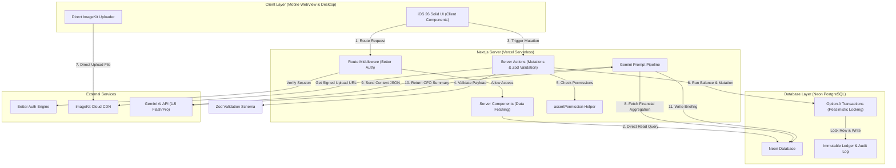
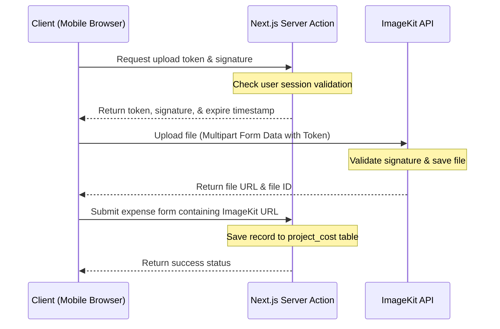

# Technical Architecture - Atria ERP

Dokumen ini mendokumentasikan desain arsitektur perangkat lunak tingkat tinggi (*high-level architecture*) Atria ERP. Arsitektur ini dirancang untuk menjamin keamanan transaksi finansial (*finance-first*), performa tinggi pada perangkat seluler, serta auditability penuh untuk seluruh perubahan data.

---

## 1. Diagram Arsitektur Tingkat Tinggi (Mermaid)

Berikut adalah visualisasi aliran data dan integrasi sistem eksternal di Atria ERP:



---

## 2. Frontend Layer Structure

Desain frontend Atria ERP membagi halaman menjadi dua jenis komponen utama untuk mengoptimalkan pemuatan data dan interaktivitas:

### 2.1 Server Components (Data Fetching)
*   **Peran:** Seluruh pemuatan data (*read-only*) dilakukan secara langsung di server menggunakan Next.js Server Components. Komponen ini langsung memanggil Drizzle ORM tanpa melalui REST API internal.
*   **Keuntungan:** Menghilangkan jeda pemuatan data di sisi client (*no client-side fetching waterfall*), meminimalkan ukuran Javascript bundle yang dikirim ke ponsel pengguna, dan mengamankan query database karena dieksekusi di lingkungan server yang aman.
*   **Pola Penggunaan:**
    ```typescript
    // app/projects/page.tsx (Server Component)
    import { db } from "@/db";
    import { project } from "@/db/schema";
    import { eq } from "drizzle-orm";
    import ProjectCardList from "./project-card-list";

    export default async function ProjectsPage(): Promise<JSX.Element> {
      // Direct database fetch at server side
      const activeProjects = await db.query.project.findMany({
        where: eq(project.status, "ACTIVE"),
        with: { budgetItems: true }
      });

      return (
        <main className="p-4 space-y-4">
          <h1 className="text-2xl font-bold tracking-tight">Daftar Proyek Aktif</h1>
          <ProjectCardList initialProjects={activeProjects} />
        </main>
      );
    }
    ```

### 2.2 Client Components (Interactive UI)
*   **Peran:** Digunakan untuk elemen antarmuka yang membutuhkan interaksi pengguna langsung, penanganan state lokal, animasi, atau akses API browser (seperti kamera untuk foto nota).
*   **Desain iOS 26 Solid:** Elemen Client Components wajib memiliki ukuran *touch target* minimal **44x44 piksel** dan menerapkan visual glassmorphic (`backdrop-blur-md`, `border-white/10`) untuk memastikan kemudahan navigasi di lapangan.
*   **Penerapan:** Penanganan form pengajuan dana, tombol approval, filter pencarian dinamis, dan visualisasi grafik keuntungan (*Gross/Net Profit*).

---

## 3. Backend Layer (Server Actions)

Semua mutasi data (penulisan saldo, persetujuan anggaran, pendaftaran pengeluaran) wajib menggunakan Next.js Server Actions yang diamankan oleh skema validasi Zod dan helper RBAC.

### 3.1 Pola Response Konsisten (`ActionResponse`)
Seluruh Server Actions wajib mengembalikan data yang mengikuti struktur generic `ActionResponse` untuk memudahkan penanganan kesalahan di sisi client secara seragam.

```typescript
// lib/types/action-response.ts
export type ActionResponse<T> =
  | {
      success: true;
      data: T;
    }
  | {
      success: false;
      error: {
        code: "VALIDATION_ERROR" | "UNAUTHORIZED" | "FORBIDDEN" | "INSUFFICIENT_FUNDS" | "TRANSACTION_FAILED" | "NOT_FOUND" | "INTERNAL_SERVER_ERROR";
        message: string;
        details?: Record<string, string[]>; // Digunakan untuk mapping error field Zod
      };
    };
```

---

## 4. Database Layer & Penegakan Saldo Kas (Option A Ledger Model)

Sistem keuangan Atria ERP mengadopsi model **Option A (Transaction Block Model)** untuk memastikan sinkronisasi yang sempurna antara saldo rekening bank (`bank_account`) dan buku besar transaksi (`cash_transaction`).

### 4.1 Pesimistik Locking (`.for('update')`)
Untuk mencegah *race condition* akibat mutasi kas yang terjadi secara konkuren (misalnya dua PM lapangan mencairkan kas kecil pada detik yang sama), baris data akun bank harus dikunci di database sebelum saldo dihitung ulang.

### 4.2 Alur Transaksi Finansial yang Aman
Setiap Server Action yang merubah saldo wajib membungkus operasinya di dalam blok `db.transaction` dengan langkah-langkah wajib berikut:

```typescript
// sample implementation logic for secure balance mutation
import { db } from "@/db";
import { bankAccount, cashTransaction, auditLog } from "@/db/schema";
import { eq } from "drizzle-orm";

interface MutateBalanceResult {
  transactionId: string;
  newBalance: number;
}

async function mutateBalance(
  bankAccountId: string,
  amount: number,
  type: "DEBIT" | "CREDIT",
  userId: string
): Promise<MutateBalanceResult> {
  return await db.transaction(async (tx) => {
    // 1. Lock bank account row using pessimistic locking
    const [account] = await tx
      .select()
      .from(bankAccount)
      .where(eq(bankAccount.id, bankAccountId))
      .for("update"); // PostgreSQL row lock

    if (!account) {
      throw new Error("ACCOUNT_NOT_FOUND");
    }

    const oldBalance = Number(account.balance);
    const mutationAmount = Number(amount);
    let newBalance = oldBalance;

    // 2. Perform math validation
    if (type === "CREDIT") {
      if (oldBalance < mutationAmount) {
        throw new Error("INSUFFICIENT_FUNDS"); // Trigger rollback
      }
      newBalance = oldBalance - mutationAmount;
    } else {
      newBalance = oldBalance + mutationAmount;
    }

    // 3. Update the bank account balance using returning()
    const updatedRows = await tx
      .update(bankAccount)
      .set({ 
        balance: newBalance.toFixed(2), 
        updatedAt: new Date() 
      })
      .where(eq(bankAccount.id, bankAccountId))
      .returning();

    // 4. Verify that exactly 1 row was updated to prevent orphan writes
    if (updatedRows.length !== 1) {
      throw new Error("BALANCE_UPDATE_MISMATCH"); // Trigger rollback
    }

    // 5. Write to immutable cash_transaction ledger
    const [transaction] = await tx
      .insert(cashTransaction)
      .values({
        bankAccountId,
        type,
        amount: mutationAmount.toFixed(2),
        description: `Mutasi kas internal: ${type === "DEBIT" ? "Uang Masuk" : "Uang Keluar"}`,
        reconciled: true,
        reconciliationDate: new Date(),
        reconciledById: userId,
        createdAt: new Date(),
        updatedAt: new Date(),
      })
      .returning();

    // 6. Write to immutable audit_log table
    await tx.insert(auditLog).values({
      userId,
      action: type === "DEBIT" ? "RECORD_MUTATION_IN" : "RECORD_MUTATION_OUT",
      targetTable: "bank_account",
      targetId: bankAccountId,
      originalState: JSON.stringify({ balance: oldBalance.toFixed(2) }),
      newState: JSON.stringify({ balance: newBalance.toFixed(2), transactionId: transaction.id }),
      createdAt: new Date(),
    });

    return { transactionId: transaction.id, newBalance };
  });
}
```

> [!IMPORTANT]
> **Rekomendasi Presisi Desimal (Decimal Precision Handling):**
> Karena JavaScript menggunakan format *floating-point* (IEEE 754) yang tidak presisi untuk operasi matematika desimal (misalnya `0.1 + 0.2` tidak sama dengan `0.3`), disarankan untuk menghindari aritmatika desimal langsung pada tipe `number` biasa. 
> 
> Beberapa pendekatan terbaik yang direkomendasikan untuk mencegah selisih nilai desimal pada saldo bank:
> 1. **Penyimpanan Satuan Terkecil (Cents/Minor Units):** Simpan semua nilai uang dalam satuan terkecil (misalnya sen atau Rupiah bulat jika tidak ada pecahan sen) sebagai tipe `integer` di database, lalu konversi ke desimal hanya saat menampilkan di UI.
> 2. **Library Matematika Presisi Tinggi:** Menggunakan library seperti `big.js` atau `decimal.js` untuk mengeksekusi kalkulasi aritmatika finansial sebelum menyimpan hasilnya kembali ke database menggunakan format string numerik (`numeric("amount", { precision: 15, scale: 2 })`).
---

## 5. Alur Unggah Berkas Bukti Langsung ke ImageKit (Secure Client Upload)

Untuk menghemat beban komputasi server Next.js, berkas struk belanja atau lampiran tagihan diunggah langsung dari browser/ponsel PM ke ImageKit menggunakan otorisasi token tanda tangan sekali pakai (*signed URL*).



---

## 6. Pipeline Peringatan Keuangan & CFO Harian (AI & Alerts Pipeline)

Atria ERP mengimplementasikan sistem proaktif untuk mencegah pembengkakan anggaran (*budget overrun*) dan memberikan laporan eksekutif kepada Owner melalui kecerdasan buatan.

### 6.1 Daily Financial Briefing Pipeline (Gemini AI)
*   **Pemicu Terjadwal:** Menggunakan Vercel Cron Job yang dipicu setiap pukul 07:00 pagi.
*   **Alur Pengumpulan Data:** Sistem mengagregasi total pengeluaran proyek aktif, performa kas korporat, tagihan jatuh tempo, serta permintaan dana PM yang berstatus `VERIFIED` dalam 24 jam terakhir.
*   **Pipeline Prompt Gemini:** Data dikirimkan ke Gemini 1.5 Flash menggunakan instruksi sistem khusus untuk menghasilkan ringkasan eksekutif dan rekomendasi tindakan (misal: persetujuan transfer vendor).
*   **Penyimpanan Laporan:** Teks luaran dari Gemini AI disimpan dalam tabel `ai_run` untuk auditabilitas konsumsi token dan diakses oleh Owner melalui menu Dashboard CFO.

### 6.2 Event-Driven Alert Triggers
*   Setiap kali ada penulisan data pada `project_budget_item.actual_spent`, sistem secara sinkron menghitung rasio pengeluaran terhadap anggaran rencana.
*   Jika rasio mencapai **90%**, sistem memicu pembuatan data pada tabel `notification` dengan status `WARNING`.
*   Jika rasio melebihi **100%** (*over-budget*), status notifikasi diset menjadi `CRITICAL` dan sistem secara otomatis mengirimkan peringatan ke perangkat mobile Owner dan Admin Finance untuk menolak pengajuan PM berikutnya sebelum ada *override approval*.

---

## 7. Kebijakan Log Audit Mutlak (Immutable Audit Logging)

Log audit di Atria ERP dirancang agar tahan terhadap segala bentuk manipulasi data.
*   **Immutable Trail:** Tabel `audit_log` dihubungkan ke tabel `user` dengan aturan `onDelete: "restrict"`. Riwayat audit tidak akan pernah terhapus bahkan jika proyek diarsipkan.
*   **State Capture:** Setiap log audit wajib merekam keadaan data sebelum perubahan (`originalState`) dan keadaan data sesudah perubahan (`newState`) dalam format string JSON untuk kebutuhan forensik audit keuangan di kemudian hari.

---

## 8. Deployment & Infrastructure

*   **Frontend & Serverless Host:** Dideploy di platform **Vercel** untuk mendukung pemetaan edge routing cepat dan performa global.
*   **Database Host:** Neon PostgreSQL serverless database. Penggunaan fitur **database branching** Neon disinkronkan dengan GitHub Action, sehingga setiap penggabungan kode (*Pull Request*) akan memicu pengujian skema database Drizzle pada lingkungan cabang terisolasi sebelum migrasi dijalankan pada database production utama (`drizzle-kit migrate`).
