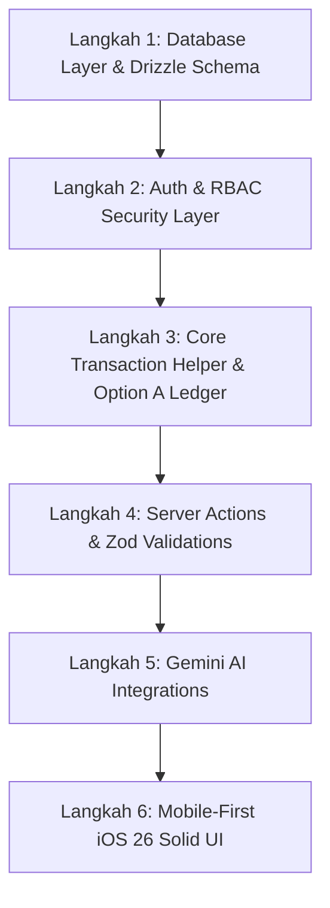

# Implementation Order & Verification Guidelines - Atria ERP

Dokumen ini mendefinisikan urutan pembangunan yang direkomendasikan (*recommended build order*) untuk Atria ERP. Dokumen ini juga memberikan justifikasi mengapa pengembangan backend dan aliran data (*data flow*) harus diselesaikan terlebih dahulu sebelum menyentuh antarmuka pengguna (*UI screens*), serta menyediakan panduan verifikasi untuk memastikan kebenaran sistem di setiap tahap. Seluruh penjelasan produk ditulis dalam Bahasa Indonesia, sementara istilah teknis tetap disajikan dalam English.

---

## Urutan Pembangunan Rekomendasi (Recommended Build Order)

Untuk menjamin aplikasi berjalan dengan prinsip **finance-first** dan mencegah dilakukannya perombakan kode besar-besaran (*integration refactors*) di pertengahan jalan, proses pembangunan dibagi menjadi 6 tahap berurutan:

---

## 1. Justifikasi Pembangunan Aliran Data Terlebih Dahulu (Data Flow First Justification)

Mengapa kita harus membangun dari Database -> Auth -> Actions -> AI -> UI? 

1.  **TypeScript Type Inference dari Database Schema:**
    Drizzle ORM memungkinkan kita untuk menurunkan tipe data TypeScript secara langsung dari skema tabel (`typeof table.$inferSelect` dan `$inferInsert`). Dengan mendefinisikan skema database terlebih dahulu, seluruh Server Actions dan komponen UI di atasnya akan mendapatkan dukungan otomatisasi autocompletion dan pengecekan tipe statis (*compile-time type safety*). Perubahan tipe data di database akan langsung terdeteksi sebagai error kompilasi pada UI, sehingga mencegah kebocoran bug desimal ke production.
2.  **Keamanan Mutlak (Zero Client Trust):**
    Dalam sistem keuangan, kita tidak boleh mempercayai input data atau logika perhitungan dari browser client. Dengan membangun autentikasi, pemeriksaan hak akses peran (`assertPermission`), dan pessimistic locking di database server terlebih dahulu, kita menjamin pintu gerbang keamanan finansial telah terkunci rapat. UI hanyalah media visual untuk memicu Server Actions ini.
3.  **UI sebagai Proyeksi Data (UI is just a Projection):**
    Penyusunan UI dasbor keuangan, visualisasi budget item progress bar, dan status badges sangat bergantung pada ketersediaan data agregat yang presisi dari database. Jika kita mendesain UI terlebih dahulu menggunakan data tiruan (*mock data*), kita berisiko melakukan refactoring tata letak UI secara besar-besaran ketika menemukan bahwa struktur query database riil ternyata berbeda atau tidak dapat mensuplai data mock tersebut dengan efisien.
4.  **Kemudahan Pengujian Terisolasi (Isolated Testing):**
    Membangun Server Actions sebelum UI memudahkan kita melakukan pengujian fungsionalitas unit menggunakan skrip otomatis sederhana (menggunakan framework pengujian seperti Bun Test atau berkas scratch manual). Kita dapat menyimulasikan aliran pembayaran invoice klien atau pembatalan transaksi saldo minus tanpa perlu membuka browser atau memicu klik tombol di ponsel emulator.

---

## 2. Panduan Verifikasi Detail pada Setiap Langkah (Verification Guidelines)

Berikut adalah petunjuk pelaksanaan verifikasi kelayakan sistem untuk setiap langkah pembangunan:

### Langkah 1: Lapisan Database & Drizzle Setup (Database Layer)
*   **Aktivitas Pembangunan:** Menulis tabel, indeks, foreign keys, dan menjalankan migrasi ke Neon PostgreSQL.
*   **Panduan Verifikasi:**
    1.  **Dry Run Migrasi:** Jalankan `bunx drizzle-kit generate` dan periksa SQL mentah di folder `/drizzle` secara visual untuk memastikan tidak ada relasi cascade yang tidak diinginkan pada tabel transaksi kas.
    2.  **Verifikasi Seed:** Jalankan perintah seeding dan verifikasi bahwa data master `role`, `project_cost_category`, dan bank accounts awal tersimpan dengan benar di database.
    3.  **Audit Constraints:** Coba lakukan query manual untuk menghapus salah satu baris `role` yang masih memiliki relasi aktif di tabel `user`. PostgreSQL harus menolak penghapusan tersebut dan mengembalikan error foreign key constraint (`restrict`).

### Langkah 2: Autentikasi & Proteksi Rute (Auth & Security Layer)
*   **Aktivitas Pembangunan:** Mengonfigurasi Better Auth, membuat Custom Middleware, dan helper otorisasi `assertPermission`.
*   **Panduan Verifikasi:**
    1.  **Middleware Redirects:** Jalankan server dan panggil endpoint dasbor ledger tanpa mengirimkan cookie session. Pastikan status respons adalah 302 Redirect ke halaman login.
    2.  **Role Verification (RBAC):** Buat unit test yang memicu pemanggilan helper `assertPermission` menggunakan data user dengan peran `PROJECT_MANAGER` untuk meminta izin `reconcile:ledger`. Pastikan eksekusi melemparkan error `FORBIDDEN` dengan deskripsi kegagalan otorisasi peran secara tepat.

### Langkah 3: Logika Transaksi & Buku Besar (Core Ledger Transactions)
*   **Aktivitas Pembangunan:** Menulis internal helper `mutateBalance` dengan Option A transaksional ledger dan pessimistic locking.
*   **Panduan Verifikasi:**
    1.  **Pessimistic Locking Verification:** Jalankan skrip testing konkuren. Kirimkan 2 request transfer keluar secara simultan pada satu rekening bank BCA Operational yang memiliki saldo awal pas-pasan.
    2.  **Expected Outcome:** Request pertama harus berhasil memotong saldo dan mencatat transaksi ledger, sedangkan request kedua harus terblokir sementara (antre), kemudian gagal seketika dengan status `INSUFFICIENT_FUNDS` saat baris data bank terbuka dari lock. Saldo bank tidak boleh bernilai negatif, dan database transaction wajib membatalkan penulisan ledger request kedua (rollback).

### Langkah 4: Server Actions & Validasi Zod (Business API Layer)
*   **Aktivitas Pembangunan:** Mengembangkan Server Actions: `recordClientPayment`, `submitVendorBill`, `scheduleVendorBillPayment`, dan `payVendorBill`.
*   **Panduan Verifikasi:**
    1.  **Zod Schema Validation:** Panggil Server Action `recordClientPayment` dengan parameter nominal `amountPaid` bernilai negatif atau format UUID invoice yang salah.
    2.  **Expected Outcome:** Action harus mengembalikan respon `{ success: false, error: { code: "VALIDATION_ERROR" } }` lengkap dengan pemetaan pesan error field yang relevan tanpa melempar kegagalan sistem internal (500 error).
    3.  **Project Scoping Validation:** Masuk dengan sesi user PM Budi Santoso, panggil Server Action `submitVendorBill` untuk mencatat tagihan ke proyek yang tidak dipimpin oleh Budi. Pastikan Action menolak dengan respon status `FORBIDDEN`.

### Langkah 5: Pipa AI & Integrasi Gemini (AI Integration Pipeline)
*   **Aktivitas Pembangunan:** Menyiapkan Google Gen AI SDK untuk parser OCR nota dan cron daily briefing CFO.
*   **Panduan Verifikasi:**
    1.  **OCR Output Structure:** Kirim foto contoh struk belanja material berbahasa Indonesia (format PNG/JPEG) ke fungsi parsing Gemini SDK.
    2.  **Expected Outcome:** Pastikan output dari SDK mengembalikan string JSON murni yang langsung dapat di-parse oleh Zod tanpa ada kegagalan format token. Verifikasi properti totalAmount di dalam JSON bernilai numerik akurat.
    3.  **Cron Job Verification:** Pemicu endpoint `/api/cron/daily-briefing` dan periksa tabel `ai_run` untuk memastikan ringkasan briefing finansial harian tersimpan dengan token count tercatat secara akurat.

### Langkah 6: Komponen UI & Layar Seluler (UI/UX Pages Layer)
*   **Aktivitas Pembangunan:** Membangun antarmuka mobile webview iOS 26 Solid, sticky bottom nav, dan desktop layouts.
*   **Panduan Verifikasi:**
    1.  **Touch Target Inspector:** Buka Chrome DevTools Mobile Emulator, aktifkan inspect element, periksa ukuran bounding box area klik pada tab Bottom Nav, tombol Approve, dan formulir input. Pastikan ukuran minimal adalah **48x48px**.
    2.  **Shimmer Skeleton Check:** Simulasikan jaringan lambat (Slow 3G) melalui DevTools, buka formulir pengeluaran dan unggah nota. Pastikan area input menampilkan shimmer skeleton abu-abu solid (tanpa spinner melingkar) selama proses asinkron Gemini OCR berjalan.
    3.  **WebView Frame Rate:** Uji transisi perpindahan halaman dasbor kas ke detail proyek pada perangkat seluler fisik. Pastikan scrolling halaman terasa responsif dan lancar (mencapai target rendering 60fps) berkat optimasi zero backdrop-blur filter.
