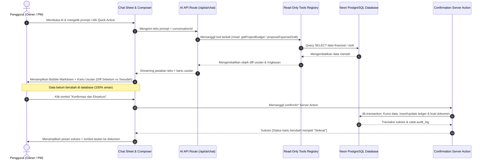

# Anatomi Elemen UI/UX — AI Assistant Paduna Build

Dokumen ini adalah panduan referensi lengkap mengenai seluruh komponen antarmuka, tata letak, hierarki visual, dan alur interaksi fitur **AI Assistant** di Paduna Build.

---

## 1. Filosofi Desain & Prinsip Kerja

Fitur AI Assistant Paduna Build dirancang dengan prinsip **Calm Modern Luxury & Human-in-the-Loop**:

1. **Transparan & Akuntabel**: Pengguna selalu melihat dari mana data diambil melalui _Tool Trace_, sehingga tidak ada angka halusinasi.
2. **Aman & Non-Destruktif**: Model bahasa (LLM) berjalan 100% _Read-Only_. AI tidak bisa memutasi data secara mandiri; perubahan baru terjadi ketika manusia menekan tombol konfirmasi pada _Proposal Card_.
3. **Nyaman Dibaca (_Reading-Anchored_)**: Viewport ditambatkan ke awal giliran pesan terbaru, membiarkan teks mengalir ke bawah tanpa menarik paksa layar pengguna.
4. **Format Kaya & Informatif**: Mendukung tabel responsif, callout peringatan, indikator diff perbandingan, dan chip tindakan lanjutan.

---

## 2. Diagram Visual Hierarki Antarmuka

```
┌──────────────────────────────────────────────────────────┐
│  [1] SHEET HEADER BAR                                    │
│  [Riwayat Sesi]            Asisten AI           [Tutup]  │
├──────────────────────────────────────────────────────────┤
│                                                          │
│  [2] EMPTY STATE (Jika Percakapan Masih Kosong)          │
│  ┌────────────────────────────────────────────────────┐  │
│  │ 🤖 Asisten Cerdas Paduna Build                            │  │
│  │ Panduan Cepat:                                     │  │
│  │ [ + Buat Proyek ]        [ 📝 Catat Biaya ]        │  │
│  │ [ 💳 Bayar Vendor ]      [ 📦 Terima Stok ]        │  │
│  │ Pertanyaan Analisis:                               │  │
│  │ • Proyek mana yang budgetnya kritis?               │  │
│  │ • Berapa posisi saldo kas saat ini?                │  │
│  └────────────────────────────────────────────────────┘  │
│                                                          │
│  [3] USER MESSAGE BUBBLE                                 │
│                                  ┌────────────────────┐  │
│                                  │ "Berapa sisa dana  │  │
│                                  │  di Sudirman?"     │  │
│                                  └────────────────────┘  │
│                                                          │
│  [4] TOOL TRACE LIST (Jejak Pengambilan Data)            │
│  ✓ 2 sumber data dibaca ▸                                │
│    • Membaca daftar proyek                               │
│    • Membaca budget dan realisasi biaya                  │
│                                                          │
│  [5] ASSISTANT RICH BUBBLE (Teks, Tabel, Alert)          │
│  ┌────────────────────────────────────────────────────┐  │
│  │ Proyek **Sudirman Suites** memiliki sisa budget:   │  │
│  │                                                    │  │
│  │ | Kategori  | Alokasi   | Sisa        | Status |   │  │
│  │ | Material  | Rp 378 Jt | -Rp 133 Jt  | Over   |   │  │
│  │ | Tukang    | Rp 194 Jt | Rp 194 Jt   | Aman   |   │  │
│  │                                                    │  │
│  │ > [!WARNING]                                       │  │
│  │ > Kategori Material telah melewati batas anggaran. │  │
│  └────────────────────────────────────────────────────┘  │
│                                                          │
│  [6] READ-ONLY RESULT CARD (Kartu Visual Pendukung)      │
│  ┌────────────────────────────────────────────────────┐  │
│  │ REALISASI BUDGET PROYEK                            │  │
│  │ Sudirman Suites                  35% Selesai       │  │
│  │ • Material  [====!] Rp 511 Jt / Rp 378 Jt (135%)   │  │
│  │ [ Buka Budget Proyek ↗ ]                           │  │
│  └────────────────────────────────────────────────────┘  │
│                                                          │
│  [7] INTERACTIVE PROPOSAL CARD (Kartu Usulan + Diff)     │
│  ┌────────────────────────────────────────────────────┐  │
│  │ USULAN PENGAJUAN BIAYA                     [Usulan]│  │
│  │ Sudirman Suites - Pembelian Cat 5 Pail             │  │
│  │ Rincian: 5 × Rp 150.000                            │  │
│  │ Total Biaya: Rp 750.000                            │  │
│  │ ────────────────────────────────────────────────── │  │
│  │ DAMPAK BUDGET KATEGORI                             │  │
│  │ Sisa Material: Rp 343.000.000  →  Rp 342.250.000   │  │
│  │ ────────────────────────────────────────────────── │  │
│  │ [       Konfirmasi dan Ajukan (1-Klik)           ] │  │
│  └────────────────────────────────────────────────────┘  │
│                                                          │
│  [8] FOLLOW-UP CHIPS (Langkah Berikutnya)                │
│  ( Mengapa material over budget? )  ( Cek saldo kas )    │
│                                                          │
├──────────────────────────────────────────────────────────┤
│  [9] CHAT COMPOSER                                       │
│  [ Ketik pesan atau instruksi operasional…       ] [ ↗ ] │
└──────────────────────────────────────────────────────────┘
```

---

## 3. Rincian 9 Komponen & Lokasi Kode

### 1. Sheet Container & Floating Launcher

- **Lokasi Kode**: [`apps/web/features/ai-chat/components/ai-chat-sheet.tsx`](file:///Volumes/DekoriaSSD/App%20Projects/Websites/atria-erp/apps/web/features/ai-chat/components/ai-chat-sheet.tsx) & [`ai-chat-fab.tsx`](file:///Volumes/DekoriaSSD/App%20Projects/Websites/atria-erp/apps/web/features/ai-chat/components/ai-chat-fab.tsx)
- **Peran**:
  - Modal laci bawah (_sliding drawer_) berbasis Framer Motion dengan estetika iOS modern (`surface-container-low`, radius atas `rounded-t-[28px]`, pull handle bar).
  - Mengelola _lifecycle_ koneksi AI SDK stream, sesi percakapan aktif, dan riwayat.
- **Interaksi**:
  - Tombol melayang (_Floating Action Button / FAB_) di sudut kanan bawah dashboard membuka sheet dengan transisi pegas halus (`transitionSpringSmooth`).

---

### 2. Empty State & Quick Action Chips

- **Lokasi Kode**: [`apps/web/features/ai-chat/components/chat-empty-state.tsx`](file:///Volumes/DekoriaSSD/App%20Projects/Websites/atria-erp/apps/web/features/ai-chat/components/chat-empty-state.tsx)
- **Peran**:
  - Tampilan pertama saat pengguna membuka asisten pada percakapan baru.
  - Menghilangkan _writer's block_ dengan memberikan 4 kartu alur terpandu (_Buat Proyek Baru_, _Catat Pengeluaran_, _Bayar Tagihan Vendor_, _Terima Barang Gudang_) serta rekomendasi pertanyaan finansial mendalam.
- **Interaksi**:
  - Menekan salah satu chip langsung mengirim instruksi ke asisten dan memulai alur percakapan terpandu secara otomatis.

---

### 3. Conversation History Picker & Switcher

- **Lokasi Kode**: [`apps/web/features/ai-chat/components/conversation-picker.tsx`](file:///Volumes/DekoriaSSD/App%20Projects/Websites/atria-erp/apps/web/features/ai-chat/components/conversation-picker.tsx)
- **Peran**:
  - Memungkinkan pengguna beralih antar sesi percakapan terdahulu atau memulai sesi baru dari awal.
  - Setiap sesi menyimpan _history_ pesan, kartu usulan, dan status konfirmasi yang telah tereksekusi.

---

### 4. Tool Trace Indicator (Jejak Pengambilan Data)

- **Lokasi Kode**: [`apps/web/features/ai-chat/components/tool-trace.tsx`](file:///Volumes/DekoriaSSD/App%20Projects/Websites/atria-erp/apps/web/features/ai-chat/components/tool-trace.tsx) & [`tool-labels.ts`](file:///Volumes/DekoriaSSD/App%20Projects/Websites/atria-erp/apps/web/features/ai-chat/utils/tool-labels.ts)
- **Peran**:
  - Memberikan transparansi real-time kepada pengguna tentang tabel/fungsi database apa yang sedang diakses AI (misal: _"Membaca saldo kas rekening"_, _"Menghitung kebutuhan material"_).
- **Interaksi**:
  - Saat aktif: Ikon berputar dengan animasi denyut (_pulse animation_).
  - Saat selesai: Terlipat secara elegan menjadi satu baris badge ringkasan centang (misal: _"✓ 2 sumber data dibaca"_). Pengguna dapat menekan badge ini untuk membuka detail riwayat tool jika diperlukan.

---

### 5. Assistant Bubble & Rich Markdown Engine

- **Lokasi Kode**: [`apps/web/features/ai-chat/components/chat-markdown.tsx`](file:///Volumes/DekoriaSSD/App%20Projects/Websites/atria-erp/apps/web/features/ai-chat/components/chat-markdown.tsx) & [`chat-bubble.tsx`](file:///Volumes/DekoriaSSD/App%20Projects/Websites/atria-erp/apps/web/features/ai-chat/components/chat-bubble.tsx)
- **Peran**:
  - Merender setiap episode `TextUIPart` sebagai bubble independen, sementara token lanjutan memperbarui bubble aktif tanpa membuat pesan baru.
  - Menjaga seluruh bubble itu tetap berada dalam satu giliran asisten dan satu riwayat pesan yang sama.
- **Kemampuan Format**:
  - **Multi-bubble streaming**: Bubble baru muncul hanya ketika text part baru menerima teks bermakna; history dibuka tanpa entrance animation.
  - **Tabel Markdown**: Otomatis dibungkus dalam kontainer putih halus dengan _horizontal scroll_ agar rapi di layar ponsel 320px–430px.
  - **Callout Peringatan / Alert**: Blok `> [!WARNING]`, `> [!TIP]`, `> [!NOTE]` dengan ikon semantik dan kontainer warna lembut.
  - **Blok Kode**: Blok berpagar abu-abu netral dengan font monospaced dan badge bahasa.

---

### 6. Read-Only Result Cards (Kartu Ringkasan Data)

- **Lokasi Kode**: [`apps/web/features/ai-chat/components/tool-results/`](file:///Volumes/DekoriaSSD/App%20Projects/Websites/atria-erp/apps/web/features/ai-chat/components/tool-results/)
  - `bank-balances-result.tsx` (Saldo per rekening bank & total kas likuid)
  - `project-budget-result.tsx` (Realisasi budget 5 kategori & indikator over-budget)
  - `upcoming-bills-result.tsx` (Daftar tagihan vendor mendekati jatuh tempo)
  - `lookup-results.tsx` (Katalog material & stok fisik, daftar vendor, invoice klien)
- **Peran**:
  - Menampilkan ringkasan visual terstruktur di bawah jawaban teks sehingga pengguna tidak perlu membaca angka mentah satu per satu. Dilengkapi tombol tautan langsung (_deep link_) ke modul ERP terkait.

---

### 7. Interactive Action Proposal Cards (Kartu Usulan + Diff)

- **Lokasi Kode**: [`apps/web/features/ai-chat/components/proposal-cards/`](file:///Volumes/DekoriaSSD/App%20Projects/Websites/atria-erp/apps/web/features/ai-chat/components/proposal-cards/)
  - `create-project-proposal-card.tsx` (Usulan proyek baru: Klien, PM, Nilai Kontrak)
  - `setup-budget-proposal-card.tsx` (Usulan alokasi budget 5 kategori: Cap internal & Target margin)
  - `vendor-payment-proposal-card.tsx` (Usulan pembayaran tagihan: Diff saldo kas sebelum vs sesudah)
  - `client-payment-proposal-card.tsx` (Usulan penerimaan termin klien: Diff kas masuk & sisa piutang)
  - `goods-receipt-proposal-card.tsx` (Usulan penerimaan barang gudang: Diff stok fisik on-hand)
  - `expense-proposal-card.tsx` (Usulan pengeluaran lapangan: Diff sisa budget kategori)
  - `expense-review-proposal-card.tsx` (Persetujuan/penolakan klaim pengeluaran oleh Owner)
- **Peran**:
  - **Pintu Eksekusi Human-in-the-Loop**: Kartu menampilkan semua rincian yang akan tercatat, perbandingan nilai **Sebelum $\rightarrow$ Sesudah**, status badge ringkas (`Usulan` / `Selesai`), serta tombol konfirmasi 1-klik.
- **Keamanan Idempoten**:
  - Eksekusi dicatat pada database (`ai_proposal_confirmation`) dengan `toolCallId`. Jika halaman di-refresh, tombol otomatis berganti menjadi status _"Selesai"_ dan tidak akan memicu dokumen ganda.

---

### 8. Follow-Up Suggestion Chips (Rekomendasi Lanjutan)

- **Lokasi Kode**: [`apps/web/features/ai-chat/components/follow-up-chips.tsx`](file:///Volumes/DekoriaSSD/App%20Projects/Websites/atria-erp/apps/web/features/ai-chat/components/follow-up-chips.tsx)
- **Peran**:
  - AI secara proaktif menganalisis kondisi konteks dan memberikan 2–3 pilihan pertanyaan atau langkah aksi lanjutan logis berbentuk tombol kapsul (_chips_) di akhir balasan.
- **Interaksi**:
  - Mengklik chip akan langsung mengirimkan pertanyaan lanjutan tersebut tanpa perlu mengetik manual.

---

### 9. Chat Composer (Kotak Input Pesan)

- **Lokasi Kode**: [`apps/web/features/ai-chat/components/chat-composer.tsx`](file:///Volumes/DekoriaSSD/App%20Projects/Websites/atria-erp/apps/web/features/ai-chat/components/chat-composer.tsx)
- **Peran**:
  - Input teks mandiri dengan radius penuh (_rounded-full_, min tinggi 48px sesuai standar form iOS Paduna Build).
  - Tombol kirim berkapsul dengan transisi otomatis ke ikon putar _loading_ saat asisten sedang berpikir atau menjalankan stream.

---

## 4. Alur Interaksi (User Journey)



---

## 5. Panduan & Ide Peningkatan Berkelanjutan (Roadmap)

Berdasarkan penggunaan langsung di lapangan, berikut adalah area yang dapat ditingkatkan secara bertahap:

1. **Quick-Edit pada Proposal Card**:
   - Menambahkan tombol _"Edit Kecil"_ (misal: mengganti rekening sumber atau nominal unit) langsung di dalam kartu usulan sebelum menekan tombol konfirmasi, tanpa perlu mengetik instruksi baru ke chat.
2. **Preset Prompt per Peran (Role-Based Chips)**:
   - Menampilkan Quick Action yang berbeda di _Empty State_:
     - **Owner**: Ringkasan margin, persetujuan biaya, saldo rekening kas bank.
     - **Project Manager**: Form pengeluaran lapangan, status material proyek, progres fisik.
     - **Purchasing**: Penerimaan barang masuk (_Goods Receipt_), tagihan vendor jatuh tempo.
3. **Voice Input / Audio Memo (Opsional)**:
   - Memungkinkan PM di lapangan merekam pesan suara singkat untuk mencatat pengeluaran harian langsung diubah menjadi draf usulan biaya oleh AI.
4. **Ekspor Ringkasan Chat**:
   - Tombol ekspor analisis keuangan atau hasil rapat singkat ke format PDF/WhatsApp memo untuk dikirimkan ke klien atau tim internal.
