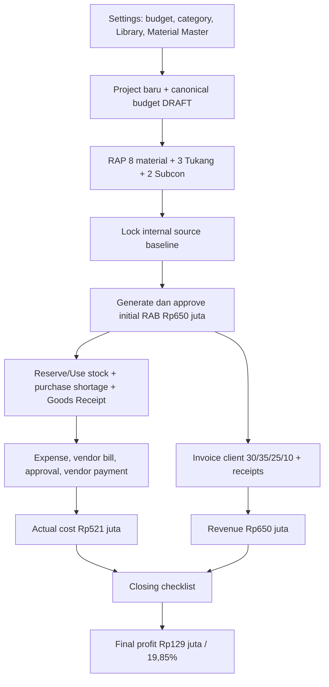

# Tutorial Lengkap Atria ERP — Project Baru sampai Selesai

Dokumen ini bukan daftar fitur. Ini adalah satu simulasi linear yang dapat diikuti dari atas ke bawah untuk memahami hubungan Settings, Project Budget, RAP, RAB, stock, expense, vendor, invoice client, profit, dan closing.

Terakhir diaudit terhadap seed dan implementasi aplikasi: **20 Juni 2026**.

---

## Hasil akhir simulasi

Kita akan menjalankan project residential fit-out kitchen, living room, dan wardrobe dengan hasil akhir berikut:

| Nilai akhir | Target |
|---|---:|
| Revenue / current approved RAB | Rp650.000.000 |
| Internal Budget Cap | Rp585.000.000 |
| Material actual | Rp255.000.000 |
| Tukang actual | Rp145.000.000 |
| Subcon actual | Rp85.000.000 |
| Operasional actual | Rp26.000.000 |
| Lain-lain actual | Rp10.000.000 |
| Total final cost | Rp521.000.000 |
| Realized gross profit | Rp129.000.000 |
| Realized margin | 19,85% |

Jangan langsung mengejar angka akhirnya. Ikuti urutan tutorial karena setiap nilai berasal dari transaksi yang berbeda.

---

# BAGIAN A — Menyiapkan sandbox

## Step 0 — Reset ke data seed

Jalankan seed bila database pernah dipakai untuk testing:

```bash
bun db/seed.ts
```

Seed menyediakan project khusus tutorial:

- Project: **Brawijaya Residence - RAB Sandbox**
- Project Value referensi: **Rp650.000.000**
- Project Manager: **Budi Santoso**
- Canonical budget: **DRAFT**
- RAP: belum ada
- RAB: belum ada
- Client invoice: belum ada
- Expense project: belum ada

Project ini adalah checkpoint “project baru” yang sudah dibuatkan oleh seed agar tutorial dapat memakai ID, client, material, vendor, dan rekening yang konsisten.

Jika ingin menguji form **Buat Proyek Baru**, lakukan setelah menyelesaikan tutorial ini. Project dari form baru dimulai dengan contract value Rp0; contract value final baru ditetapkan ketika RAB pertama disetujui.

## Step 1 — Login sebagai Owner

1. Buka `/login`.
2. Isi:
   - Email: `ronald@dekoria.com`
   - Password: `password123`
3. Klik **Masuk Sistem**.

Owner dipakai pada awal tutorial untuk membaca Settings dan memastikan source of truth harga benar.

---

# BAGIAN 0 — Memahami Dashboard Finansial (`/ledger`)

Halaman utama setelah Anda login sebagai Owner (`ronald@dekoria.com`) atau Finance Admin (`lisa@dekoria.com`) adalah Dashboard Finansial. Sebelum melangkah lebih jauh, pahami arti dari setiap tab, metrik, dan cara membacanya.

## 1. Metrik Utama (Financial Pulse)
Metrik ini adalah indikator kesehatan keuangan Dekoria secara real-time yang selalu terlihat di atas dashboard:
*   **Kas Tersedia (Cash Available)**: Jumlah seluruh saldo rekening kas/bank aktif (e.g., BCA Operasional, Kas Besar, dsb). Jika ada transaksi pengeluaran (paid claims/payment), nilai ini langsung berkurang. Jika ada pembayaran dari client, nilai ini bertambah.
*   **Piutang Terbuka (Receivables Outstanding)**: Sisa termin invoice yang telah ditagihkan ke client namun statusnya belum lunas/paid (`UNPAID` atau `PARTIALLY_PAID`). Ini adalah dana masa depan yang dijadwalkan masuk ke kas Dekoria.
*   **Hutang Terbuka (Payables Outstanding)**: Tagihan dari vendor (vendor bills) untuk pengadaan material atau subkon yang statusnya belum dibayar lunas. Ini adalah kewajiban kas keluar yang harus segera dijadwalkan pembayarannya.
*   **Rencana Margin (Projected Margin)**: Nilai kontrak berjalan dari semua proyek aktif dikurangi dengan anggaran/internal budget proyek tersebut.

## 2. Navigasi Tab Dashboard Finansial
Gunakan segmented tabs di bagian bawah metrik utama untuk melihat detail operasional:

### Tab A: Ringkasan
Ini adalah landing page dashboard Anda:
*   **Posisi Finansial**: Kas, piutang, hutang, kewajiban dekat, budget terpakai, sisa budget, dan margin proyeksi.
*   **Prioritas**: Maksimal tiga tindakan paling penting sesuai role.
*   **Preview Risiko**: Project berisiko, jatuh tempo terdekat, perhatian material, dan perubahan kas terbaru.

### Tab B: Persetujuan (Approvals) — *Khusus Role Owner*
Semua pengajuan yang membutuhkan persetujuan Owner berkumpul di sini. Owner harus memeriksa detail pengaju sebelum menyetujui:
*   **Field Claims (Pengeluaran Lapangan)**: Pengajuan kas kecil oleh PM yang nilainya melebihi limit kategori budget atau terjadi overrun. Statusnya harus `VERIFIED` oleh Finance sebelum masuk ke antrean Owner.
*   **Vendor Payments**: Rencana pembayaran tagihan vendor yang bernilai Rp5.000.000 atau lebih.

### Tab C: Budget
Tab ini memberikan deteksi dini kebocoran budget proyek:
*   Menganalisis perbandingan antara **Allocated** (budget yang dialokasikan ke kategori seperti Material, Tukang, dsb) dengan **Actual Spent** (pengeluaran riil) dan **Pending** (pengeluaran yang sedang diajukan/diverifikasi).
*   Membaca status risiko per kategori:
    *   `SAFE`: Pengeluaran masih jauh di bawah alokasi.
    *   `WATCH`: Pengeluaran mencapai 80%–100% dari alokasi.
    *   `CRITICAL`: Pengeluaran melebihi 100% dari alokasi (over budget).

### Tab D: Jatuh Tempo
Tab ini memetakan arus kas keluar-masuk jangka pendek:
*   Dokumen terbuka dikelompokkan menjadi **Terlambat**, **Hari Ini**, **7 Hari ke Depan**, dan **Berikutnya**.
*   Nominal selalu menggunakan sisa outstanding setelah pembayaran parsial.
*   Membantu Finance Admin menyusun prioritas pembayaran vendor agar tidak terkena denda atau penahanan material.

### Tab E: Rekening
Menampilkan total kas, cakupan kewajiban dekat, rekening aktif/tidak aktif, saldo, transaksi terakhir, dan status rekonsiliasi. Operasi kas dibuka melalui detail rekening.

### Tab F: Material
Menampilkan kompilasi masalah pergudangan di seluruh proyek Dekoria:
*   **RAP Shortage**: Material di dalam RAP proyek yang jumlah kebutuhan fisiknya melebihi stok tersedia di gudang (`needToBuy > 0`), sehingga Anda wajib melakukan pembelian (vendor bill).
*   **Low Stock Alerts**: Material yang stok fisiknya di gudang berada di bawah batas minimum pengaman (`minimumStock` / buffer).

AI CFO briefing sedang ditunda dan tidak memiliki menu, halaman, atau pipeline aktif pada tahap ini. AI OCR nota tetap tersedia pada flow expense.

---

# BAGIAN B — Memahami Settings sebelum membuat RAP

## Step 2 — Periksa Budget Allocation Settings

1. Buka menu navigasi.
2. Masuk ke **Pengaturan ERP** (atau `/settings`).
3. Pilih tab **Budget Allocation** (atau `/settings/budget`).
4. Pastikan nilai berikut terlihat:

| Setting | Nilai seed |
|---|---:|
| Internal Budget Cap | 90% Project Value |
| Tukang | 18% Internal Budget |
| Material | 35% Internal Budget |
| Operasional | 1% Internal Budget |
| Lain-lain | 0,5% Internal Budget |
| Subcon | 0% Internal Budget |
| Total category allocation | 54,5% Internal Budget |
| Unallocated Buffer | 45,5% Internal Budget |

### Yang harus dipahami

Untuk Project Value Rp650.000.000:

1. Internal Budget = 90% × Rp650.000.000 = **Rp585.000.000**.
2. Target Gross = Rp650.000.000 − Rp585.000.000 = **Rp65.000.000**.
3. Default category allocation = 54,5% × Rp585.000.000 = **Rp318.825.000**.
4. Unallocated Buffer = 45,5% × Rp585.000.000 = **Rp266.175.000**.

**Unallocated Buffer bukan profit.** Buffer adalah bagian Internal Budget yang belum diberikan ke kategori.

## Step 3 — Periksa Item & Price Library

1. Masih di Pengaturan ERP, buka tab **Item & Price Library** (atau `/settings/library`).
2. Cari **Installation Crew Package**.
3. Kartu harus menunjukkan:
   - Internal Cost: **Rp45.000.000**
   - Suggested Client Price: **Rp56.250.000**
   - Gross Margin: **20%**
   - Cost components: **5**
4. Klik tombol edit untuk membaca breakdown tanpa perlu menyimpan perubahan.

Breakdown seed:

| Cost component | Nilai |
|---|---:|
| Kepala tukang 10 hari | Rp6.000.000 |
| Empat installer / 40 orang-hari | Rp26.000.000 |
| Alat dan consumable | Rp4.000.000 |
| Mobilisasi | Rp3.500.000 |
| Supervision dan contingency | Rp5.500.000 |
| Total Internal Cost | Rp45.000.000 |

Harga client dihitung:

`Rp45.000.000 ÷ (1 − 20%) = Rp56.250.000`

Library adalah template. Ketika dipakai di project, data disalin menjadi snapshot. Mengubah Library besok tidak mengubah RAP/RAB project lama.

## Step 4 — Periksa Material Master

1. Buka tab **Material Master** di Pengaturan ERP (atau `/settings/materials`), atau halaman **Material & Stok** (navigasi utama).
2. Pastikan delapan material berikut tersedia:

| Material seed | Unit | Current stock | Average cost |
|---|---:|---:|---:|
| Multipleks 18mm Meranti | lembar | 35 | Rp245.000 |
| HPL Taco Light Oak T-123 | lembar | 12 | Rp190.000 |
| Solid Surface White Countertop | meter | 4 | Rp1.950.000 |
| MDF 12mm Moisture Resistant | lembar | 18 | Rp180.000 |
| Cabinet Hardware Set Soft-close | set | 24 | Rp725.000 |
| PU Finishing System | paket | 3 | Rp3.800.000 |
| LED Strip & Driver 24V | meter | 35 | Rp210.000 |
| Mirror 5mm Bevel | m² | 8 | Rp475.000 |

Material Master adalah barang yang dikontrol stock-nya. Library adalah template harga/scope yang dapat memakai Material Master tersebut.

---

# BAGIAN C — Membuka project baru dan membaca budget

## Step 5 — Buka project tutorial

1. Buka menu **Proyek**.
2. Pilih **Brawijaya Residence - RAB Sandbox**.
3. Buka tab **Overview**.

Pada kondisi awal:

- Project sudah `ACTIVE`.
- Project Budget masih `DRAFT`.
- RAP belum ada.
- RAB belum approved.
- Tab operasional tertentu masih terkunci sampai initial RAB disetujui.

## Step 6 — Pahami category budget awal

Nilai referensi project seed adalah Rp650.000.000, sehingga default category budget adalah:

| Category | Default allocation |
|---|---:|
| Material | Rp204.750.000 |
| Tukang | Rp105.300.000 |
| Operasional | Rp5.850.000 |
| Lain-lain | Rp2.925.000 |
| Subcon | Rp0 |

Rencana project kita lebih besar dari default category allocation. Target final actual-nya:

| Category | Allocation yang sehat | Planned actual |
|---|---:|---:|
| Material | Rp270.000.000 | Rp255.000.000 |
| Tukang | Rp155.000.000 | Rp145.000.000 |
| Subcon | Rp90.000.000 | Rp85.000.000 |
| Operasional | Rp30.000.000 | Rp26.000.000 |
| Lain-lain | Rp12.000.000 | Rp10.000.000 |
| Unallocated Buffer tersisa | Rp28.000.000 | — |

### Status implementasi UI

Backend `reallocateProjectBudget` sudah transactional, memvalidasi total maksimal 100%, dan mewajibkan alasan untuk approved budget. Namun editor reallocation project-level belum tersedia sebagai form lengkap di Project Detail.

Artinya, pada tutorial UI saat ini lu dapat melanjutkan dengan default allocation, tetapi beberapa category akan terlihat over budget. Itu bukan error perhitungan; itu menandakan buffer belum direalokasikan. Ini adalah gap UI yang masih perlu diselesaikan.

---

# BAGIAN D — Membuat RAP 8 material

## Step 7 — Login sebagai PM

1. Logout dari Owner.
2. Login:
   - Email: `budi@dekoria.com`
   - Password: `password123`
3. Buka menu **Proyek** → pilih **Brawijaya Residence - RAB Sandbox** → buka tab **RAP**.

## Step 8 — Buat RAP Draft

1. Pada panel **RAP Material**, klik **Create RAP Draft**.
2. Tunggu status berubah menjadi `DRAFT`.
3. Tombol **Add RAP Material** (atau `+` button) sekarang aktif.

## Step 9 — Tambahkan Multipleks

1. Klik **Add RAP Material** (atau `+` button).
2. Pada form bottom sheet, tentukan:
   - **Gunakan template Library**: `Multipleks 18mm Meranti`
   - **Area / Ruangan**: `Kitchen + Wardrobe`
   - **Nama Material**: `Multipleks 18mm Meranti` (otomatis terisi)
   - **Jumlah Dibutuhkan**: `205`
   - **Buffer**: `10`
   - **Sumber Pemenuhan**: `Stock + Purchase`
   - **Catatan Internal**: `Gunakan stock existing lebih dulu; purchase shortage dan cutting buffer.`
3. Klik **Save RAP Item**.

Yang tersimpan:

- Material Master link.
- Internal cost snapshot dari Library.
- Suggested client price snapshot.
- Required, buffer, total needed, available stock, dan need to buy.

## Step 10 — Tambahkan tujuh material lainnya

Ulangi klik **Add RAP Material** → **Gunakan template Library** untuk setiap baris:

| No. | Template | Area | Required | Buffer | Source |
|---:|---|---|---:|---:|---|
| 2 | HPL Taco Light Oak T-123 | Kitchen + Living | 180 | 10 | Stock + Purchase |
| 3 | MDF 12mm Moisture Resistant | Wardrobe | 105 | 5 | Stock + Purchase |
| 4 | Cabinet Hardware Set Soft-close | Semua area | 56 | 4 | Stock + Purchase |
| 5 | Solid Surface White Countertop | Kitchen | 18 | 1 | Stock + Purchase |
| 6 | PU Finishing System | Workshop | 5 | 1 | Stock + Purchase |
| 7 | LED Strip & Driver 24V | Semua area | 75 | 5 | Stock + Purchase |
| 8 | Mirror 5mm Bevel | Wardrobe + Living | 34 | 2 | Stock + Purchase |

Setelah selesai, RAP harus menampilkan **8 material items**.

## Step 11 — Review lalu lock RAP

Sebelum lock, periksa setiap kartu:

- total quantity = required + buffer;
- available stock;
- need to buy;
- internal planned cost;
- source stock/purchase;
- tidak ada material yang salah unit.

Kemudian:

1. Setelah material selesai, klik **Lanjut ke Tukang** di bagian bawah list.
2. Pada tahap **Tukang**, buat package atau klik **Tidak Digunakan** bila tidak ada. Jika ada package, pastikan statusnya **Siap**. Setelah itu, klik **Lanjut ke Subcon**.
3. Pada tahap **Subcon**, lakukan hal serupa, lalu klik **Lanjut ke Review**.
4. Pada tahap **Review**, klik **Finalisasi Internal Plan** sebagai Owner/Finance.
5. Status RAP berubah dari `DRAFT` menjadi `LOCKED`.
6. Tombol edit/delete item hilang atau ditolak backend.

Locked RAP adalah baseline internal. Jangan membuka baseline lama untuk perubahan scope. Gunakan **Create RAP Revision**.

### Dampak Finansial & Cara Membaca (Lock RAP)
*   **Apa yang Berubah di UI?**
    *   Pada tab **RAP** proyek, status RAP berubah dari `DRAFT` menjadi `LOCKED`.
    *   Tombol **Add RAP Material**, **Edit**, dan **Delete** hilang atau dinonaktifkan.
    *   Total planned internal cost (nilai estimasi biaya internal total) proyek sekarang terlihat terkunci pada panel summary.
*   **Apa Efek Keuangannya?**
    *   Aksi ini **tidak memicu pergerakan kas** (kas bank tetap) dan belum memicu pencatatan biaya riil.
    *   Aksi ini bertindak sebagai **baseline kontrol biaya internal** (RAP). Anggaran belanja material maksimal yang direncanakan terkunci untuk mencegah PM mengubah scope secara sepihak.

---

# BAGIAN E — Membuat 3 Tukang dan 2 Subcon packages

1. Pastikan Anda berada di tahap **Tukang** pada tab RAP.
2. Klik **Tambah Package**.
3. Pada form bottom sheet, tentukan:
   - **Gunakan template Library**: pilih `Tukang · Workshop Cabinetry Production`
   - **Budget Category**: `Tukang`
   - **Area / Scope**: `Kitchen + Living + Wardrobe`
   - **Nama Package**: `Workshop Cabinetry Production` (otomatis terisi)
   - **Jumlah**: `1`
   - **Satuan**: `ls`
4. Klik **Save Package**.
5. Package baru tersimpan sebagai `DRAFT`. Klik item package tersebut untuk membuka detailnya, lalu klik **Tandai Siap** (di panel detail package).
6. Pastikan status package berubah menjadi **Siap** sebelum lanjut.

Expected Internal Cost: **Rp80.000.000**.

## Step 13 — Tambahkan dua Tukang packages lainnya

Ulangi langkah yang sama:

| Template | Area | Qty | Internal Cost |
|---|---|---:|---:|
| Installation Crew Package | Site — semua area | 1 ls | Rp45.000.000 |
| Finishing & Snagging Crew | Site — closeout | 1 ls | Rp20.000.000 |

Setelah setiap package disimpan, buka detailnya lalu klik **Tandai Siap**. Ketiga Tukang packages harus berstatus **Siap** sebelum dapat dipilih sebagai source RAB.

1. Klik **Lanjut ke Subcon** di bagian bawah panel Tukang untuk membuka tahap Subcon.
2. Klik **Tambah Package** pada panel **Subcon**.
3. Pada form bottom sheet, tentukan template, area, jumlah, dan satuan:

| Template | Vendor default | Area | Internal Cost |
|---|---|---|---:|
| Countertop Fabrication Package | CV Batu Prima Countertop | Kitchen | Rp41.000.000 |
| Glass & Electrical Specialist Package | PT Sinar Kaca & Electrical | Living + Wardrobe | Rp44.000.000 |

Total planned Subcon = **Rp85.000.000**.

Setelah masing-masing package disimpan, buka detailnya lalu klik **Tandai Siap**. Kedua Subcon packages harus berstatus **Siap** sebelum dapat dipilih sebagai source RAB.

### Kalau tombol Add Work Package disabled

Periksa tiga hal:

1. Role harus Owner, Finance, atau PM project tersebut.
2. Canonical budget project harus mempunyai category `TUKANG`/`SUBCON`.
3. Project harus sesuai scope PM.

RAP Material yang sudah locked tidak seharusnya memblokir penambahan Tukang/Subcon package. Package mempunyai lifecycle sendiri.

---

# BAGIAN F — Membuat initial RAB Rp650 juta

## Step 15 — Login kembali sebagai Owner

1. Logout dari PM.
2. Login `ronald@dekoria.com` / `password123`.
3. Buka project Brawijaya → tab **RAB**.

Pada panel **Pilih source quotation**:

1. Centang 8 RAP Material items.
2. Centang 3 Tukang packages yang sudah `ACTIVE`.
3. Centang 2 Subcon packages yang sudah `ACTIVE`.
4. Buka accordion **Tambahkan item manual pertama** di bagian bawah, lalu isi:
   - **Nama item**: `Project coordination & logistics`
   - **Deskripsi untuk client**: `Koordinasi proyek, dokumentasi, dan administrasi pelaksanaan.`
   - **Jumlah**: `1`
   - **Satuan**: `ls`
   - **Harga satuan client**: `10000000`
5. Klik **Generate Draft dari 14 Source** (angka source bisa bertambah atau berbeda tergantung input manual).

## Step 17 — Review draft RAB

Draft RAB memang menampilkan kembali setiap material dan package yang dipilih. Itu perilaku yang benar: setiap baris masih membawa snapshot quantity, unit, dan source project.

**Jangan mengubah semua Qty menjadi 1.** Pertahankan Qty dan Unit material sesuai RAP. Qty `1` hanya dipakai pada Work/Subcon Package yang sejak awal memang dibuat sebagai satu `ls`/paket.

Arti field pada setiap quotation line:

- **Qty**: quantity client-facing yang berasal dari source; untuk material biasanya sama dengan total required + buffer.
- **Unit**: satuan client-facing, misalnya lembar, meter, set, m², atau ls.
- **Unit Price**: harga jual per unit kepada client, bukan internal cost.
- **Line Total**: Qty × Unit Price; dihitung otomatis.
- **Hide**: mengeluarkan baris dari visible total RAB. Gunakan hanya bila baris tidak boleh ditagihkan/ditampilkan.
- **Named Bundle**: menggabungkan minimal dua quotation line menjadi satu baris paket client. Detail member tetap tersimpan dan hanya terlihat internal; total memakai harga paket, bukan menjumlahkan member lagi.
- **Save Quotation Item**: menyimpan perubahan pada baris tersebut; lakukan pada setiap baris yang diedit.

Untuk mencapai commercial total tutorial, pertahankan quantity material dan ubah Unit Price sebagai berikut:

### Material client-safe rows

| Source internal | Qty × Unit | Client label | Client Unit Price | Target Line Total |
|---|---:|---|---:|---:|
| Multipleks | 215 lembar | Kitchen cabinetry core material | Rp372.093,02 | ±Rp80.000.000 |
| HPL | 190 lembar | Decorative laminate finishing | Rp289.473,68 | ±Rp55.000.000 |
| MDF | 110 lembar | Wardrobe internal panel material | Rp318.181,82 | ±Rp35.000.000 |
| Hardware | 60 set | Premium soft-close hardware | Rp1.000.000 | Rp60.000.000 |
| Solid surface | 19 meter | Kitchen countertop material | Rp2.894.736,84 | ±Rp55.000.000 |
| PU finishing | 6 paket | Workshop finishing material | Rp5.833.333,33 | ±Rp35.000.000 |
| LED | 80 meter | Integrated furniture lighting | Rp312.500 | Rp25.000.000 |
| Mirror | 36 m² | Wardrobe and feature mirror | Rp694.444,44 | ±Rp25.000.000 |

Subtotal material-facing RAB ≈ **Rp370.000.000**. Selisih rupiah kecil dapat muncul karena Unit Price disimpan dua desimal; koreksi selisih tersebut pada manual coordination line saat final commercial review.

### Tukang client-safe rows

| Source | Qty × Unit | Client label | Unit Price / Line Total |
|---|---:|---|---:|
| Workshop Cabinetry Production | 1 ls | Custom furniture production | Rp85.000.000 |
| Installation Crew Package | 1 ls | Site installation works | Rp55.000.000 |
| Finishing & Snagging Crew | 1 ls | Final finishing and closeout | Rp30.000.000 |

Subtotal Tukang-facing RAB = **Rp170.000.000**.

### Subcon client-safe rows

| Source | Qty × Unit | Client label | Unit Price / Line Total |
|---|---:|---|---:|
| Countertop Fabrication | 1 ls | Countertop fabrication & installation | Rp55.000.000 |
| Glass & Electrical Specialist | 1 ls | Glass, mirror & specialist electrical | Rp45.000.000 |

Subtotal Subcon-facing RAB = **Rp100.000.000**.

Manual coordination line dimulai dari **Rp10.000.000**. Sesuaikan beberapa rupiah bila diperlukan agar visible total tepat Rp650.000.000 setelah pembulatan material Unit Price.

Total visible RAB:

`Rp370.000.000 + Rp170.000.000 + Rp100.000.000 + Rp10.000.000 = Rp650.000.000`

Untuk setiap line yang diubah:

1. Edit label, description, dan Unit Price. Edit Qty/Unit hanya bila scope client-facing memang berbeda dari source dan perubahan itu telah direview.
2. Bila ingin menyederhanakan quotation, klik **Buat Paket Quotation**, pilih minimal dua line, beri nama paket, lalu periksa harga paket. Harga awal otomatis sebesar jumlah member dan dapat dioverride untuk keputusan commercial.
3. Gunakan **Hide** hanya bila line tidak boleh masuk visible total.
4. Klik **Save Quotation Item**.

### Contoh Named Bundle

1. Klik **Buat Paket Quotation** setelah line standalone tersimpan.
2. Pilih `Kitchen cabinetry core material` dan `Decorative laminate finishing`.
3. Nama paket: `Kitchen Cabinetry Material Package`.
4. Qty `1`, Unit `paket`.
5. Pertahankan suggested price sebesar jumlah kedua line agar total quotation tidak berubah.
6. Klik **Simpan Paket**.

Client melihat satu paket; tim internal tetap dapat membaca source member. Membongkar paket saat RAB masih `DRAFT` mengembalikan member menjadi line standalone.

## Step 18 — Approve initial RAB

1. Pastikan visible total tepat **Rp650.000.000**.
2. Klik **Approve Quotation**.

Expected result:

- RAB revision 1 menjadi `APPROVED`.
- Project contract value menjadi Rp650.000.000.
- Approved RAB value menjadi Rp650.000.000.
- Internal Budget menjadi Rp585.000.000.
- Canonical budget menjadi `APPROVED`.
- Source RAP/package yang digunakan dikunci.
- Tab operational project terbuka.
- Audit log approval dibuat.

Invoice client belum dibuat pada tahap ini.

### Dampak Finansial & Cara Membaca (Approve RAB)
*   **Apa yang Berubah di UI?**
    *   Pada detail proyek (Overview), **Nilai Kontrak** (Contract Value) berubah dari Rp0 menjadi Rp650.000.000.
    *   **Internal Budget** berubah menjadi Rp585.000.000 (90% dari nilai kontrak).
    *   Kategori budget proyek terisi dengan alokasi otomatis (Material Rp204.750.000, Tukang Rp105.300.000, dsb).
    *   Tab **Profit** menampilkan **Target Margin** sebesar Rp65.000.000 (10% dari nilai kontrak).
    *   Tab-tab operasional proyek yang sebelumnya terkunci kini terbuka sepenuhnya.
    *   Di halaman Dashboard Finansial (`/ledger`), metrik **Piutang Terbuka** belum bertambah karena invoice belum diterbitkan. Namun, **Rencana Margin** global akan meningkat berdasarkan proyeksi proyek ini.
*   **Apa Efek Keuangannya?**
    *   Aksi ini **tidak memengaruhi saldo kas langsung** (belum ada kas masuk atau keluar).
    *   Aksi ini menetapkan baseline pendapatan komersial (RAB) sebesar Rp650 juta dan baseline biaya maksimal (Internal Budget) sebesar Rp585 juta. Selisihnya (Rp65 juta) adalah target laba kotor awal proyek.

---

# BAGIAN G — Simulasi Change Order

Bagian ini opsional untuk first-time walkthrough, tetapi penting untuk memahami kenapa approved quotation tidak boleh ikut berubah saat RAP diedit.

## Step 19 — Buat RAP Revision

1. Buka tab RAP.
2. Pada RAP locked, isi alasan:
   `Client meminta tambahan wardrobe lighting dan pengurangan finishing feature wall.`
3. Klik **Create RAP Revision**.
4. RAP revision 2 dibuat sebagai `DRAFT`; revision 1 tetap `LOCKED`.
5. Edit/tambah material pada revision 2.
6. Lock revision 2.

## Step 20 — Generate RAB Revision

1. Kembali ke tab RAB.
2. Klik **Generate RAB Revision**.
3. Klik **Refresh linked sources**.
4. Tombol refresh hanya aktif bila kartu menampilkan source yang benar-benar stale.
5. Sistem memperbarui quantity/unit/calculated price dari source terbaru, tetapi mempertahankan label client, description, hide, Named Bundle, dan manual lines.

## Step 21 — Approve Formal Change Order

Gunakan simulasi net-zero:

- Tambah wardrobe specialist lighting: +Rp15.000.000.
- Kurangi living feature finishing: −Rp15.000.000.
- Revised contract tetap Rp650.000.000.

1. Pada panel **Aksi draf** di tab RAB, klik **Proses Change Order**.
2. Pada bottom sheet **Proses Change Order**, isi:
   - **Alasan perubahan**: `Perubahan lighting wardrobe dan simplifikasi finish living room.`
   - **Ringkasan scope lama ke baru**: `Tambah lighting wardrobe Rp15 juta, kurangi finish living Rp15 juta.`
   - **Referensi persetujuan client**: `WA-NADIA-CO-001`
   - **Tanggal persetujuan client**: tanggal hari ini.
3. Klik **Setujui Change Order & Revisi**.

Expected result dalam satu transaksi:

- RAB revision 1 menjadi `SUPERSEDED`.
- RAB revision 2 menjadi satu-satunya `APPROVED`.
- Contract dan budget memakai revision 2.
- Source revision baru dikunci.
- Change Order menjadi `APPROVED`.
- Audit log dibuat.

Scroll ke **Revision & Change Order History**, buka RAB R1 → R2, lalu pastikan reason, scope, previous/delta/revised value, source revision, client reference, creator, dan approver dapat dibaca kembali.

### Dampak Finansial & Cara Membaca (Approve Change Order)
*   **Apa yang Berubah di UI?**
    *   Di tab **RAB** detail proyek, revisi 1 berstatus `SUPERSEDED`, dan revisi 2 berstatus `APPROVED`.
    *   Di tab **Overview** proyek, nilai alokasi kategori budget proyek diperbarui berdasarkan revisi baru.
    *   Di halaman Dashboard Finansial (`/ledger`), **Rencana Margin** global terupdate (dalam simulasi net-zero ini margin tidak berubah secara nominal, tetapi baseline aslinya bergeser).
*   **Apa Efek Keuangannya?**
    *   Aksi ini **tidak memengaruhi kas bank secara langsung**.
    *   Aksi ini mendokumentasikan modifikasi formal kontrak komersial dan menyelaraskan alokasi budget internal dengan revisi lapangan baru secara legal dan auditable.

---

# BAGIAN H — Stock existing, purchase shortage, dan Goods Receipt

Global **Material & Stock** sekarang menjadi control center operasional. Bila hanya ada satu lokasi, flow Transfer menyediakan inline create location dan otomatis membuat zero-stock inventory defaults untuk material aktif.

- **Overview** membaca nilai stock, available value, alert, approval, dan quick actions.
- **Inventory** mencari material dan membuka breakdown per location.
- **Needs** membaca shortage lintas project dan kembali ke RAP terkait.
- **Activity** membaca movement, receipt, transfer, dan stock count history.

Gunakan **Transfer** untuk perpindahan antar lokasi; source dan destination diposting bersamaan. Gunakan **Stock Opname** untuk hitung fisik: Purchasing submit, lalu Owner/Finance approve. Untuk membatalkan receipt, Purchasing membuka receipt pada Activity dan mengirim **Request Reversal**; Owner/Finance menyetujui compensating movement. Vendor bill/payment tidak ikut dibatalkan.

## Step 22 — Pahami urutan stock

Urutan yang benar:

1. `RESERVE`: menjanjikan stock untuk project; belum menjadi biaya dan belum memindahkan kas.
2. `USE`: material benar-benar dipakai; menjadi non-cash project cost pada average cost.
3. Purchase/vendor bill: mencatat pembelian atau kewajiban supplier.
4. `GOODS_RECEIPT`: barang fisik diterima; stock bertambah dan average cost diperbarui.
5. Vendor payment: uang benar-benar keluar.
6. `RETURN`: leftover reusable kembali ke stock dan membalik project cost.
7. `WASTE`: material rusak/hilang tetap menjadi project cost dan wajib audit note.

## Step 23 — Target penggunaan stock existing

Gunakan stock existing berikut untuk tutorial:

| Material | Qty Use | Average Cost | Non-cash cost |
|---|---:|---:|---:|
| Plywood | 15 | Rp245.000 | Rp3.675.000 |
| HPL | 4 | Rp190.000 | Rp760.000 |
| MDF | 8 | Rp180.000 | Rp1.440.000 |
| Hardware | 10 | Rp725.000 | Rp7.250.000 |
| Solid surface | 2 | Rp1.950.000 | Rp3.900.000 |
| PU finishing | 1 | Rp3.800.000 | Rp3.800.000 |
| LED | 15 | Rp210.000 | Rp3.150.000 |
| Mirror | 3 | Rp475.000 | Rp1.425.000 |
| Total | | | Rp25.400.000 |

1. Buka menu **Proyek** → pilih **Brawijaya Residence - RAB Sandbox** → tab **Stok**.
2. Di bagian **Mutasi Stok Proyek**, Anda memiliki empat tombol operasi: **Reserve**, **Use**, **Return**, **Waste**.
3. Klik **Reserve** untuk menjanjikan stock existing ke project (ini belum menjadi biaya):
   - Pilih **RAP Material** (misalnya `Kitchen cabinetry core material`).
   - Pilih **Inventory Location** (misalnya `Gudang Dekoria`).
   - Tentukan **Quantity** (jumlah yang di-reserve).
   - Isi **Catatan**.
   - Klik **Catat Reserve**.
4. Klik **Use** saat barang benar-benar keluar (average cost menjadi non-cash Material actual):
   - Pilih **RAP Material** dan **Inventory Location**.
   - Tentukan **Quantity**.
   - Isi **Catatan**.
   - Klik **Catat Use**.
5. Klik **Return** untuk leftover reusable (tidak boleh melebihi net usage project dan membalik cost).
6. Klik **Waste** untuk material rusak/hilang:
   - Isi **Audit note** minimal 10 karakter.
   - Klik **Catat Waste** dan konfirmasi pada dialog pop-up.

### Dampak Finansial & Cara Membaca (Mutasi Stok Proyek)
*   **Apa yang Berubah di UI?**
    *   Pada tab **Stok** proyek, tabel **Mutasi Stok Proyek** mencatat riwayat pergerakan stok:
        *   `RESERVE` mencatat reservasi stok. `availableStock` material tersebut di gudang berkurang, tetapi `currentStock` fisik tetap.
        *   `USE` memotong `currentStock` fisik di gudang, dan nilai moneter material tersebut (quantity × average cost) dialokasikan sebagai pengeluaran riil di tab **Overview** proyek (kategori Material).
    *   Di halaman Dashboard Finansial (`/ledger`) tab **Budget Risk**, status realisasi kategori Material proyek terupdate (bertambah Rp25.400.000 sebagai biaya non-cash).
*   **Apa Efek Keuangannya?**
    *   Aksi `RESERVE` **tidak memicu pergerakan kas dan biaya**.
    *   Aksi `USE` mencatat **biaya non-kas (non-cash cost)** proyek sebesar Rp25.400.000. Ini memangkas sisa alokasi kategori budget Material tetapi tidak mengurangi saldo kas bank Dekoria karena barang diambil dari aset stok gudang yang ada.


## Step 24 — Buat vendor bill untuk shortage

Login sebagai Purchasing:

- Email: `agus@dekoria.com`
- Password: `password123`

Buka menu **Kas & Tagihan** → pilih tab **Tagihan Vendor** (VENDOR_BILLS) → klik tombol **Tambah** (atau `+` button).

Buat vendor bill material shortage secara bertahap. Total purchase material yang kita targetkan adalah:

`Material actual Rp255.000.000 − stock existing Rp25.400.000 = Rp229.600.000`

Contoh bill pertama:

- Vendor: `PT Cahaya Mas Panel`
- Project: `Brawijaya Residence - RAB Sandbox`
- Category: `Material`
- Bill number: `CMP/BRAW/001`
- Amount: `120000000`
- Tanggal Jatuh Tempo: `15 Juli 2026`
- Notes: `Batch panel plywood, HPL, MDF, dan finishing.`

Buat bill berikutnya sampai total purchase material Rp229.600.000. Gunakan nomor bill unik dan isi **Tanggal Jatuh Tempo** sesuai termin yang disepakati dengan masing-masing vendor. Field ini wajib; untuk simulasi, gunakan tanggal yang berada setelah tanggal pembuatan bill, misalnya `22 Juli 2026` dan `29 Juli 2026`.

Tanggal jatuh tempo mencatat kapan kewajiban kepada vendor harus dibayar. Tanggal ini bukan tanggal pembayaran aktual; pembayaran baru dicatat atau dijadwalkan pada flow Vendor Payment.

1. Buka menu **Material & Stok** di navigasi utama.
2. Pada panel **Quick Operations**, klik tombol **Goods Receipt** untuk membuka bottom sheet.
3. Pada bottom sheet **Goods Receipt**, isi:
   - **Project**: Brawijaya Residence - RAB Sandbox
   - **Inventory location**: Gudang Dekoria
   - **Vendor bill**: pilih bill yang sesuai
   - **Receipt number**: nomor surat jalan unik
   - **Received date**
4. Pada list **Received items**, tambahkan item penerimaan barang:
   - Pilih **Material**.
   - Pilih **RAP link** (opsional).
   - Isi **Qty** dan **Unit cost** aktual.
5. Klik **Review Receipt** di bagian bawah, lalu klik **Post Receipt** pada dialog konfirmasi.

Expected result:

- `goods_receipt` menjadi `POSTED`.
- Stock movement `GOODS_RECEIPT` dibuat per item.
- Current stock bertambah.
- Average cost dihitung weighted average.
- Last purchase price diperbarui.
- Tidak ada uang keluar karena Goods Receipt bukan payment.

### Dampak Finansial & Cara Membaca (Vendor Bill & Goods Receipt)
*   **Apa yang Berubah di UI?**
    *   Di halaman Dashboard Finansial (`/ledger`), metrik **Hutang Terbuka (Payables Outstanding)** bertambah sebesar total Rp229.600.000.
    *   Di `/ledger` tab **Cash Due**, bill tersebut terdaftar di bagian tagihan jatuh tempo terdekat.
    *   Di menu **Material & Stok** (tab **Inventory**), `currentStock` material bertambah secara fisik dan **Average Cost** diperbarui menggunakan metode *moving weighted average* otomatis.
    *   Di tab **Overview** proyek, actual spent kategori Material meningkat.
*   **Apa Efek Keuangannya?**
    *   Pencatatan **Vendor Bill** mengakui **Hutang Dagang (Liabilitas)** baru. Kas bank belum bergerak, namun posisi profitabilitas proyek sudah terbebani actual cost.
    *   **Goods Receipt** memindahkan status material dari rencana belanja (shortage) menjadi persediaan aset fisik di gudang, meningkatkan nilai persediaan aset tanpa memicu mutasi kas.

---

# BAGIAN I — Tukang, Subcon, Operasional, dan Lain-lain actual

## Step 26 — Catat Tukang actual

Gunakan Expense flow dan link ke Work Package yang sesuai:

| Work Package | Final actual |
|---|---:|
| Workshop Cabinetry Production | Rp80.000.000 |
| Installation Crew Package | Rp45.000.000 |
| Finishing & Snagging Crew | Rp20.000.000 |
| Total Tukang | Rp145.000.000 |

Untuk setiap expense:

1. Buka menu **Kas & Tagihan** → pilih tab **Pengeluaran Lapangan** (FIELD_CLAIMS) → klik tombol **Tambah** (atau `+` button).
2. Pada form bottom sheet:
   - Pilih **Proyek**: Brawijaya Residence - RAB Sandbox.
   - Pada baris pengajuan, pilih **Budget Category**: Tukang.
   - Pilih **Work Package** yang sesuai.
   - Isi **Kuantitas** (Qty), **Harga Satuan**, dan **Deskripsi**.
   - Unggah foto nota jika ada.
3. Klik **Ajukan Pengeluaran**.
7. Login Finance untuk verify.
8. Bila threshold/overrun meminta approval, login Owner dan approve.
9. Finance cairkan sampai status `PAID`.

## Step 27 — Catat Subcon actual melalui vendor bill

| Subcon Package | Vendor | Final actual |
|---|---|---:|
| Countertop Fabrication | CV Batu Prima Countertop | Rp41.000.000 |
| Glass & Electrical Specialist | PT Sinar Kaca & Electrical | Rp44.000.000 |
| Total Subcon | | Rp85.000.000 |

Buat vendor bill dengan Category `Subcon` dan link package yang sesuai bila selector tersedia pada flow tersebut.

## Step 28 — Catat Operasional dan Lain-lain

Operasional tidak membutuhkan RAP/package berat. Catat expense cepat sampai total:

- Transport/mobilisasi/supervisi/handling: **Rp26.000.000**.
- Consumable kecil, administrasi, dan minor closeout: **Rp10.000.000** pada Lain-lain.

Setelah semua actual masuk:

| Category | Actual |
|---|---:|
| Material | Rp255.000.000 |
| Tukang | Rp145.000.000 |
| Subcon | Rp85.000.000 |
| Operasional | Rp26.000.000 |
| Lain-lain | Rp10.000.000 |
| Total | Rp521.000.000 |

### Dampak Finansial & Cara Membaca (Actual Cost Entry)
*   **Apa yang Berubah di UI?**
    *   Di tab **Overview** proyek, pengeluaran kategori Tukang, Subcon, Operasional, dan Lain-lain bertambah sesuai nominal actual yang dicatat.
    *   Di tab **Profit** proyek, total **Actual Cost** meningkat hingga total Rp521.000.000.
    *   Di halaman Dashboard Finansial (`/ledger`) tab **Budget Risk**, status penyerapan anggaran proyek akan diperbarui. Jika ada kategori yang menyerap anggaran melebihi alokasi default (karena buffer belum direalokasikan), indikator status kategori tersebut akan berubah menjadi `CRITICAL` atau `OVER_BUDGET`.
*   **Apa Efek Keuangannya?**
    *   Setiap pencairan Field Claim (lapangan) yang berstatus `PAID` **langsung memotong saldo kas/bank** Dekoria dan menambah biaya aktual proyek.
    *   Pencatatan vendor bill (e.g., untuk Subcon) **menambah liabilitas hutang dagang**, dan baru memotong kas bank setelah transaksi pembayaran disetujui Owner dan dicairkan oleh Finance.

---

# BAGIAN J — Approval dan pembayaran vendor

## Step 29 — Schedule vendor payment

Login Finance:

- Email: `lisa@dekoria.com`
- Password: `password123`

1. Buka menu **Kas & Tagihan** → pilih tab **Tagihan Vendor** (VENDOR_BILLS).
2. Temukan bill yang telah di-post di sub-tab **Tagihan** (BILLS).
3. Klik tombol **Jadwalkan Bayar** (atau **Jadwalkan Sisa**) pada item bill tersebut.
4. Pada bottom sheet **Jadwalkan Bayar**, tentukan:
   - **Pilih Rekening Bank Sumber**: `BCA Operasional`
   - **Nominal yang akan Dibayar**
   - **Tanggal Rencana Pembayaran**
5. Klik **Jadwalkan**.

Pembayaran nominal Rp5.000.000 atau lebih akan otomatis membutuhkan Owner approval.

## Step 30 — Owner approve vendor payment

1. Login Owner.
2. Buka menu **Persetujuan (Approvals)**.
3. Cari item persetujuan Vendor Payment terkait Brawijaya.
4. Review detailnya, lalu klik **Approve**.

## Step 31 — Finance membayar vendor

1. Login Finance.
2. Buka menu **Kas & Tagihan** → pilih tab **Tagihan Vendor** (VENDOR_BILLS) → pilih sub-tab **Rencana Bayar** (PAYMENTS).
3. Temukan item rencana bayar yang berstatus `APPROVED`.
4. Klik tombol **Cairkan / Bayar**.
5. Pada bottom sheet **Cairkan Pembayaran Vendor**:
   - Tentukan **Pilih Kantong / Sumber Kas** (misalnya `BCA Operasional`).
   - Isi **Nomor Referensi Bukti Transfer** (misalnya `TRF-BCA-55203`).
6. Klik **Konfirmasi Pembayaran**.

Expected result:

- Vendor payment `COMPLETED`.
- Vendor bill `PAID` bila seluruh nominal terpenuhi.
- Bank balance berkurang.
- Cash transaction `CREDIT` dibuat.
- Category `paidAmount` tersinkron.

### Dampak Finansial & Cara Membaca (Disburse Vendor Payment)
*   **Apa yang Berubah di UI?**
    *   Di halaman Dashboard Finansial (`/ledger`), metrik **Kas Tersedia** berkurang sebesar nominal pembayaran.
    *   Rekening bank pembayar (BCA Operasional) berkurang saldonya di panel **Bank Accounts** di tab **Overview**.
    *   Metrik **Hutang Terbuka (Payables Outstanding)** berkurang sesuai nominal yang dibayarkan.
    *   Tab **Payments** proyek menunjukkan status pembayaran telah lunas.
*   **Apa Efek Keuangannya?**
    *   Terjadi **mutasi kas keluar riil (cash outflow)**. Saldo kas bank berkurang, liabilitas hutang berkurang, dan transaksi dicatat sebagai `cash_transaction` tipe `CREDIT` di dalam pembukuan kas umum.

---

# BAGIAN K — Invoice client 30/35/25/10

## Step 32 — Generate invoice schedule

Login Owner atau Finance lalu buka menu **Proyek** → pilih **Brawijaya Residence - RAB Sandbox** → tab **Payments**.

Jika belum ada invoice:

1. Klik **Generate termin 30% · 35% · 25% · 10%**.
2. Sistem membuat empat invoice:

| Stage | Persentase | Amount |
|---|---:|---:|
| DP | 30% | Rp195.000.000 |
| Progress 1 | 35% | Rp227.500.000 |
| Progress 2 | 25% | Rp162.500.000 |
| Pelunasan | 10% | Rp65.000.000 |
| Total | 100% | Rp650.000.000 |

Generator memastikan total tepat 100%. Rounding difference, bila ada, dimasukkan ke invoice terakhir.

## Step 33 — Catat pembayaran DP parsial

Pada invoice DP Rp195.000.000:

1. Klik **Catat Pembayaran**.
2. Pilih BCA Operasional.
3. Isi amount `100000000`.
4. Isi reference `TRF-NADIA-DP-01`.
5. Simpan.

Expected:

- Invoice DP menjadi `PARTIALLY_PAID`.
- Cash in bertambah Rp100.000.000.
- Belum boleh closing.

## Step 34 — Lunasi DP dan termin berikutnya

Catat pembayaran berikut:

1. Sisa DP: Rp95.000.000.
2. Progress 1: Rp227.500.000.
3. Progress 2: Rp162.500.000.
4. Pelunasan: Rp65.000.000.

Setelah selesai:

- Semua non-void invoice `PAID`.
- Total invoice = Rp650.000.000.
- Total client receipts = Rp650.000.000.

### Dampak Finansial & Cara Membaca (Client Invoice & Receipts)
*   **Apa yang Berubah di UI?**
    *   Di halaman Dashboard Finansial (`/ledger`), metrik **Kas Tersedia** bertambah bertahap hingga total Rp650.000.000 dari seluruh penerimaan termin.
    *   Metrik **Piutang Terbuka (Receivables Outstanding)** berkurang menjadi Rp0 setelah semua termin dilunasi client.
    *   Di tab **Payments** proyek, semua invoice client berstatus `PAID` dan menampilkan history pembayaran termin.
*   **Apa Efek Keuangannya?**
    *   Terjadi **mutasi kas masuk riil (cash inflow)**. Kas bank bertambah, piutang berkurang (karena hak tagih telah direalisasikan menjadi uang kas), dan dicatat sebagai `cash_transaction` tipe `DEBIT` di dalam pembukuan kas umum.

---

# BAGIAN L — Membaca profitability dengan benar

## Step 35 — Buka tab Profit

Perhatikan bahwa layar memisahkan:

1. **Target Gross**: contract − Internal Budget.
2. **Projected Margin**: contract − forecast final cost.
3. **Realized Margin**: final revenue − seluruh actual cost.
4. **Cash Position**: client cash received − paid cash outflow.

Final calculation tutorial:

`Revenue = Rp650.000.000`

`Total actual cost = Rp255.000.000 + Rp145.000.000 + Rp85.000.000 + Rp26.000.000 + Rp10.000.000 = Rp521.000.000`

`Realized Gross Profit = Rp650.000.000 − Rp521.000.000 = Rp129.000.000`

`Realized Margin = Rp129.000.000 ÷ Rp650.000.000 = 19,846%`

## Step 36 — Pahami kenapa Cash Position berbeda

Stock existing yang dipakai bernilai Rp25.400.000. Itu adalah actual cost, tetapi tidak menyebabkan cash outflow baru saat project berlangsung.

`Cash cost = Rp521.000.000 − Rp25.400.000 = Rp495.600.000`

Jika semua invoice sudah diterima dan semua cash cost sudah dibayar:

`Cash Position = Rp650.000.000 − Rp495.600.000 = Rp154.400.000`

Cash Position Rp154,4 juta bukan profit. Profit tetap Rp129 juta karena stock existing tetap mempunyai nilai ekonomi yang dikonsumsi project.

---

# BAGIAN M — Project Closing

## Step 37 — Jalankan closing checklist

Login Owner atau Finance.

1. Buka menu **Proyek** → pilih **Brawijaya Residence - RAB Sandbox** → tab **Profit** (profitability).
2. Scroll ke bagian paling bawah ke panel **Project Closing Checklist**.
3. Klik tombol **Periksa kesiapan closing**.

Checklist akan menolak completion bila:

- total invoice tidak sama dengan contract;
- invoice belum lunas/void;
- vendor bill belum paid/void;
- vendor payment belum final;
- expense masih submitted/verified/unpaid;
- masih ada RAB draft;
- Change Order masih terbuka;
- tidak ada tepat satu current approved RAB;
- stock reservation belum selesai;
- canonical budget belum approved/sinkron.

## Step 38 — Selesaikan blocker

Jangan memaksa status project dari Edit Project. Buka blocker yang ditampilkan, selesaikan transaksi sumbernya, lalu klik **Periksa kesiapan closing** lagi.

## Step 39 — Complete Project

Jika checklist semua berwarna hijau (tidak ada blockers):

1. Masukkan note pada text area **Catatan closing final (minimal 10 karakter)**:
   `Seluruh scope, invoice, vendor, expense, stock, dan dokumen closeout telah direview.`
2. Klik tombol **Complete Project & Create Final Snapshot**.

Expected result:

- Project status menjadi `COMPLETED`.
- Final profitability snapshot dibuat.
- Realized Margin tersimpan.
- Cash Position tersimpan terpisah.
- Audit log completion dibuat.
- Generic Edit Project tidak dapat digunakan untuk melewati checklist.

### Dampak Finansial & Cara Membaca (Project Closing)
*   **Apa yang Berubah di UI?**
    *   Status proyek berubah menjadi **COMPLETED** (Selesai).
    *   Detail proyek dikunci dari penambahan transaksi baru.
    *   Tab **Profit** menampilkan data snapshot final profitability secara permanen: realized margin kotor sebesar **Rp129.000.000 (19,85%)** dan posisi kas akhir proyek (**Rp154.400.000**).
*   **Apa Efek Keuangannya?**
    *   Aksi ini **tidak memicu pergerakan kas bank**.
    *   Aksi ini membekukan semua pembukuan proyek secara permanen dan merekam snapshot profitabilitas final ke dalam database Dekoria (tabel `project_profitability_snapshot`) untuk keperluan pelaporan laba rugi konsolidasi perusahaan.

---

# Ringkasan alur yang baru saja dijalankan



---

# Current UI gaps yang jangan disalahartikan sebagai langkah tutorial

Berikut bukan instruksi yang terlewat; UI-nya memang belum lengkap:

1. Project Budget Reallocation sudah ada di backend, tetapi belum mempunyai editor project-level lengkap.
2. Goods Receipt dapat langsung `POSTED`; UI void/reversal masih perlu dibuat.
3. Category-plan revision action sudah ada, tetapi dedicated create-revision sheet per package belum lengkap; source revision yang dipakai RAB sudah terlihat pada Change Order History.
4. Change Order guided UI saat ini menjalankan create → client confirmation → approval dalam satu flow Owner/Finance. Inbox terpisah untuk pending-client/pending-approval masih follow-up.

Gap tersebut dicatat juga pada `docs/guide/page_audit_2026-06-18.md` agar guide tidak pernah menyuruh user menekan tombol yang sebenarnya belum ada.
